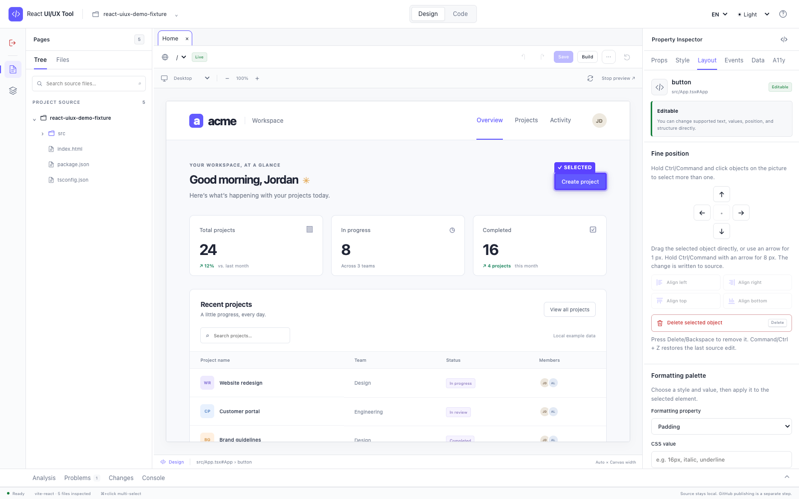
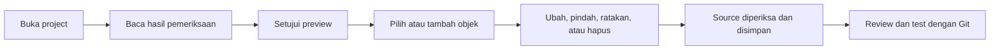
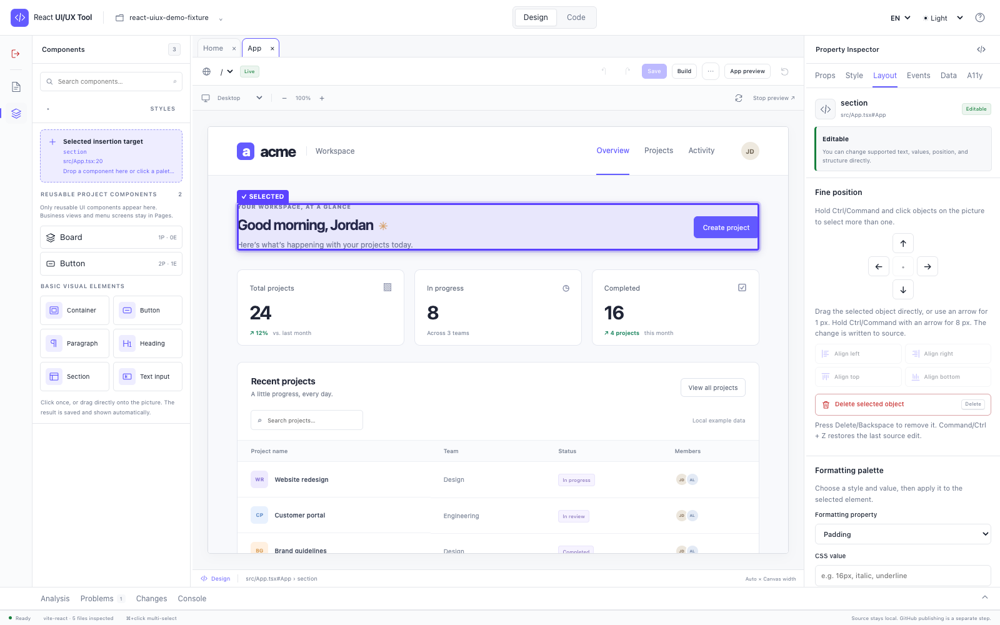
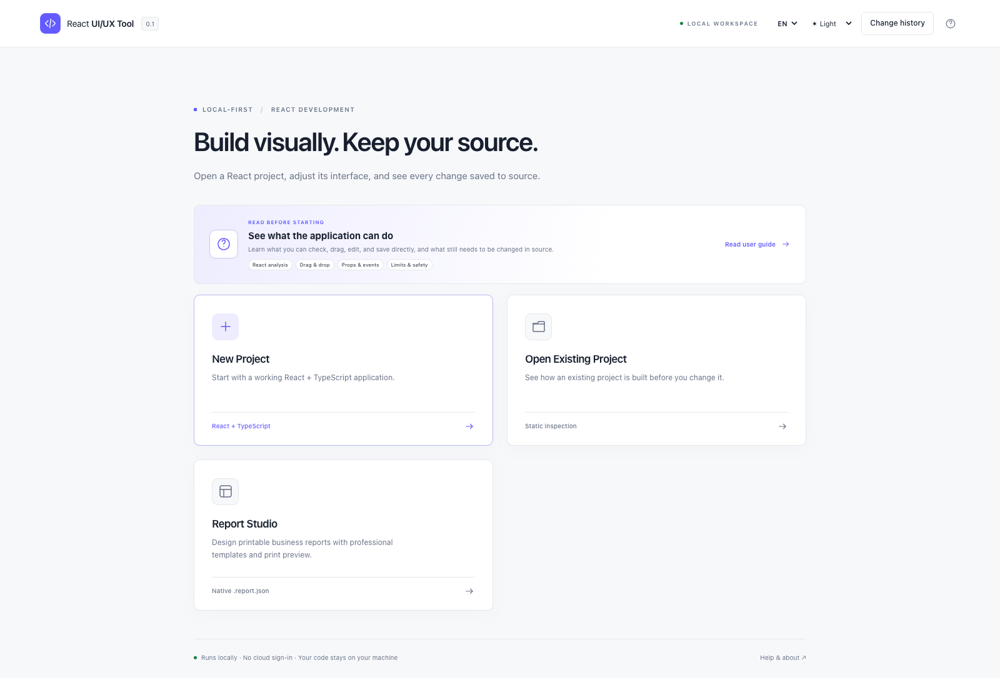
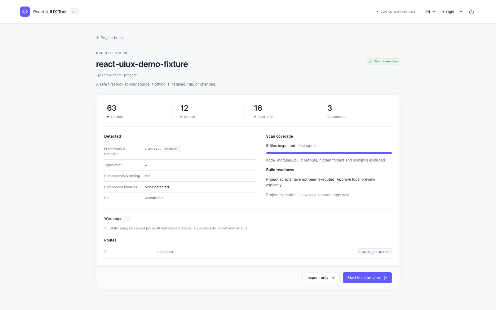
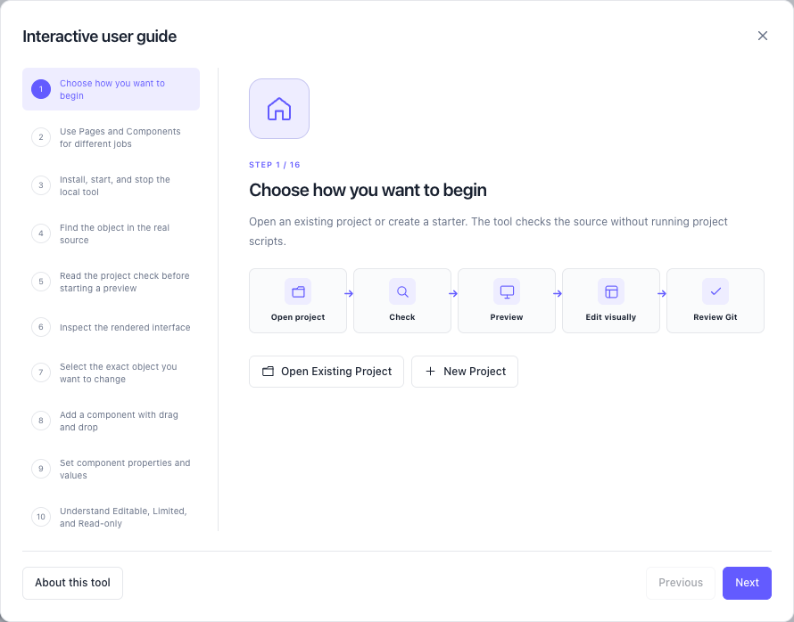

# React UI/UX Tool

Visual studio React yang berjalan lokal: analisis JSX/TSX asli, preview aplikasi yang
didukung, dan edit visual tervalidasi langsung ke source untuk direview melalui Git.

[English](README.md) · [Panduan Bahasa Indonesia](docs/USER_GUIDE_ID.md) ·
[English user guide](docs/USER_GUIDE_EN.md) · [Compatibility](COMPATIBILITY_MATRIX.md) ·
[Batasan](KNOWN_LIMITATIONS.md) · [Benchmark](BENCHMARKS.md) ·
[Lisensi](LICENSE) · [Lisensi pihak ketiga](THIRD_PARTY_NOTICES.md) ·
[Inspirasi & kredit](INSPIRATION.md) ·
[GitHub](https://github.com/RaditteAnggoro/react-uiux-tool)

Versi **0.1.0**, disiapkan untuk pengujian lokal. Paket belum dipublikasikan ke npm.
Source project tetap berupa React
biasa dan dapat diedit lewat VS Code.



## Yang dapat dilakukan

- Membuka project React tanpa menjalankannya, lalu menjelaskan hasil pemeriksaan.
- Menampilkan screen nyata dan component reusable setelah preview lokal disetujui.
- Menambah, menyalin, memindahkan, meratakan, mengubah, dan menghapus objek yang didukung.
- Menyimpan perubahan langsung ke JSX/TSX biasa dan menyediakan satu langkah Batalkan.
- Menaruh menu bisnis di Pages dan hanya menampilkan component visual reusable di Components.
- Berjalan lokal tanpa login cloud atau push Git otomatis.



## Menjalankan di lokal

Disarankan Node.js 24; minimum package `>=22.12.0`. Pengujian implementasi ini memakai
macOS dan Node 24.22.1. Windows/Linux belum dinyatakan terverifikasi hanya karena ada
konfigurasi CI. Siapkan terminal dan browser desktop. Tidak perlu Docker, Electron,
database, akun cloud, atau API berbayar.

```bash
cd /path/ke/react-uiux-tool
npm install
npm run build
npm start
```

Buka alamat `http://127.0.0.1:<port>` yang muncul di terminal. Hentikan dengan
**Ctrl+C**; menutup tab browser tidak menghentikan service Node. Untuk development,
gunakan `npm run dev`.

```bash
# Analisis read-only, tidak menjalankan aplikasi target
node dist/cli.js analyze ./fixtures/demo --json
# Buka project tertentu
node dist/cli.js open /absolute/path/ke/project-react
node dist/cli.js --help
```

## Uji alur edit pertama

1. Pilih Bahasa Indonesia atau English, lalu buka project React existing tepercaya.
2. Periksa hasil pemeriksaan project dan mulai preview lokal secara eksplisit.
3. Pilih elemen tetap di Design. Ubah nilai yang didukung melalui Props lalu pilih
   **Simpan ke source**; file dan preview langsung diperbarui.
4. Pilih container di Pages, lalu tambahkan component reusable atau elemen visual dasar
   dari Components. Anda juga dapat menariknya langsung ke gambar.
5. Drag objek terpilih, gunakan ikon perataan, Delete/Backspace untuk menghapus, dan
   Command/Ctrl+Z untuk mengembalikan perubahan terakhir.
   Pada project nyata, review hasil file melalui Git sebelum push.

## Membuat dan membuka project

**Buat Project Baru**: pilih folder kosong dan nama project. Versi ini membuat
Vite + React + TypeScript. Template: Blank, Business Dashboard, Data Entry/Form, dan
Operations Console. Styling: plain CSS, CSS Modules, atau Tailwind v4. Review daftar
file/dependency terlebih dahulu. Creation hanya membuat file; jalankan `npm install`
dan `npm run dev` sendiri ketika siap. Starter Next.js belum tersedia.

**Buka Project yang Sudah Ada**: gunakan folder picker jika tersedia atau masukkan
absolute path. Analisis awal bersifat read-only dan menunjukkan framework/route,
component, source element, props, behavior, styling, editability, Git state, cakupan
scan, dan warning. **Inspect Only** tidak mengeksekusi kode aplikasi.

Preview yang disetujui memakai mesin Vite internal untuk project React dengan
`index.html`. Penanda source hanya di memori, tidak mengubah file project. Script dan
dynamic config Vite/PostCSS project tidak dijalankan. Alias umum dari
tsconfig/jsconfig dan alias literal Vite/Webpack dibaca secara statis. Saat component
hasil pemeriksaan dipilih, tampilan Design terpisah dibuka dan provider
context lokal yang dipakai langsung melalui hook dicari otomatis. Alias dinamis,
plugin, setup runtime bertingkat, asset, atau environment khusus tetap mungkin
memerlukan setup manual.
Next.js App/Pages dapat dianalisis statis; runtime selection Next belum tersedia.
Baca [matrix](COMPATIBILITY_MATRIX.md).

## Batasan edit dan keamanan

- Edit text/props/class/inline style tetap menghasilkan perubahan source kecil.
  Penambahan elemen dasar dapat mengisi nilai yang diperiksa dan mereferensikan
  function event yang sudah ada dalam scope; tool tidak membuat business logic baru.
  Hook dan logic lain tetap dimiliki source code.
- Tambah/pindah/ratakan/hapus hanya untuk struktur tetap yang lolos pemeriksaan.
  Ada alternatif tombol untuk keyboard. JSX berulang, bersyarat, atau tidak jelas
  dikunci dengan alasan yang jelas.
- Components hanya menampilkan component visual reusable; business view, page,
  screen, dan route tetap berada di Pages. Drag ke container yang valid menambahkan
  JSX dan import otomatis. Bagian JSX terpilih dapat disalin sambil
  mengganti nilai literal `id`, `name`, `fromName`, `toName`, atau `*Id`.
- Inspector membaca kontrak aman dari TypeScript props dan default destructuring
  JavaScript. Literal string/number/boolean dapat ditambah, nilai union menjadi
  pilihan, dan callback event dapat dihubungkan ke function yang sudah ada dalam
  scope. Method React dan logic handler baru tetap dikelola source.
- Edit visual yang didukung langsung ditulis ke directory source. Setiap write tetap
  memeriksa hash/path dan menyimpan satu checkpoint Undo. Review hasilnya melalui Git
  sebelum push; tool tidak melakukan commit atau push otomatis.



## Tur aplikasi

| Mulai dan pelajari | Periksa sebelum menjalankan |
| --- | --- |
|  |  |
| **Panduan interaktif** | **Edit tampilan** |
|  |  |
- Controller hanya di `127.0.0.1`, memakai session authorization serta pemeriksaan
  Host/Origin. Tidak ada telemetry, auto-commit, push GitHub, atau deploy.
- Preview menjalankan kode aplikasi setelah persetujuan. Isolated Design mengarahkan
  request service fetch/XHR ke mock lokal kosong; App preview dan Interact tetap bisa
  memanggil backend. Efek mount lain tidak di-sandbox.

Bahasa EN/ID dan theme light/dark/system ada di header. Theme Studio tidak menulis
ulang CSS target. Bantuan membuka panduan lokal. Baca [SECURITY.md](SECURITY.md).

## Pemeriksaan development

```bash
npm run typecheck
npm test
npm run build
npx playwright install chromium
npm run test:e2e
npm run benchmark
```

Engine ada di `src/engine`, controller dan preview di `src/server`, generator di
`src/templates`, UI di `studio/src`, dan contoh lokal di `fixtures/demo`. Hasil
verifikasi dicatat di [IMPLEMENTATION_STATUS.md](IMPLEMENTATION_STATUS.md).

Adapter runtime Next, user Board dengan provider, adapter component library,
Storybook import, global token editing, history lebih panjang, visual regression,
dan extension VS Code masih rencana lanjutan.

## Inspirasi & kredit

Project independen yang terinspirasi oleh [Y[wai] / waiVSCode](https://marketplace.visualstudio.com/items?itemName=corernd.wai-vscode),
[Codux](https://www.codux.com/), [Onlook](https://github.com/onlook-dev/onlook),
[Puck](https://github.com/puckeditor/puck), [Storybook](https://storybook.js.org/),
[React Grab](https://github.com/aidenybai/react-grab), [Craft.js](https://github.com/prevwong/craft.js),
[SculptUI](https://github.com/sculptui/vscode), serta [Plasmic](https://github.com/plasmicapp/plasmic).
Referensi desain juga mencakup [ts-morph](https://github.com/dsherret/ts-morph),
[Recast](https://github.com/benjamn/recast), dan [dnd-kit](https://github.com/clauderic/dnd-kit).
Project tersebut bukan sponsor atau afiliasi. Halaman
[inspirasi dan kredit](INSPIRATION.md) menjelaskan hal yang dipelajari serta bagian
yang tidak digunakan. Lihat [NOTICE.md](NOTICE.md) untuk asal-usul project dan
[daftar lisensi pihak ketiga](THIRD_PARTY_NOTICES.md) untuk seluruh versi package
yang dikunci. Implementasi asli berlisensi **MIT © 2026 RA**.
