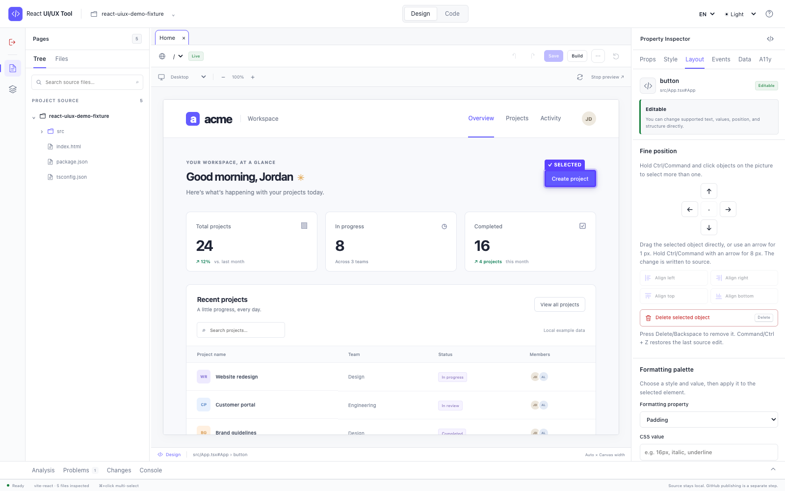
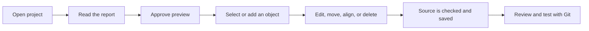
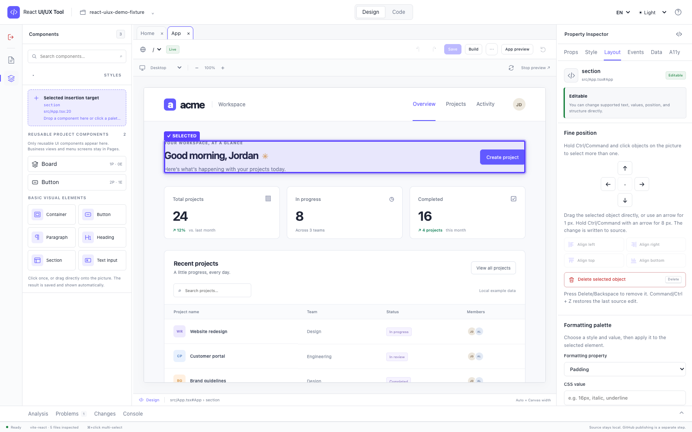
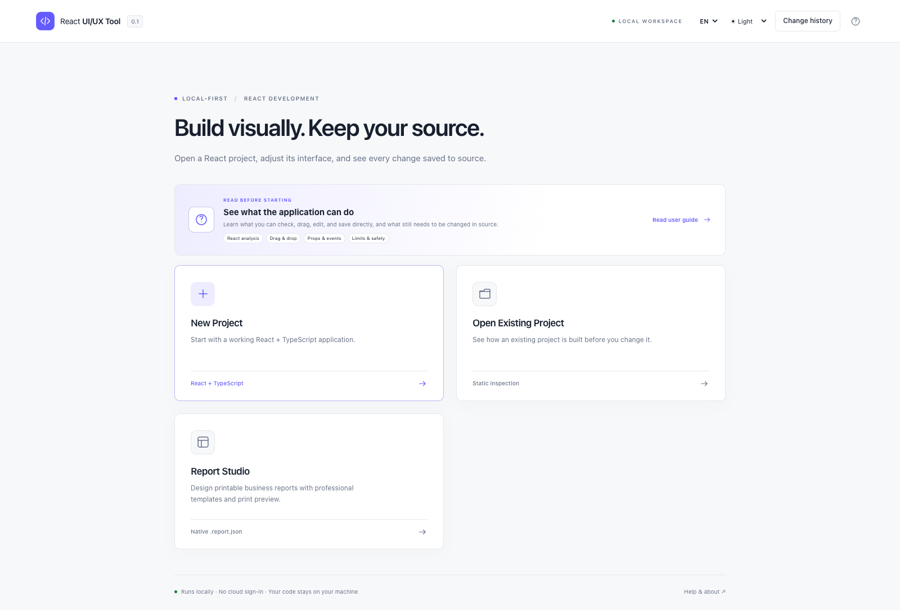
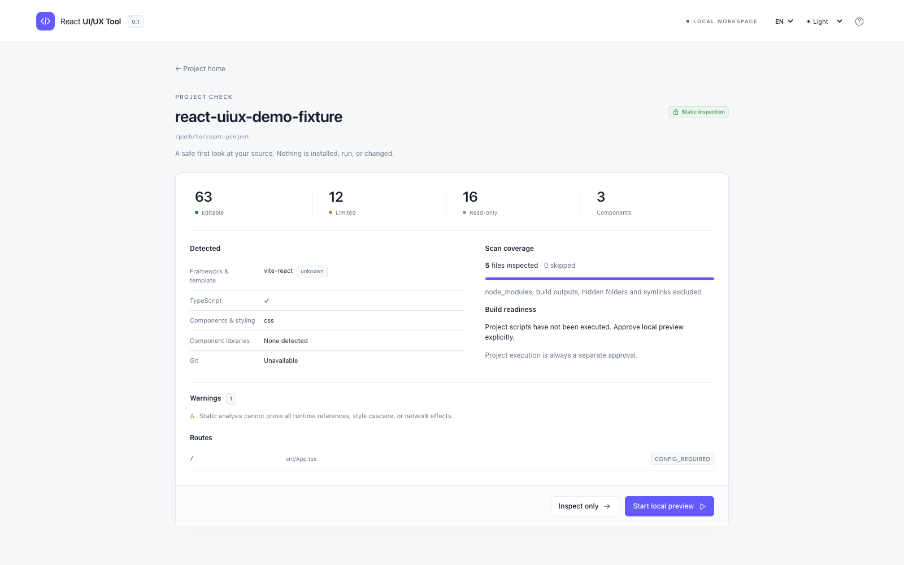
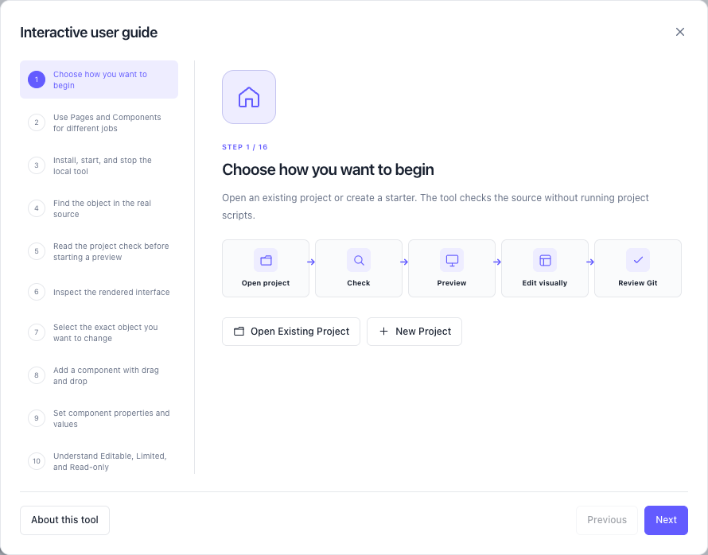

# React UI/UX Tool

[](package.json)
[](package.json)
[](LICENSE)
[](#what-it-does)

A local-first visual editor and UI builder for React. Inspect real JSX/TSX, preview
supported applications, and turn drag-and-drop changes into validated source edits
that stay easy to review with Git.

**Best for:** React teams that want a visual workflow without replacing their
existing codebase with a proprietary page format.

[Bahasa Indonesia](README.id.md) · [English user guide](docs/USER_GUIDE_EN.md) ·
[Panduan Bahasa Indonesia](docs/USER_GUIDE_ID.md) · [Compatibility](COMPATIBILITY_MATRIX.md) ·
[Known limitations](KNOWN_LIMITATIONS.md) · [Benchmarks](BENCHMARKS.md) ·
[License](LICENSE) · [Third-party licenses](THIRD_PARTY_NOTICES.md) ·
[Inspiration & credits](INSPIRATION.md) ·
[GitHub](https://github.com/RaditteAnggoro/react-uiux-tool)

Version **0.1.0**, prepared for local testing. The package has not been published to
npm. Source remains ordinary React code;
there is no hidden page schema replacing an existing application.



## What it does

Two workspaces ship today: the React project editor and **Report Studio**, a
local-first native report designer (`.report.json`) with professional templates,
canvas editing, and print preview. PDF, HTML, CSV, XLSX, and DOCX exports support
limited subsets. The experimental `.yrf` inspector can save edited copies or create
new files; these have not been validated with the vendor renderer.

- Opens a React project without running it, then explains what was found.
- Shows real screens and reusable components in a local preview after approval.
- Adds, copies, moves, aligns, edits, and deletes supported visual objects.
- Saves supported changes directly to normal JSX/TSX and keeps one safe Undo step.
- Keeps business screens in Pages and shows only reusable visual items in Components.
- Works locally with no cloud sign-in or automatic Git push.



## Requirements and quick start

Node.js 24 is recommended; the package requires Node `>=22.12.0`. This implementation
was exercised on macOS with Node 24.22.1. Windows/Linux checks are defined in CI but
must pass there before those platforms are described as verified. Use a current
desktop browser. No Docker, Electron, database, cloud account, or paid API is needed.

```bash
cd /path/to/react-uiux-tool
npm install
npm run build
npm start
```

Open the `http://127.0.0.1:<port>` URL printed in the terminal. Stop Studio and its
managed preview with **Ctrl+C**. Closing a browser tab does not stop Node.
For source development, use `npm run dev` instead of `npm start`.

```bash
# Read-only project report; does not start the target application
node dist/cli.js analyze ./fixtures/demo --json
# Open a chosen project in Studio
node dist/cli.js open /absolute/path/to/react-project
node dist/cli.js --help
```

## Try the direct source-edit workflow

1. Choose English or Bahasa Indonesia, then open a trusted existing React project.
2. Review the project report and explicitly start the local preview.
3. Select a fixed element in Design mode. In Props, change a supported value and
   choose **Save to source**; the file and preview update immediately.
4. Select a container in Pages, then add a reusable component or basic visual element
   from Components. You can also drag it directly onto the picture.
5. Drag selected objects, use the alignment icons, Delete/Backspace to remove, and
   Command/Ctrl+Z to restore the latest change.
   In a real project, review the resulting files through Git before pushing.

## New and existing projects

**New Project** creates a Vite + React + TypeScript application in a chosen empty
folder. Templates: Blank, Business Dashboard, Data Entry/Form, and Operations Console.
Styling: plain CSS, CSS Modules, or Tailwind v4. Review the file/dependency plan first.
Creation writes files only; run `npm install` and `npm run dev` yourself when ready.
Do not select Next.js for creation in this release.

**Open Existing Project** accepts a native directory picker where available, or an
absolute path. The first analysis is read-only: framework/routes, source elements,
component and import evidence, literal props, behavior, styling, editability, Git
state, scan coverage, and limitations. **Inspect Only** executes no application code.

The approved preview supports conventional Vite/React applications with
an `index.html` entry. It adds source metadata in memory, without editing the project.
It deliberately bypasses target scripts and dynamic Vite/PostCSS configuration.
Common tsconfig/jsconfig and literal Vite/Webpack aliases are read statically;
selecting a discovered component opens a separate Design view and finds direct
local context providers used through hooks. Dynamic aliases, custom plugins, nested
runtime setup, assets, or environment variables may still need manual setup. Next.js
App/Pages projects support static inspection; Next
runtime source selection is not implemented. See the
[matrix](COMPATIBILITY_MATRIX.md).

## Editing boundaries

- Supported fixed text, props, classes, and inline styles produce small source
  changes. Basic element insertion can set checked values and reference an
  existing in-scope event function; it never invents handler business logic. Hooks
  and unrelated comments/imports stay source-owned.
- Supported fixed structures allow insertion, movement, alignment, and removal, with
  keyboard alternatives. Dynamic, conditional, repeated, or unclear objects are
  locked rather than rewritten speculatively.
- Only reusable visual project components appear in Components; business views,
  pages, screens, and routes remain in Pages. Dragging a reusable component into a
  supported container adds its JSX and import. A selected JSX section can be copied while
  changing a literal `id`, `name`, `fromName`, `toName`, or `*Id` value.
- The inspector derives safe component contracts from TypeScript props and JavaScript
  destructuring defaults. It can add literal string/number/boolean props, constrain
  union values, and bind declared callback events to existing in-scope functions.
  React methods and new handler logic remain source-owned.
- Supported visual edits write directly to the source directory. Every write still
  checks the analyzed hash/path and keeps one conflict-checked Undo checkpoint.
  Review the resulting files with Git before pushing; no commit or push is automatic.



## Product tour

| Start and learn | Check before running |
| --- | --- |
|  |  |
| **Interactive guide** | **Visual editing** |
|  |  |

English/Indonesian and light/dark/system settings are available in the header. Studio
theme changes do not rewrite application CSS. All help links open bundled local docs.

## Safety and privacy

The controller binds only to `127.0.0.1` and checks session authorization, Host, and
Origin. Analysis does not run project code or inspect excluded secret files. Preview
executes app source after approval. Isolated component Design redirects fetch/XHR
service requests to an empty local mock; App preview and Interact can call real
backends. Other mount effects are not sandboxed.
Use trusted test projects. There is no telemetry, auto-commit, push, or deployment.
Read [SECURITY.md](SECURITY.md) before changing the local trust model.

## Development and validation

```bash
npm run typecheck
npm test
npm run build
# First-time browser setup, if Chromium is not installed:
npx playwright install chromium
npm run test:e2e
npm run benchmark
```

`src/engine` owns analysis and source patches; `src/server` owns the protected local
controller and preview; `src/templates` generates files-only starters; `studio/src`
contains React UI and catalogs; `fixtures/demo` provides a local teaching project.
Review [IMPLEMENTATION_STATUS.md](IMPLEMENTATION_STATUS.md) for recorded verification.

## Roadmap

Next runtime adapter, broader component-library schemas, provider-aware user Boards,
Storybook argument import, global-token edits, richer history, visual regression,
and a thin VS Code extension remain follow-up work. They are not shipped claims.

## Inspiration & Credits

Independent work inspired by [Y[wai] / waiVSCode](https://marketplace.visualstudio.com/items?itemName=corernd.wai-vscode),
[Codux](https://www.codux.com/), [Onlook](https://github.com/onlook-dev/onlook),
[Puck](https://github.com/puckeditor/puck), [Storybook](https://storybook.js.org/),
[React Grab](https://github.com/aidenybai/react-grab), [Craft.js](https://github.com/prevwong/craft.js),
[SculptUI](https://github.com/sculptui/vscode), and [Plasmic](https://github.com/plasmicapp/plasmic).
The design brief also references [ts-morph](https://github.com/dsherret/ts-morph),
[Recast](https://github.com/benjamn/recast), and [dnd-kit](https://github.com/clauderic/dnd-kit).
These projects are not sponsors or affiliates. The detailed
[inspiration record](INSPIRATION.md) explains what was learned and what is not
included. See [NOTICE.md](NOTICE.md) for provenance and the generated
[third-party inventory](THIRD_PARTY_NOTICES.md) for every locked package version and
license. Original implementation: **MIT © 2026 RA**.

### Workspace guides

Use the [English guide](docs/USER_GUIDE_EN.md) or [panduan Indonesia](docs/USER_GUIDE_ID.md) for illustrated React editing, report design, palette, data, saving and troubleshooting. Report Studio supports native reports and experimental `.yrf` copy editing; see [format limitations](KNOWN_LIMITATIONS.md) before relying on vendor output.
