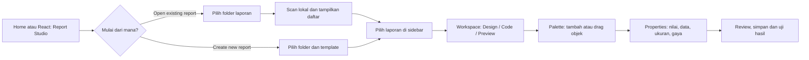

# Report Studio — seamless project workflow and visual editing plan

Status: proposed plan, 6 November 2026. This document describes future work; it is not a claim that all features are implemented. It extends the existing Report Studio v2 plan and preserves the user's decision to keep the experimental `.yrf` write and creation flows available.

## Update: palette dan edit `.yrf` existing

Editor `.yrf` menyediakan palette Text, Field, Box, Line (klik atau drag ke band),
hapus objek, properti string/angka/boolean, dan drag/resize untuk geometri kotak maupun
garis berbasis endpoint. Perubahan menjadi draft dan disimpan sebagai salinan dengan
hash conflict check. Penyisipan/penghapusan mempertahankan teks di luar perubahan.
Code mendukung nilai terstruktur. Perilaku vendor, objek tambahan, tabel vendor, dan
kesetaraan cetak belum tervalidasi; belum semua tipe objek memiliki kontrol visual.
Status P2 dan pending di bawah adalah catatan historis sebelum update ini.

## Basic palette bergaya toolbar (permintaan 2026-11-06)

Implemented in the native inspector (rendered, not cosmetic):

- **Style presets**: Body Text, Heading 1, Heading 2, List Paragraph, Caption.
- **Typography**: font family, size, weight, italic, underline, strikethrough,
  text colour, highlight/background, letter spacing, line height.
- **Paragraph**: left/centre/right/justify, bulleted and numbered lists.
- **Fill & outline**: background plus border width/colour.
- **Arrange**: text wrapping toggle, rotation, multi-select with six alignment modes,
  group/ungroup (group shares a `groupId`; one click selects the group and moves it
  together), delete and keyboard movement.
- **Palette**: grouped into Text & data / Layout / Tables with icon + label buttons, so
  the list stays compact without a long scroll; drag or click adds to the selected band.
- **Collapsible left panel**: palette groups are `<details>` sections, Structure lists one
  collapsible row per band (only the selected band opens by default), and the `.yrf`
  structure tree collapses each band. The React workspace Components palette also gains
  a compact **Styles** row.
- **Style presets in the palette**: Heading, Body, Muted, Accent, Card, Danger (plus
  report-only List/Caption/Highlight/Table header). Report presets write element props;
  React presets send a multi-property style patch so source follows the choice.
- **Existing `.yrf` files** now get the same treatment where the adapter allows it:
  the Styles group edits the vendor `style` string (bold/italic/underline, size, colour,
  alignment) through the structural scalar editor, the approximate canvas reflects those
  declarations live, and multi-select alignment stages geometry patches that `Save copy`
  writes. Unknown declarations, scripts and other vendor keys stay untouched; vendor
  semantics remain unverified.
- **Report exit**: explicit Exit button in the report header, matching the red-accented
  exit in the React rail; destructive Remove buttons are filled red and separated.
- **`.yrf` canvas tidiness**: labels/textboxes render as light cards, lines render as thin
  rules, shapes use dashed outlines, bands have subtle separators and alternating tint;
  selection uses a stronger outline and stays above neighbours.

Renderer support: HTML and canvas honour underline, strike, list prefixes, borders,
rotation and wrapping. PDF draws text/lines/tables and now emits a fidelity warning when
underline/strike/list/border/rotation are simplified. Not implemented from the screenshots:
table column editor, font effects (shadow/outline), text-direction controls, real
group resize, and picture effects; these remain explicit gaps.

## Perbaikan audit putaran 2 — 2026-11-06

| Temuan | Perbaikan | Bukti |
| --- | --- | --- |
| Source `.yrf` lama setelah Save copy | API mengembalikan `source` + `inspection`; UI mengganti source/hash/path sekaligus; Apply source juga menyimpan source baru | E2E: drag → Save copy → Code memuat `left` baru; edit source berikutnya tetap mempertahankan `left` |
| Draf `.yrf` hilang tanpa peringatan | `draftChanges` menyimpan perubahan saat berpindah objek; Back/Open/Browse memakai modal Save / Discard / Cancel | E2E: Caption berubah → Back memunculkan dialog, Cancel bertahan |
| Angka form kalah oleh posisi drag | Urutan dedupe: draft lama → geometry drag → form terbaru (form menang) | Kode + tes manual |
| Handle resize `.yrf` tidak dirender | Blok handle ditambahkan di dalam band terpilih; hanya muncul untuk satu objek terpilih | E2E: handle `se` terlihat, drag menambah `width` di salinan |
| Repeat hanya tersimpan, tidak berefek | Kontrol Repeat dibatasi ke `pageHeader`/`pageFooter` (satu-satunya band yang diulang pagination); default dicentang | E2E: uncheck pageHeader → tersimpan `repeat: false` |
| ID parameter ganda setelah hapus | ID baru mencari angka terkecil yang belum dipakai | Kode diperbaiki; alur tambah/hapus diuji |
| Panduan & label Code bertentangan | Label tab menjadi **Code**; panduan EN/ID menjelaskan Edit source, Apply & save copy, dan guard draf | Docs check |
| Multi-select + align (permintaan) | Shift/Cmd-click, outline ganda, group drag, align kiri/kanan/tengah/atas/bawah/tengah-vertikal, delete massal | E2E: dua objek → Align left → posisi sama → hapus keduanya |

## Status P1–P4 baru — diimplementasikan bertahap 2026-11-06

| Tahap | Status | Bukti/isi |
| --- | --- | --- |
| P1 — workspace dan palette native | Done with gaps | Palette selalu terlihat (text, field, table, form, image, box, line), drag ke band dan klik; panel Reports/Properties bisa dibuka pada layar sempit; properties, resize, undo, simpan/buka ulang diuji |
| P2 — editor `.yrf` | Partial | Code bisa diedit + Apply menyimpan salinan tervalidasi; drag dan delapan handle resize memakai patch span; caption/geometri tetap; original byte-identik. **Tambah/hapus objek dan palette `.yrf` belum ada** |
| P3 — data dan format lain | Partial | Parameter add/remove, toggle band repeat, impor CSV/JSON yang menggabungkan dataset, panel Formats. **Looping dataset dan adapter per ekstensi belum ada** |
| P4 — verifikasi | Partial | Typecheck, unit, build, Playwright penuh dijalankan; panduan EN/ID diperbarui. **Screenshot/diagram aktual, uji touch, dan viewport sweep belum** |

Pending P1–P4:

1. `.yrf` add/delete object dan palette per tipe belum diimplementasikan; operasi tersebut
   memerlukan penyisipan/penghapusan array yang mempertahankan format dan tes round-trip.
2. Table column editor, nilai default/caption form, dan parameter binding di ekspresi belum
   tersedia di UI.
3. Looping dataset (repeat per baris) belum dapat dikonfigurasi; template masih tetap.
4. Uji touch/pen, zoom sweep, viewport sempit menyeluruh, dan screenshot panduan belum ada.
5. Adapter format baru (PDF/XLSX/DOCX import) tetap menunggu lisensi dan fixture.

## Status P0 baru — diimplementasikan 2026-11-06

| Item P0 | Status | Bukti |
| --- | --- | --- |
| Pilihan **Open existing / Create new** sebagai langkah pertama | Done | E2E: heading "How do you want to start?", dua kartu, template hanya muncul setelah Create dipilih |
| Scan lokal dan daftar laporan di sidebar | Done | `/api/reports/browse` (depth 2, 200 entri), daftar satu baris per file dengan nama + path relatif |
| Search, refresh, jumlah hasil, empty/truncated | Done | E2E: pencarian menyaring ke 1 hasil, refresh mengembalikan 2 hasil; catatan truncation ditampilkan |
| Tidak ada penulisan saat scan/pilih | Done | E2E: folder tetap kosong sampai Create ditekan; file yang ada tidak berubah |
| Perbaikan area kuning | Done | Akar masalah: badge memakai class `yrf`, sehingga `.yrf { display:flex }` milik inspector membuat badge 231×720 px. Modifier diganti `kind-yrf`; E2E mengunci badge < 80×30 px |

Pending P0:

1. **Picker native belum diuji otomatis**; tes memakai input path manual karena dialog macOS tidak dapat dikendalikan Playwright.
2. **Cancel picker dan folder yang hilang** belum punya tes UI.
3. **Hasil scan terpotong** baru diuji di level API (200 entri), belum di UI.
4. **Multiple file dengan nama sama** belum diuji dapat dibedakan lewat path relatif di daftar.
5. **Viewport sempit** untuk panel Reports/Palette belum diuji.

## Arah upgrade baru — masukan pengguna 6 November 2026, 12:04

**Status: rencana, belum diimplementasikan.** Bagian ini menjadi acuan utama bila
usulan lama atau status historis di bawah berbeda. Tujuannya: Report Studio semudah
membuka project React; user memilih laporan dari daftar lalu langsung mendapat satu
workspace untuk desain, code, dan penambahan objek. Pertahankan akses Report Studio yang
mudah ditemukan di Home dan dari workspace React.

### Masalah pada screenshot dan kondisi saat ini

| Masukan | Yang terlihat/terkonfirmasi | Target perubahan |
| --- | --- | --- |
| Saat masuk belum ditanya ingin membuka laporan | Layar awal menampilkan daftar template dan canvas kosong; pilihan folder dan daftar terletak lebih bawah di sidebar. | Tampilkan pilihan **Open existing report** dan **Create new report** sebagai langkah pertama. |
| `.yrf` belum terasa seperti editor | Screenshot menunjukkan Design perkiraan, Code read-only dan input geometri; kode menyediakan edit caption/geometri ke salinan, tetapi belum ada visual drag/resize atau palette `.yrf`. | Satu workspace dengan Design, Code yang bisa diedit, palette, properti, drag/resize dan penyimpanan yang jelas. |
| Area kuning di daftar membingungkan | Kode memberi badge `.yrf` latar kuning; screenshot juga memperlihatkan area kuning sangat besar. Ukuran area pada screenshot perlu direproduksi sebelum menyimpulkan penyebab CSS-nya. | Tampilkan daftar/tree ringkas, satu baris per file, nama, path relatif dan jenis; badge kecil, tanpa area kosong besar atau warna sebagai satu-satunya penanda. |
| Palette tidak terlihat / pilihan objek kurang | Native saat ini punya tombol text, box, line dan image di bagian Structure yang harus dicari dengan scroll; belum ada tombol tambah field/table/form. `.yrf` belum punya palette. | Palette terlihat jelas di workspace untuk format aktif; sediakan text, field, table, form dan elemen lain secara bertahap sesuai adapter. |

### Alur yang diinginkan



1. **Open existing report** membuka pemilih folder, lalu scan dimulai untuk folder
   pilihan itu. Tampilkan loading, jumlah hasil, daftar yang dapat dicari, refresh,
   empty/error/cancel state, dan path folder. Scan bersifat lokal dan read-only.
   Batasi kedalaman/jumlah/ukuran sesuai kebijakan implementasi; jelaskan bila hasil
   terpotong. Jangan jalankan script vendor atau project saat scan.
2. **Create new report** membuka pemilihan folder tujuan dan template; daftar template
   tidak mendominasi alur membuka laporan yang sudah ada. Izinkan kembali tanpa menulis.
3. Sidebar **Reports** bergaya tree React menampilkan native dan `.yrf` sebagai baris
   yang dapat dipilih, termasuk nama dan lokasi relatif untuk membedakan nama sama.
   Jenis file lain hanya ditampilkan sesuai dukungan adapter yang nyata; jangan
   mengklaim bahwa semua ekstensi bisa diedit. Saat file diklik, buka pada workspace
   yang sama, bukan mengalihkan user ke pengalaman inspector terpisah.
4. Pertahankan folder laporan eksplisit dan terpisah dari konteks project. Root project
   tidak dipilih diam-diam sebagai tujuan; folder yang disarankan boleh dipilih user.
   Jangan membuat folder atau menulis file saat menemukan laporan.

### Rancangan workspace

```text
+---------------------------------------------------------------+
| Report Studio   [nama laporan]  Design | Code | Preview  Save |
+--------------+------------------------------+-----------------+
| Reports      |                              | Properties      |
| [Search]     |       Halaman / canvas       | Content         |
| ▸ folder     |      [objek + handle]        | X / Y / W / H  |
|   invoice    |                              | Font / warna    |
|   voucher    |                              | Data / binding  |
|--------------|                              |                 |
| Palette      |                              |                 |
| Text  Field  |                              |                 |
| Table Form   |                              |                 |
| Image Line   |                              |                 |
+--------------+------------------------------+-----------------+
```

- **Reports** dan **Palette** harus mudah ditemukan tanpa menggulir melewati daftar
  template panjang. Gunakan panel/tab yang bisa diubah ukurannya; pada layar kecil,
  sediakan cara membuka kembali panel tanpa menutup fungsi penting.
- **Design**: pilih, tambah dengan drag-and-drop atau klik, pindah dan resize dengan
  handle, edit isi/gaya, duplicate, delete, undo/redo, zoom dan keyboard. Target drop
  dan objek terpilih terlihat jelas. Nilai di Properties selalu mencerminkan objek.
- **Code**: native JSON dan source `.yrf` masing-masing dapat diedit sebagai draft;
  validasi dan pesan lokasi error sebelum Apply, dengan perubahan yang diterapkan
  tercermin di Design. JSON invalid tidak menimpa draft valid atau file. Jangan pernah
  mengeksekusi code atau script vendor hanya karena user membuka, mengedit atau preview.
- **Preview** harus menyatakan renderer yang digunakan; untuk `.yrf` tampilan lokal
  tetap ditandai perkiraan sampai dibandingkan dengan renderer vendor. Keinginan untuk
  mengedit `.yrf` bukan bukti bahwa format atau tampilan cetaknya sudah terverifikasi.
- **Palette**: text/label, field terikat, table berulang, form/layout, image, box,
  line, serta band/section. Jelaskan bahwa *form* berarti susunan label dan field
  laporan; interaksi input saat runtime memerlukan dukungan terpisah. Dukung
  pengaturan caption, nilai default, binding/dataset, kolom tabel, warna, font, border,
  posisi, ukuran, alignment, dan properties yang didukung format. Tampilan perlu
  menandai dengan alasan ketika tipe tertentu belum tersedia untuk format aktif.
- Parameter dan data: panel untuk sample data, nama dan nilai parameter, binding
  field, repeat dataset, format nilai dan preview hasil; definisikan perilaku untuk
  input kosong, kolom hilang, data invalid dan ekspresi yang tidak didukung. Tidak
  membuat koneksi database atau mengirim data ke layanan lain secara diam-diam.

### Pengembangan `.yrf` yang diminta

- Tujuan produk adalah **Code bisa diedit** dan **visual drag-and-drop, move, resize,
  tambah/hapus objek** untuk `.yrf`, termasuk palette, tidak berhenti pada inspector
  read-only. Implementasi memerlukan parser/serializer yang dapat mempertahankan
  properti dan objek yang tidak dikenal, ID serta struktur vendor, disertai fixture
  representatif dan tes round-trip. Tentukan mapping tiap tipe berdasarkan bukti;
  jangan diam-diam mengonversi `.yrf` ke format native.
- Tetap sediakan alur caption/geometri dan pembuatan `.yrf` eksperimental yang sudah
  ada; permintaan ini **tidak** meminta menutup operasi tulis yang belum melewati gate
  vendor. Pertahankan conflict check berbasis hash, batas path/symlink, validasi,
  explicit save, dan save-copy yang sudah ada; perubahan ke file asli memerlukan
  desain backup dan pemulihan yang jelas, tanpa menimpa secara diam-diam.
- Code harus memperlakukan script sebagai teks inert, menjaga isinya saat round-trip,
  dan tidak menjalankannya. Validasi struktural lokal tidak membuktikan kompatibilitas
  vendor: tampilkan status eksperimental dan perbedaan/risiko yang relevan sampai
  ada perbandingan renderer vendor. Jika suatu tipe belum bisa ditulis dengan benar,
  jelaskan batas per tipe sambil melanjutkan pengembangan; jangan mengklaim siap.

### Urutan pengerjaan dan kriteria penerimaan

| Tahap | Pekerjaan | Kriteria penerimaan yang bisa diuji |
| --- | --- | --- |
| P0 — masuk dan daftar | Pilihan Open/Create, picker, scan, sidebar laporan, perbaikan area kuning | Folder contoh dengan native dan `.yrf` menampilkan satu baris tiap file; klik membuka laporan; search/refresh, empty, error, cancel dan hasil scan terpotong jelas; tidak ada penulisan saat scan. |
| P1 — workspace dan palette native | Panel Reports/Palette, Design/Code/Preview, field/table/form, properties | Dari file native yang dipilih, user bisa tambah via drag dan klik, edit nilai/binding/ukuran, resize, undo, simpan dan buka ulang; keyboard dan UI sempit tetap bisa digunakan. |
| P2 — editor `.yrf` | Source draft yang editable, visual move/resize dan palette sesuai tipe yang didukung | Edit source valid lalu Apply mengubah Design; drag/resize dan tambah/hapus diuji terhadap fixture; perubahan tersimpan sebagai copy, source tidak berubah, unknown fields dan script inert terjaga; konflik eksternal ditolak. |
| P3 — data dan format lain | Parameter, dataset, looping, adapter per ekstensi | Contoh dua baris tampil dan total dibandingkan hitungan manual; kompatibilitas dan keterbatasan per format terlihat; unsupported tidak dikonversi diam-diam. |
| P4 — verifikasi | UI, backend, format, data dan panduan | Typecheck, unit/API, build dan Playwright relevan; uji mouse/keyboard, zoom, scroll, path/symlink, source draft invalid, perubahan eksternal, multi-file dan undo; perbarui panduan Indonesia/English dengan screenshot atau diagram aktual. |

Untuk verifikasi `.yrf`, tambahkan perbandingan dengan file dan hasil cetak vendor
bila tersedia; sampai itu hasil eksperimen tidak disebut setara atau terverifikasi.
Gunakan data latihan untuk demo. Setiap tahap di atas adalah pekerjaan mendatang;
status historis di bawah tidak berarti kebutuhan baru sudah selesai.

## Goal

Let a beginner find, create, inspect, and edit a report visually without typing a file path or knowing report-file internals. Provide the same Report Studio from the home page and from an open React project, preserving the existing project context. A report format's visible controls must reflect what its adapter actually supports.

## Current observations

- Home has a Report Studio entry. The React workspace and Report Studio are separate UI surfaces; project reports are not yet a first-class navigation destination.
- The native report canvas already supports moving an existing object with a pointer and has property controls, sample-data input, preview, and undo. The request is for a discoverable palette-to-canvas flow, resize handles, richer editing, and reliable data-driven design; do not reimplement existing movement without examining it.
- The `.yrf` inspector currently asks for a file path, shows an approximate band/object view, raw geometry and caption controls, and can preview and save an experimental copy. `.yrf` creation also exists behind acknowledgement. Vendor units and rendering fidelity are unverified.
- Screenshot evidence shows clipped text in the native canvas, an inspector without visible resize handles, and a path-only `.yrf` entry. Reproduce these on the current build before changing code; the screenshots alone do not establish root cause.
- PDF/HTML/XLSX/CSV/DOCX are currently export outputs with format-specific limitations, not universal editable report sources. Do not promise WYSIWYG equivalence or convert files silently.

## Implementation status — phase 1 (2026-11-06)

Delivered:

- Home and project entries open the same Report Studio; the project rail has a
  **Reports** button and **Back to project** returns to the workspace with project
  state intact (Playwright covered).
- Report folder is explicit: native **Choose report folder** picker, a visible folder
  label, the open project shown only as context, `public/rpt` offered only as a
  suggestion the user must click, and no automatic folder creation or project-root
  fallback. Browsing a project uses a read-only context scope; opening a project file
  sets that file's folder explicitly and shows the destination.
- Bounded report browsing (`GET /api/reports/browse`, depth 2, 200 entries) lists
  `.report.json` and `.yrf` with type badges, skips hidden/dependency/build/symlink
  paths and rejects traversal; manual absolute path remains as a fallback.
- Native **Code** tab edits the JSON draft and validates before applying; invalid text
  never replaces the draft. **Preview** stays separate.
- Beginner creation needs no value typing: the file name is pre-filled
  (`invoice.report.json`) and creation is enabled only when a report folder is chosen.
- `.yrf` inspector replaces the required pasted path with folder browsing plus list,
  keeps the manual path fallback, and disables geometry/caption controls for
  vendor object kinds the adapter does not support.

Historical snapshot at the end of phase 1 (later phases below supersede this list): eight resize handles, palette-to-canvas drag/drop,
image import/clipboard, dataset picker with CSV, `.yrf` inert Code tab, and horizontal
resize cursors. The canvas keeps its existing single-gesture move and numeric inputs.

## UX and navigation

### One studio, two entries

1. Keep the home-page Report Studio entry for standalone reports.
2. Add **Reports** to the React workspace rail. It discovers report candidates within the selected project, including `public/rpt` where present, without running project scripts or proprietary code.
3. Select a report to open the same Report Studio with the current project and return destination retained. Back returns to the previous React workspace and preserves project, route, selection, and panel state where feasible; show an explicit fallback if the context has changed.
4. Offer **New report**, **Open folder**, search, format labels, recent project reports and a clear empty state. A standalone report-folder flow remains available. Do not automatically create folders or write files during discovery.
5. Before switching project, report, mode or workspace with unsaved edits, offer Save / Discard / Cancel; if save fails remain in the editor. Keep separate React and report undo histories.

### Browse and select a report

- **Never silently use the main project root as the report folder.** The screenshot shows an easily missed path field pointing at the project folder. When entering from React Studio, display the project location as context, not as an implicitly selected report destination. Do not call a folder-selection API, create a report, or save a file in that root merely because the project is open.
- If a report-specific directory such as `public/rpt` is detected, present it prominently as a suggested location with its full project-relative path; the user must explicitly select or confirm it. If none is detected, require **Choose report folder** before creating or saving a report. Never automatically create `public/rpt`. In the standalone flow likewise require a visible folder choice. Choosing the project root itself is permitted only as a deliberate, explicit user choice, with its destination shown before creation.
- Show a persistent, readable **Report folder** label and destination in the workspace and in the create/save confirmation, including the complete path via expansion or accessible detail when visually truncated. Make the selected project and report folder visually distinct. If the selected folder disappears, changes, or access fails, stop the write and ask the user to choose again; never fall back to the project root.
- Replace the required pasted `.yrf` path with a visible **Browse folder** action and an in-app list/tree of matching report files. Reuse the current native directory picker and manual absolute-path fallback; do not claim a native file picker exists unless implemented and tested. Include `.yrf` case-insensitively and native `.report.json`, with meaningful unsupported/empty/error states.
- Scope listing and opening to the explicitly selected root or an already opened project. Bound recursion, entries, depth and file size; exclude secrets, hidden folders and dependency/build directories according to existing safety policies. Reject traversal and symlink escapes, including parent-directory symlinks. Do not inspect every file just to show the list.
- Show name, relative location and type. Cancel leaves selection and unsaved work untouched; missing or changed files prompt reselect/reopen. Multiple files with the same name must remain distinguishable.

### Shared Design / Code / Preview structure

- Native report: **Design** (canvas), **Code** (native JSON), **Preview** (rendered output). Design and code reflect the same unsaved draft. Code editing must validate with actionable line/field errors; invalid text never overwrites the last valid draft or file. Save is explicit.
- `.yrf`: **Design** (explicitly approximate inspector and supported copy-edit controls), **Code** (editable inert source draft as specified in the new direction above), and **Preview** only if a compatible renderer is explicitly approved and available. Do not present the approximate canvas as vendor-identical. Keep current experimental copy-only caption/geometry edits and acknowledged creation available; no forced shutdown of these flows.
- Make source versus output and experimental/unsupported states visible before action. Opening a file or switching tabs must not execute report scripts, invoke a remote service, or write source.

## Beginner-friendly canvas

### Selection and resizing

- A selected supported object shows a visible outline and eight corner/edge handles, with directional resize cursors like the supplied WPS/Word screenshot. Drag inside the object moves it; dragging a handle resizes it. Allow click selection, Escape, pointer capture and cancellation, plus keyboard move/resize and numeric X/Y/W/H inputs.
- Use one coordinate model per format. Convert pointer movement according to canvas zoom and page/band offsets; preserve fixed opposite edges when resizing from the left/top, constrain minimum size and page/band limits, and make snapping/grid optional. One completed gesture creates one undo step; cancelled gestures do not modify the draft.
- Fix text clipping and scale issues with representative fonts, sizes, zoom levels and selected/unselected states. Do not silently resize or truncate report contents; show overflow warnings.
- Native reports: implement supported move/resize in the native document model. `.yrf`: preserve raw vendor numbers and experimental labeling; any visual manipulation must use the same guarded span-based patch and save-copy workflow. Do not invent a universal mm conversion or claim accurate print geometry. Disable unsupported objects/operations with a reason, not a fake handle.

### Palette, properties and clipboard

- Offer a labeled palette for text, bound field, image, line, rectangle and table. Drag an item into an eligible band; also provide click-to-add and keyboard alternatives. Show insertion target, invalid-drop feedback, and an empty state. Object and band add/delete for `.yrf` are requested future work; implement and test each supported mapping while retaining existing `.yrf` editing.
- Inspector: content, font family/size/weight, text color, background/fill, borders, alignment and image fit where supported by the selected type and output format. Live draft updates must be reversible and validated. Render fidelity warnings when a format cannot represent a property.
- Support copying/duplicating a selected object with a unique native ID and a clear insertion position; preserve underlying binding values without silently copying external references. Image paste/import should use explicit user action and accepted local file/blob data, with type and byte limits, safe decoding, no automatic remote downloads, and no embedding executable SVG. Handle denied clipboard access with an upload fallback.
- Validate accessible names, focus order, keyboard-only operations and reduced motion. Do not rely on color alone for selection or warnings.

### Data and repeatable sections

- Provide a dataset panel with synthetic sample JSON/CSV, schema preview, field selection, explicit binding, and a repeatable detail/table band. Show an example of rows in Design and Preview, and clear no-data/malformed/missing-field states. Treat sample data as local user data; no network connection or automatic upload.
- Preserve exact numeric values and declared rounding policy. Grouping/subtotals should use the existing safe expression/decimal implementation only where independently tested; no arbitrary JavaScript execution. Test empty, single, multi-page, negative and large-value rows, and compare displayed totals with exported data.
- `.yrf` data bindings, vendor scripts, summaries and unknown properties remain opaque and are preserved. Source code editing is requested as an inert draft; evaluating vendor scripts remains out of scope.

## Format capability policy

| Format | Initial UX | Save and fidelity rule |
| --- | --- | --- |
| Native `.report.json` | Full Design/Code/Preview for supported elements; drag, resize, styles and sample-data bindings in increments below | Versioned native source; validate and hash-check on explicit save. |
| `.yrf` / `.YRF` | Target: editable approximate Design and inert Code, with palette; existing experimental caption/geometry and creation flows retained | Existing file remains untouched; save a collision-safe copy, preserve unknown data/scripts/formatting, check source hash. Vendor compatibility and units remain unverified. |
| PDF | View/export only until a proven adapter exists | No claim of arbitrary editable PDF or visual parity. |
| HTML, CSV/TSV, XLSX, DOCX | Existing output or explicitly supported data import only | Report loss of geometry, styles, rows, formulas or pagination as applicable; retain source. No universal round-trip claim. |
| JRXML/RDL/other report templates | Identify and explain unsupported or adapter-specific inspection | Add import/edit only with documented mapping, preservation tests and user-visible limitations. |

No third-party format inherits native capabilities merely because it is JSON. Update `COMPATIBILITY_MATRIX.md`, `KNOWN_LIMITATIONS.md`, report format docs and EN/ID catalogs whenever real support changes.

## Phase status (updated 2026-11-06)

Legend: **Done** = implemented and covered by automated checks; **Partial** = implemented
with named gaps; **Not started** = no code yet.

| # | Phase | Status | Evidence |
| --- | --- | --- | --- |
| 1 | Project navigation and browsing | **Done with gaps** | Unit: browse API (depth, exclusions, suggestion, symlink); e2e: home and project entries, list click, default filename, "Not selected" in project, Back to project returns to rail |
| 2 | Design / Code / Preview and clipping | **Done with gaps** | Native Code tab validates and rejects invalid JSON (e2e); tab switches keep selection and draft (e2e); clipping root cause fixed (pt→px scale) with overflow warning; `.yrf` source shown inert and read-only (e2e) |
| 3 | Native canvas interactions | **Done with gaps** | Eight handles with directional cursors, 1 mm snapping toggle (Alt bypass), Escape cancel, one undo per completed gesture, palette click + drag-to-band, Alt+Arrow keyboard resize (e2e across all 8 handles, zoom 125%, boundary, save) |
| 4 | Styling, images and data | **Done with gaps** | Font family/weight/italic/background, field binding path and table dataset controls; PNG/JPEG/WebP upload ≤ 2 MiB with no SVG and no network; CSV import with schema preview and sample rows shown in Design and Preview (e2e) |
| 5 | Experimental `.yrf` interaction | **Done with gaps** | Span-preserving caption/geometry copy edits; duplicate-key refusal; BOM/CRLF/Unicode preservation; collision-safe `edited` / `edited-2` copies; external-edit conflict; parent-directory symlink rejection (unit + API tests) |
| 6 | Other formats | **Done with gaps** | Capability panel exposes per-format create/open/edit/export states from the registry; JRXML/RDL/RPT declared explicitly unsupported; CSV/JSON import is labelled data-only and never treated as a design import (e2e) |

### Phase 6 acceptance detail

Covered:

- The **Formats** panel renders the registry: `.report.json` editable, `.yrf` read-only
  with an experimental editable subset, PDF/HTML/XLSX/CSV/DOCX export-only or planned,
  and JRXML/RDL/RPT **unsupported**. States come from the same registry the API uses, so
  visible controls cannot drift from adapter claims.
- JRXML, RDL and proprietary `.rpt/.repx/.frx` are declared with all operations
  `unsupported` and a reason; they are never opened as JSON or converted silently.
- CSV/JSON import is labelled **data only** in the message and never mutates the design;
  it targets the table's dataset and appears in Design and Preview.
- No new format adapter was added, so no fidelity claim changed.

Pending for phase 6:

1. **No new adapters** (PDF import, XLSX worksheet import, DOCX import) were added; the
   plan requires licensing, fixtures and preservation tests per adapter.
2. **Data import is client-side** and not persisted as a dataset file; reopening the
   report does not restore the imported sample rows.
3. **No field-mapping wizard** between imported columns and template columns.
4. **PDF preview (PDF.js) is not shipped**, so PDF remains export-only.
5. **Vendor-rendered goldens** remain the gate for any "verified" format claim.

### Phase 5 acceptance detail

Covered:

- Every patch targets one allowlisted object property, re-scans scalar spans, and refuses
  the write when another value would change or when the target key is duplicated.
- BOM, CRLF and Unicode captions survive byte-for-byte outside the edited span; JSON is
  re-parsed with the BOM stripped for validation only.
- Unknown vendor properties survive a patch (asserted against a synthetic fixture).
- Save-copy is collision-safe (`x.edited.yrf`, then `x.edited-2.yrf`) and re-checks the
  source hash immediately before writing; an external edit returns `409 CONFLICT`.
- Parent-directory symlinks are rejected (`403 SYMLINK_PARENT`), in addition to the
  existing file-symlink, traversal, secret-path and 5 MiB checks.
- Creation remains available behind the acknowledgement checkbox and is covered by API
  and browser tests.

Pending for phase 5:

1. **No add/delete of objects or bands**; the plan keeps these blocked until an independent
   implementation and vendor evidence exist.
2. **Scripts and vendor expressions stay opaque**; no editing or evaluation.
3. **Vendor renderer golden comparison is absent**; nothing is claimed as verified
   compatible, only structurally preserved.
4. **Near-5 MiB `.yrf` files** are not exercised through the browser.
5. **Save-copy naming is automatic only** (no custom destination picker) and there is no
   overwrite-original flow by design.

### Phase 4 acceptance detail

Covered:

- Inspector adds font family, weight, italic, background, field binding path and table
  dataset selection on top of the existing size/colour/alignment controls.
- Image import is an explicit local file action: PNG/JPEG/WebP only, 2 MiB limit,
  FileReader to a `data:` URL, no SVG and no remote fetch. The canvas shows the image and
  the inspector shows a thumbnail.
- CSV import parses RFC-4180-style rows locally, targets the table's dataset, shows a
  schema preview (`lines (2): description, …`) and renders the first rows in Design.
  Preview receives the same sample data.
- Errors are visible: malformed CSV, unsupported image type and oversize files set an
  explicit message instead of failing silently.
- E2E covers image upload, CSV import, table row rendering, preview data and saved props
  (`fontWeight`, `italic`, `background`, embedded image data).

Pending for phase 4:

1. **Clipboard paste** is not implemented; import is via file selection only (the plan
   allows an upload fallback, but paste itself is absent).
2. **No image crop/fit editing beyond `contain`/`cover`**, and no pixel-dimension or
   resolution warning.
3. **Column mapping is manual**: CSV headers must match the table column keys; there is
   no field-mapping wizard or type inference.
4. **Malformed-row reporting is file-level**, not per-row with line numbers.
5. **Repeating band configuration is template-fixed**; there is no UI to add/remove
   detail bands or grouping.
6. **Large datasets are untested** in the canvas (no virtualisation; preview sends all
   rows).
7. **Per-property renderer fidelity warnings** are not shown in the inspector; warnings
   appear at export time instead.

### Phase 3 acceptance detail

Covered:

- A selected element shows eight handles with directional cursors. Pointer resize preserves
  the opposite edge, enforces a 2 mm minimum, clamps to the page width and to x/y ≥ 0,
  and converts movement through the canvas zoom.
- One completed gesture is one undo step; Escape during a gesture restores the snapshot
  and leaves the draft untouched (e2e).
- Snapping is 1 mm by default, toggleable, and bypassed for a gesture with Alt.
- Palette buttons add text/box/line by click and by dragging onto a band, with the drop
  point converted to document millimetres.
- Keyboard: arrows move by 1 mm (Shift 5 mm), Alt+Arrow resizes, numeric X/Y/W/H remain.
- Tests exercise all eight handles, a 125% zoom, the top-left boundary, cancel, undo and
  save after resize.

Pending for phase 3:

1. **Locked/hidden elements are not implemented**, so their interaction tests are absent.
2. **No visual grid overlay**; snapping exists but there is no rendered grid or guides.
3. **Touch/pointer capture** is not used: gestures listen to mouse events, so touch and
   pen input are untested.
4. **Band-height limits are not enforced**; only page width and x/y ≥ 0 are clamped.
5. **Redo after a resize** and multi-element group resize are not covered.
6. **Grid toggle state is not persisted** across reloads.

### Phase 2 acceptance detail

Covered:

- Clipping reproduced by measuring `.rs-el` scroll vs client sizes: font size was
  multiplied by the mm→px scale (3.78×), so text rendered far larger than its box. The
  canvas now converts pt→px with zoom only; the invoice title measures as not clipped.
- Overflow is never hidden: text/field content is visible beyond its box and the status
  bar reports "Elements overflow their box: N" for the current draft.
- Native **Code** tab shows the same draft, validates through `/api/reports/validate`,
  and invalid JSON leaves the last valid draft untouched (e2e). Valid JSON applies the
  draft and updates the Design view.
- Tab switches preserve the selected object and the draft (e2e).
- `.yrf` **Code (read-only)** tab renders the raw vendor source inertly with a
  read-only textarea; switching back to **Design (approximate)** keeps the selected
  object (e2e). Source is returned bounded by the existing 5 MiB limit.

Pending for phase 2:

1. **Zoom sweep not covered.** Clipping is asserted at 100% only; add a Playwright pass
   at 50%, 125% and 160%.
2. **Long unbroken strings and Unicode/Indonesian text** are not covered by an overflow
   fixture; add one to confirm wrapping and warning counts.
3. **Overflow auto-fit is intentionally absent.** The plan forbids silent resizing or
   truncation, so tight templates show a warning instead; a "fit box to text" action is
   not implemented.
4. **`.yrf` large source rendering** (near the 5 MiB cap) is not tested in the browser.
5. **Preview tab has no automated visual comparison**; it only checks that the iframe
   renders.

### Phase 1 acceptance detail

Covered:

- Home entry and project-rail entry open the same studio; `Back to project` returns to
  the workspace (Playwright, project fixture).
- Folder selection is explicit; opening a project shows it only as **Open project**
  context and the folder reads `Not selected — choose a report folder`.
- Browsing lists `.report.json` and `.yrf` with type badges, depth-2 bound, 200-entry
  cap, and skips hidden, `node_modules`, build, `secrets`, and symlink entries.
- `public/rpt` appears only as a clickable suggestion; no folder is created.
- Creating a report needs no typed value: the file name is pre-filled.
- Manual absolute path remains as a fallback when the native picker is unavailable.

Pending for phase 1:

1. **Native picker not exercised by automation.** Playwright cannot drive the macOS
   `osascript` dialog, so tests use the manual-path fallback. Add a fake picker seam so
   the primary beginner path (button → folder → list) is covered end to end.
2. **Suggestion click untested.** The `public/rpt` button is rendered from server
   suggestion data but no e2e clicks it; add a fixture with `public/rpt`.
3. **Cancellation and vanished folder untested in UI.** `pick-directory` cancellation
   and a deleted report folder must leave the destination unchanged and show an error
   without falling back; cover both.
4. **Full-path visibility is title-only when truncated.** Provide an expandable path
   detail (accessible name) instead of relying on `title`.
5. **Dirty prompts for Open and Create are not covered.** Back is covered; opening
   another report or creating while dirty needs Playwright coverage for
   Save / Discard / Cancel, including save-failure staying in the editor.
6. **Opening a project file from the context list sets its folder implicitly.**
   The destination is shown afterwards, but the plan asks for confirmation before the
   write path; add one confirmation (or explicit "Use this folder") step.
7. **Missing evidence for the same-name ambiguity.** Two reports with the same file
   name in different subfolders are not yet tested as distinguishable.
8. **Narrow viewport not checked** for the new folder/report list layout.

## Phased implementation and acceptance

1. **Project navigation and browsing.** Home and project entries open the same studio; select a fixture report through the directory UI with no pasted path; return preserves project context. Confirm that opening a project alone never selects its root as the report destination or creates a report there. Test explicit suggested-folder selection, explicit root selection, path visibility, cancellation, missing/removed directory with no fallback, symlink/traversal, unsupported extension and dirty-state prompts.
2. **Design/Code/Preview and clipping.** Open native and `.yrf` fixtures, inspect their source inertly, switch tabs without losing selection or draft, and reproduce/fix clipped text. Invalid native JSON cannot overwrite the last valid version. `.yrf` code is read-only and approximate mode is explicit.
3. **Native canvas interactions.** Add palette-to-band drag/drop, click/keyboard alternatives, eight resize handles, snapping, numeric controls and undo/redo. Test all handles at multiple zoom levels and boundaries, cancel, locked elements, pointer/keyboard access and save/reopen.
4. **Styling, images and data.** Add type-appropriate inspector controls, safe image import/clipboard fallback, sample JSON/CSV selection, repeatable rows and bindings. Verify empty/error/large cases, sample-data privacy, semantic totals and renderer-specific limitations.
5. **Experimental `.yrf` interaction.** Expand only operations that preserve the user's chosen copy-only experimental workflow. Verify source spans, expected values, exact original bytes, unknown fields, duplicate IDs/keys, parent-symlink/path containment, external edits and collision-safe copies. Use synthetic fixtures first. Existing experimental creation is not to be disabled by this plan.
6. **Other formats.** Add one adapter at a time after licensing and fixture tests; label fidelity and prevent silent destructive conversion. Vendor-rendered goldens and explicit rights are evidence requirements for any vendor-verified claim, not a reason to remove the existing experimental flow.

## Technical boundaries and verification

- Likely touchpoints: `studio/src/App.tsx`, `studio/src/features/report-studio/`, `src/server/report-routes.ts`, `src/reports/core/`, `src/reports/formats/yrf/`, the format registry, bilingual catalogs, compatibility/limitations docs, and report/Playwright tests. Keep report model separate from JSX patch logic.
- Preserve loopback binding, session capability, Origin/Host checks, explicit action for writes, project/file containment, hash conflicts and atomic/collision-safe saves. Never run the target project's scripts or vendor runtime as part of the initial check. A vendor preview needs the project's distinct approval path and verified usage rights.
- Use synthetic fixtures and temporary directories in automated tests; do not copy private customer reports or data into the repository. Compare no-op `.yrf` bytes and unrelated spans after every supported patch, including Unicode/BOM/newline variants where supported.
- Run `npm run typecheck`, `npm test`, `npm run build`, and relevant Playwright tests. Browser checks should include desktop and narrow viewports, zoom, keyboard, drag/resize, dirty prompts, error states and console/network evidence. Record actual results; golden/vendor output requires a separately authorized, licensed environment.

## Research references and decisions

- [UITOOL waiReport guide](https://uitool.org/uitool/uitool_solutions.html): describes a browser WYSIWYG band editor and a JSON code view for `.YRF`. It does not establish permissions to reuse or redistribute vendor code.
- [Anka Report](https://github.com/ankareport/ankareport): MIT-licensed section-based designer with move/resize, bindings and undo; useful UX/architecture reference, with no verified `.yrf` round trip.
- [pdfme](https://github.com/pdfme/pdfme): MIT-licensed TypeScript/React visual PDF-template tooling; useful for fixed layouts, not established as a WaiReport adapter.
- [react-moveable](https://github.com/daybrush/moveable): interaction library with resize/drag/snap; evaluate against existing pointer code before adding a dependency. Pin versions and review license, transitive dependencies, bundle size, keyboard access and performance first.
- [NextReport Engine](https://github.com/nextreport/engine): advertises bands, drag/resize and a React designer; evaluate only as a conceptual or optional adapter reference. Its schema/runtime is distinct and its self-hosting footprint needs assessment.

References are examples, not dependencies or compatibility guarantees. No vendor source or third-party package should be copied or installed automatically.

## Audit fixes — 6 November 2026

- `.yrf` selection preserves object drafts and preview/save use the same patch list;
  switching to Code with visual drafts prompts for a decision.
- HTML wrapping, canvas typography, and PDF rich-format warnings have regression checks.
- React Style exposes a basic CSS property palette using the existing direct-edit path.
  It is not full parity with the native report palette: report presets and automatic
  lists are not implemented for React, and `.yrf` still has no insertion palette.
- Report Align and Group require the same band; a visible explanation replaces the
  previously incorrect cross-band alignment. Existing groups can still be ungrouped.

## Reference financial reports: remaining work

The supplied pre-analysis and approval memo PDFs contain multi-page A4 reports with repeated headers and footers, dense financial tables, multi-level column headings, highlighted totals, narrative sections, images/signatures and variable-length content. The files are reference material only; customer data must not be copied into templates or tests.

- **Available starting point:** native reports have images, fields and tables; YRF has experimental image import and static table/form layouts made from individual objects. These are not an implementation of the reference reports.
- **Next — table designer:** editable rows and columns, cell borders, fills, alignment, numeric formats, merged/multi-level headers, column sizing and overflow handling. Acceptance: build a synthetic credit summary without editing source, save and reopen with values and layout intact.
- **Next — dynamic data:** configurable dataset bindings, repeating rows, grouping, subtotals and totals with explicit rounding and formatting. Acceptance: compare calculated amounts against independently checked synthetic fixtures, including empty and multi-page data.
- **Next — pagination and output:** split long tables and narratives, repeat table/report headers and footers, keep totals together, and compare PDF/HTML output at page boundaries. Acceptance: synthetic multi-page reference layouts verified by rendered images and extracted values.
- **YRF interoperability:** use actual vendor samples or documented field definitions and the licensed runtime to verify image rendering, data binding, pagination, and changes saved as copies. Local self-inspection does not prove WaiReport output. Do not claim the two formats have feature parity until exercised.
- **Template and guide:** once these capabilities are working, offer anonymized pre-analysis and approval memo templates and document end-to-end creation, data mapping, preview, export and review. Never embed the supplied customer information.

## P0 execution — 10 November 2026

- **Contract and rendering:** define editable table column keys, labels, widths, alignment and financial formatting; render real cells in PDF and HTML, keeping existing report documents compatible. Verify with synthetic data and PDF/HTML assertions.
- **Editor and bindings:** expose column controls and data paths in native Properties; preserve the YRF editor's existing copy-only write behaviour. Verify add/change/remove, save/reopen and source preservation through browser tests.
- **Financial values:** use explicit decimal/rounding behaviour and independently calculated cases for values and group totals; do not claim equivalence with production financial calculations or vendor output without evidence.
- **Final:** typecheck, unit tests, build, focused browser checks and documentation; report remaining YRF/vendor limitations before committing.

**P0 progress, 10 November:** native column editing, static rows, dataset path, number formats and PDF cell drawing are implemented for the tested subset. P0 remains **partial**: table row/cell styling beyond header and border, a guided subtotal/total builder, vendor-native YRF table/data mapping, and validation in WaiReport are outstanding. Large values must be supplied as decimal strings for exact arithmetic; visually clipped PDF cell values generate an estimated-width warning. Neither the supplied financial reports nor their production totals have been reproduced or certified.
