# React UI/UX Tool — User Guide

Version 0.1.0 · local test edition · [Bahasa Indonesia](USER_GUIDE_ID.md) · [README](../README.md) · [GitHub](https://github.com/RaditteAnggoro/react-uiux-tool)

This guide describes the available local workflow. Features marked unavailable do
not mean every React application can be edited safely.

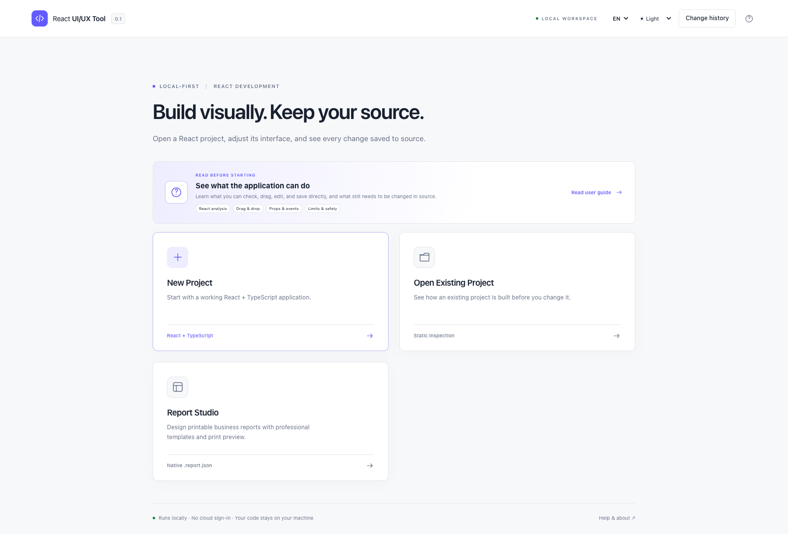

## Guide map

This is the main reference for installation, project checks, visual
editing, safety, troubleshooting, and Git review. Use the in-application **?** button
for the same workflow as an interactive tour.

- [Install and run](#1-install-start-and-stop)
- [Understand the screen](#2-first-launch-and-screen-map)
- [Open and analyze a project](#5-open-an-existing-project-and-read-analysis)
- [Select and edit visually](#6-select-elements-use-modes-and-open-source)
- [Add, copy, move, align, and delete](#9-fixed-structure-and-keyboard-alternatives)
- [Undo and review with Git](#10-direct-writes-git-review-and-undo)
- [Troubleshoot safely](#12-troubleshooting-and-privacy)
- [Create and edit reports](#14-report-studio-create-and-edit-reports)
- [Practice report drag and drop](#add-move-and-resize-objects)
- [Data, parameters, repeating rows, and totals](#data-parameters-repeating-rows-and-totals)

## 1. Install, start, and stop

Use Node.js 24, a terminal, and a desktop browser. The declared minimum is 22.12.0;
the recorded development host is macOS with Node 24.22.1. Windows/Linux workflows
need their CI and manual checks before being described as verified. ChromeOS Linux
is experimental. No cloud account, Docker, Electron, database, or paid API is needed.

```bash
# From the react-uiux-tool repository
npm install
npm run build
npm start
```

Open the printed `http://127.0.0.1:<port>` URL. A random free loopback port avoids
conflicts. For development use `npm run dev`. To stop, press **Ctrl+C** in that
terminal; Studio also stops its managed preview. Closing the browser tab is not a
process stop. Avoid running multiple target servers on a low-memory laptop.

For a read-only command-line report:

```bash
node dist/cli.js analyze /absolute/path/to/project --json
node dist/cli.js open /absolute/path/to/project
node dist/cli.js --help
```

## 2. First launch and screen map

Open **Change history** from the home header to see recorded
commit dates, times and changes. Entries are Git commit times except where marked
as preparation time; actual deployment or installation times are not tracked.
Release notes are maintained in the application.

Choose **English** or **Bahasa Indonesia** on first use. The header language control
works without restarting and does not translate project content. Choose light,
dark, or system theme; this affects only Studio.

| Area | Purpose |
| --- | --- |
| Home | Front User Guide, New Project, Open Existing Project, recent projects |
| Project Check | What was found, scan coverage, readiness, editing status, warnings |
| Left rail/panel | Pages, Components, Tree, Files, Boards |
| Canvas | Approved real preview, Design/Interact, viewport width, zoom |
| Inspector | Props, Style, Layout, Events, Data, A11y |
| Bottom panel | Analysis, Problems, Changes, Console, Scenarios |
| Source workflow | Direct conflict-checked writes, one-session Undo, Git review before push |

Panel separators support dragging and keyboard arrows. Inspection remains useful
at smaller widths, but this is a desktop editor, not a full mobile design app.
Use the **?** control for local guides and About/version information.
The User Guide card appears before all project actions so scope, direct-write behavior,
preview risk, drag/drop, properties, events, and limitations can be read first.

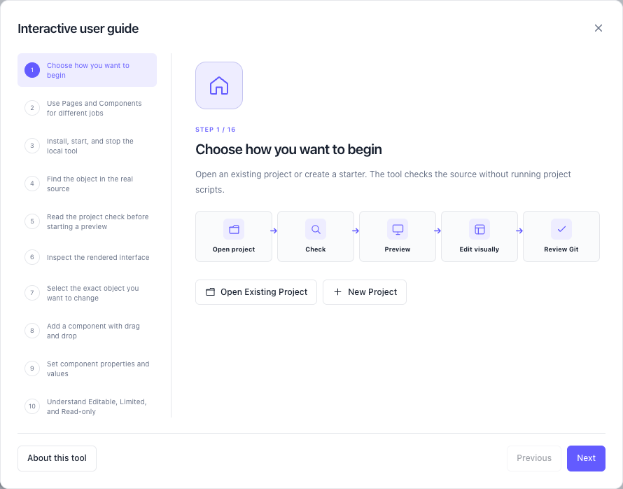

## 3. Quick start

Choose **Open Existing Project** and select a trusted React project. Read the project
report before starting its local preview; this first check does not execute project
scripts. In Studio, select a fixed JSX object in Pages, inspect it in Design, and use
the supported Props/Events/Layout controls. Changes write directly to that project,
so use a disposable branch or fixture when learning and review with Git before push.

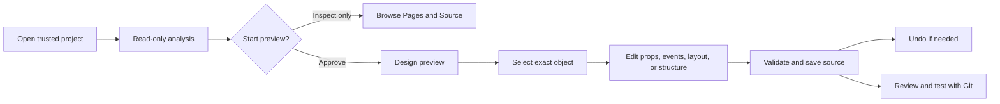

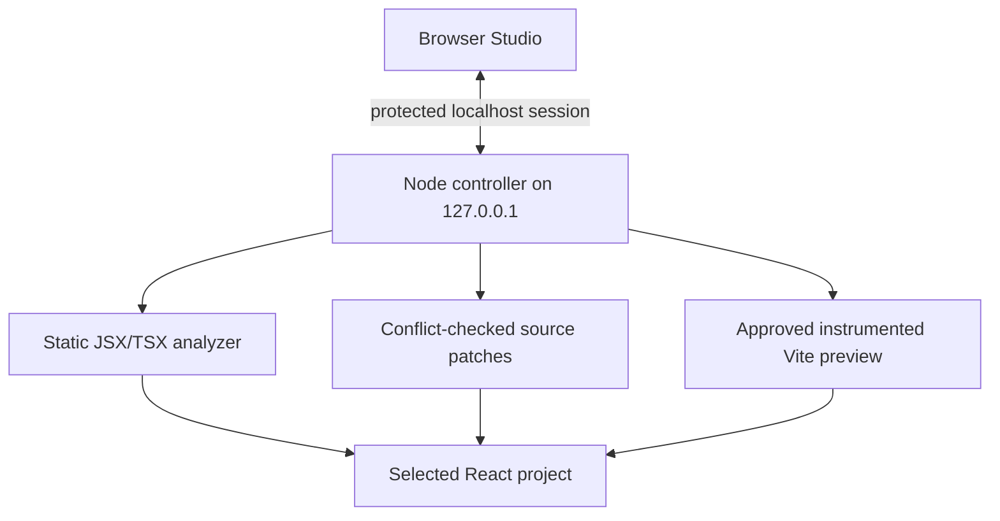

## 4. Create a new project

1. Choose **New Project**.
2. Enter an absolute parent directory or use **Browse**. The parent must exist and
   be writable. A folder picker is an OS bridge, not unrestricted browser access.
3. Enter a folder name. Check the full target path. Spaces/Unicode are supported;
   path separators, reserved device names, and unsafe names are rejected.
4. Choose **Vite + React + TypeScript** and a local template: Blank, Business
   Dashboard, Data Entry/Form, or Operations Console. Next.js creation is unavailable.
5. Choose plain CSS, CSS Modules, or Tailwind v4. The Tailwind starter includes its
   Vite plugin/dependencies; no component library is silently downloaded.
6. Review files, dependencies, and commands. Choose **Create files only**.

Creation does not run `npm install`, a lifecycle script, or a development command.
When ready, open the generated folder in a terminal and run:

```bash
npm install
npm run dev
# In a separate check, or after stopping the server:
npm run build
```

Existing nonempty folders, files, and symlink destinations are rejected. If a
creation attempt fails, choose an empty destination and retry; never delete useful
source to make the wizard proceed.

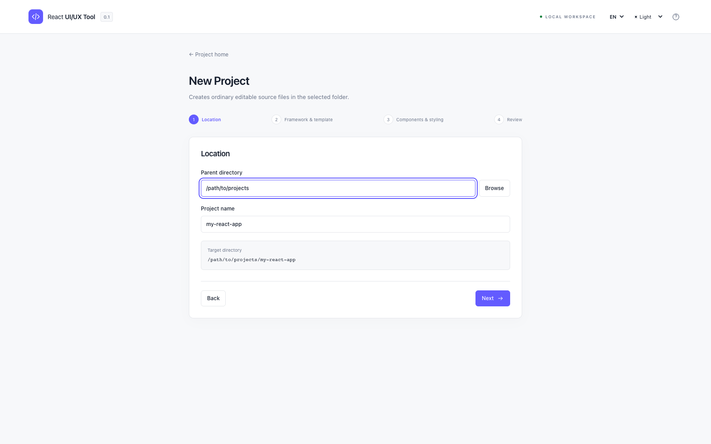

## 5. Open an existing project and read analysis

Choose **Open Existing Project**, then select the root containing `package.json`.
For monorepos, select the relevant application package. The initial scan does not
run package scripts, import project config, install dependencies, or modify files.

Read framework/router, discovered routes/components, literal props, behavior,
styling, source locations, Git state, readiness, warnings, and inspected/skipped
coverage. Counts are detected evidence, not proof of complete whole-program impact.
Choose **Inspect Only** to continue without execution, or approve **Start Preview**.

| State | Meaning |
| --- | --- |
| Editable | This operation has a supported source representation |
| Limited | Some properties/operations can be edited; others remain source-owned |
| Read-only | Inspection works, but a safe rewrite is unavailable |
| Unresolved | Source ownership cannot be established sufficiently |
| Error | Parsing/analysis failed; review the reported cause |

Vite/React with conventional `index.html` is supported by the Design preview.
The preview uses Vite in memory and does not run target scripts/configuration. It may
not reproduce custom plugins, SSR, environment injection, or dynamic aliases.
Selecting a discovered component opens it in a separate Design view; direct
local context providers used by imported hooks are found when the relationship is
clear. Nested/dynamic/router/auth provider setup is not guaranteed. Next App/Pages
projects are statically inspected; there is no Next
runtime preview. MUI/Ant Design and Storybook detection do not imply editable custom
controls or executable story import. See [compatibility](../COMPATIBILITY_MATRIX.md).

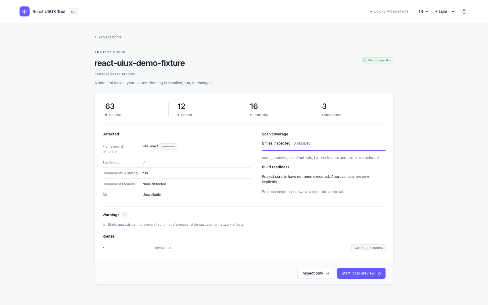

## 6. Select elements, use modes, and open source

In **Design**, hover shows a dotted outline. Click selection is intentionally stronger:
a solid purple 3 px outline, translucent fill, shadow, and **SELECTED** label identify
the active object. Additional Ctrl/Command-click selections use dashed outlines.
The inspector and source tree identify its file/line. You can also select directly
from the left tree. Selecting a component row switches the canvas from the app entry
to that component's isolated design, which lets menu-driven screens be inspected
without logging in. Use **App preview** to return to the normal entry. Elements with
unavailable mapping remain uneditable.

**Interact** enables normal application events and may perform real network requests.
A separate component Design redirects fetch/XMLHttpRequest service calls to an empty
local response so a menu screen can open without its backend. App preview, Interact,
WebSocket/EventSource, and other actions that run when a page opens can still affect
real systems. Use a trusted development environment for your own applications.

**Code** displays source without editing it. In Props, click the source location
to open that file in Code; ordinary manual editing in VS Code is
always possible. After an external edit, re-analyze. A stale patch cannot be applied.

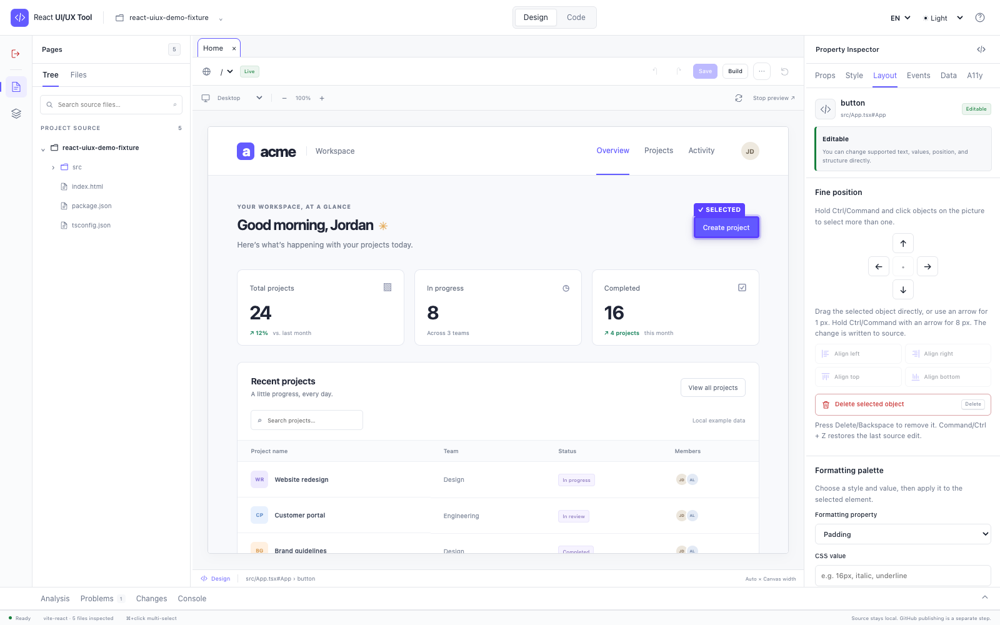

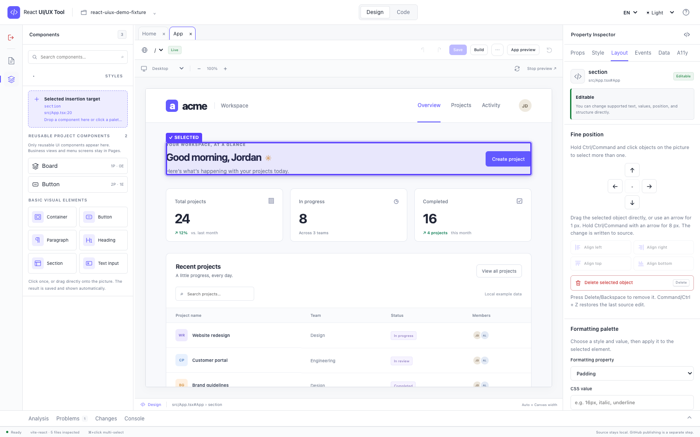

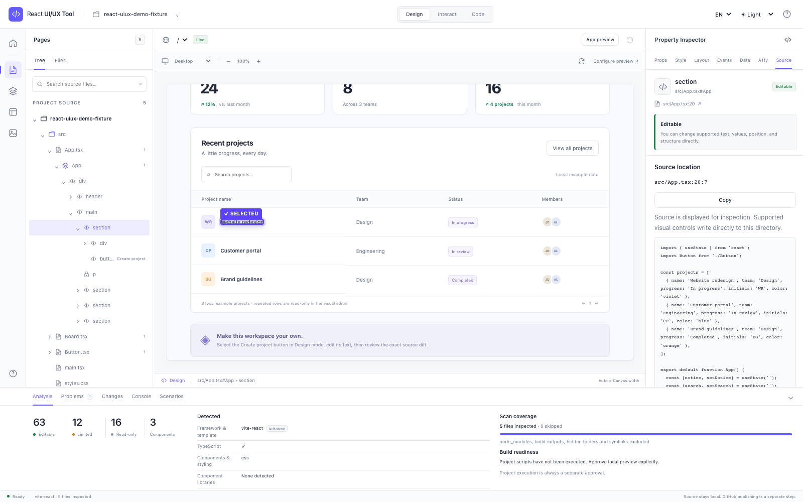

## 7. Component Boards and scenarios

Boards is currently an experimental session-only area, not the primary editing flow.
It does not yet import any project scenario or keep Board configuration after restart.
For existing projects, use Pages → Components → Inspector. Provider-aware arbitrary
Boards, configurable response fixtures, and Storybook scenario import remain future
work.

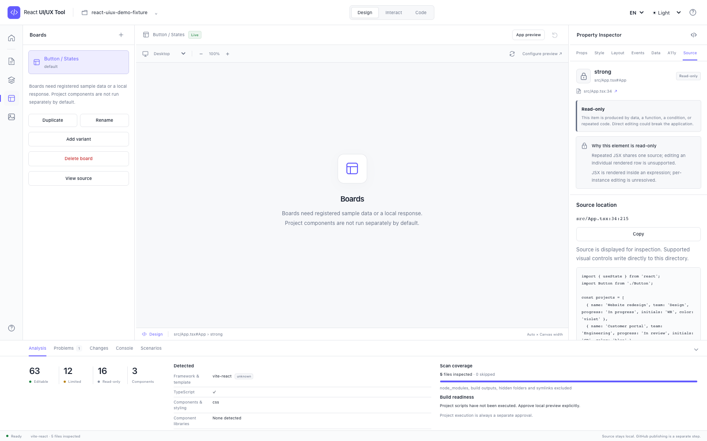

## 8. Props, styles, events, data, and change range

**Props:** supported literal strings/numbers/booleans and literal child text can be
written directly. For a resolved project component, the inspector reads TypeScript
prop declarations and JavaScript destructuring defaults. Literal-union options become
a select control, and a missing optional literal prop can be added to the JSX usage.
Values such as `{customer.name}`, spreads, and controlled bindings stay source-owned.
A control being visible does not bypass engine validation.
Empty supported HTML text elements such as paragraphs can receive their first text
through **Text content**; expressions and other containers still require source review.

**Style/Layout:** inspect source evidence for inline declarations, classes, CSS
variables, or stylesheet references. Only grounded source is editable. Class
declarations and computed browser cascade are not interchangeable; full computed
cascade resolution and global-token rewriting are unavailable. A supported inline
style change is explicitly an inline change, not a claim to edit a global rule.
Under **Style origin**, choose **Edit this inline style** to load an editable inline
property and its current value into the editor. Change the value and save it; class
and stylesheet origins must be edited in their source files.

**Events/Data/A11y:** a declared callback prop (or supported native React event) can
be added or replaced with an existing function discovered in the owning component.
The function must already be callable in that source scope. Backend actions, new
handler logic, imperative component methods, hook logic, runtime data, and permission
rules are not automatically rewritten.
To remove a named binding, select the event, choose **Remove event binding**, and
confirm. The binding is removed but the function remains. Inline expressions stay
source-owned and cannot be changed using this control.

The tool determines and checks how widely a change will apply before saving:

| Change range | Boundary |
| --- | --- |
| This instance only | The selected JSX usage in its actual source file |
| Shared implementation | A deliberate shared definition edit |
| Global token | Shown as a separate intent; automatic rewrite is blocked in this release |

Review known usages and incomplete indexing caveats. Editing a custom component's
internal DOM can affect all its consumers; inspect the owner first. Studio must
never silently turn an instance request into a token edit.

## 9. Fixed structure and keyboard alternatives

The left rail has two deliberately separate workspaces:

- **Pages** contains the lazy source Tree and Files list. Expand a directory/file/
  React component, then select the fixed JSX container where the new item should go.
- **Components** contains reusable visual project components, friendly visual
  basic visual elements, and a **Selected insertion target** card. Business menus under
  `views`, `pages`, `screens`, and `routes` remain in Pages. Providers, contexts,
  hooks, services, stores, and utilities are excluded from the insertion palette.
  Reusable locations such as `components`, `ui`, `shared`, `common`, `controls`,
  `widgets`, and design-system folders are preferred. It does not repeat the source tree.

Select a container in Pages, open Components, then drag a palette item onto the target
card. A project component adds its JSX and relative import directly. Wrapped
`memo(forwardRef(...))` default exports are recognized. The inserted project component
is selected so its props and callback events can be configured immediately. Clicking
a palette item is the keyboard alternative to dragging.

Basic element cards use recognizable icons and names such as **Container**, **Button**,
**Paragraph**, **Heading**, **Section**, and **Text input**; users do not need to
remember HTML tags. Project component icons distinguish common dates, combos, forms,
tables, inputs, files, alerts, and layout components.

Select an existing JSX subtree and use **Duplicate selected component** to choose a
literal `id`, `name`, `fromName`, `toName`, or `*Id` inside it, then supply the new
value. The subtree is copied beside the original with that identity changed.

Basic element insertion may also include checked fixed values and a safe event that
references an existing in-scope function. Every supported action writes immediately.
Drag a selected object directly to reposition it. Arrow keys move 1 px and
Ctrl/Command+Arrow moves 8 px. Ctrl/Command-click selects multiple objects; dragging
one selected object moves the group. Layout provides visual Align left/right/top/
bottom controls. Use **Delete selected object**, Delete, or Backspace to remove an
eligible fixed object. Command/Ctrl+Z restores the latest source edit. **Move Up**
and **Move Down** change source order. The tool never invents handler logic.

Repeated/conditional objects, unclear placement, unsupported nesting, and dynamic
containers are blocked. Private/unresolved components and required prop values are
not guessed. Read the reason and use source editing when an operation is unsupported.

## 10. Direct writes, Git review, and undo

Supported visual actions write directly to the selected source file. Before writing,
the engine rechecks the path, analyzed hash, operation, nesting, export, and syntax.
If VS Code or another process changed the file, the write fails rather than overwrite
it. Re-analyze before trying again.

**Undo** or **Command/Ctrl+Z** restores the latest visual-edit checkpoint in the current session only if
the current file still matches the saved version. There is no persistent multi-step
redo history. No build, lint, commit, or push is automatic. Review the changed files
with the project's normal Git workflow and run its own checks before pushing.

## 11. Shortcuts and accessibility

- **Esc:** clear selection or close the active dialog.
- **Command/Ctrl+Z:** restore the latest conflict-free visual source edit.
- **Delete/Backspace:** remove the selected eligible static object after confirmation.
- **Arrow:** move the selected object(s) 1 px.
- **Command/Ctrl+Arrow:** move the selected object(s) 8 px.
- **Command/Ctrl+Click:** add or remove an object from multi-selection.
- **Tab/Shift+Tab:** navigate controls and dialogs.
- Focus a panel separator and use arrow keys to resize it.
- Use visible Move/Insert buttons as alternatives to drag-and-drop.

Cmd/Ctrl+S, automatic save, command palette, multi-level history, and redo are not
shipped. Browser-native text-input undo remains available while typing in a field.

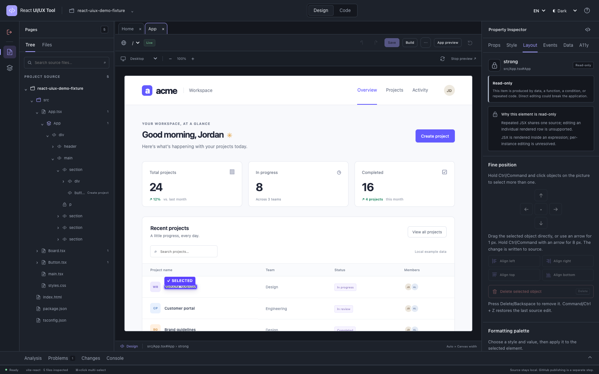

## 12. Troubleshooting and privacy

| Symptom | Next step |
| --- | --- |
| Folder picker unavailable | Paste an absolute path; Linux picker needs `zenity` |
| Project not recognized | Select the application package with `package.json` |
| Non-UTF-8 source warning | The named file is skipped safely; convert it explicitly in an encoding-aware editor if it must be inspected or edited |
| Preview fails or is blank | Check entry path/dependencies, Problems/Console, provider and adapter limits |
| Locked element | Read its source/editability reason; use Code or VS Code |
| Click appears to select nothing | Stay in Design mode and look for the solid purple SELECTED outline; hover alone is dotted |
| Added object should be removed | Select it, open Layout, then use Delete selected object or Delete/Backspace |
| Command/Ctrl+Z does nothing | Finish the active text field first; only the latest visual source checkpoint is available and external file changes block restoration |
| A business screen appears in Components | Re-analyze after updating; views/pages/screens/routes belong in Pages, while only reusable visual components belong in Components |
| Direct edit rejected | Re-analyze; verify scope, supported type, hash, export, and nesting |
| Application calls backend | Stop preview; use trusted fixtures/test configuration |
| Board requires provider | User-provider Board setup is not yet supported |
| High memory | Choose a narrower app package and stop unused dev servers |

The service runs locally without telemetry. Recent-project metadata contains local
paths/names/times; it is not an uploaded source cache. Keep `.env`, session tokens,
keys, and private data out of logs and screenshots. See [SECURITY.md](../SECURITY.md).

Visual regression is not implemented; absence of a screenshot comparison is
**NOT RUN**, never evidence of a visual pass. Screenshots included with the repository
are documentation of real running fixtures, not mockup proof of unimplemented flows.

## 13. FAQ and glossary

**Can any React app be edited?** No. Analysis and preview coverage differ, and each
operation is validated. **Does this replace VS Code?** No; normal source remains the
source of truth. **Must I install Storybook?** No. **Can Studio edit backend code or
push to GitHub?** No. GitHub publication remains a separate owner-controlled step.

**Who made this and what inspired it?** React UI/UX Tool is independent work by RA,
licensed under MIT. The About window links to the project's
[license](../LICENSE), [complete locked-package license inventory](../THIRD_PARTY_NOTICES.md),
and [inspiration record](../INSPIRATION.md). Inspiration is credited without claiming
sponsorship, affiliation, endorsement, or copied source.

- **Board:** isolated local component scenario.
- **Canvas:** running preview surface.
- **Inspector:** selected-source controls and evidence.
- **Props:** component inputs.
- **Source mapping:** linking rendered elements to JSX file/span.
- **Style provenance:** evidence for the source of a style declaration.
- **Diff:** exact before/after source differences.
- **Scope:** instance, shared implementation, or token intent.
- **Static analysis:** inspecting source without running the project.

Read [known limitations](../KNOWN_LIMITATIONS.md), [implementation status](../IMPLEMENTATION_STATUS.md),
the [project notice](../NOTICE.md), and the [Indonesian guide](USER_GUIDE_ID.md) for
additional context.

## 14. Report Studio: create and edit reports

Think of Report Studio as a worktable: the **folder** stores your work, a **template** is a starting example, and the **canvas** is the page where you arrange objects.

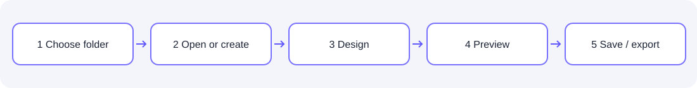

### Start from Home or a project

1. Choose **Report Studio** on Home.
2. Choose **Choose report folder** and select a destination. If the picker cannot open, paste the full path as a fallback. Check the displayed folder before creating a file.
3. Choose a template and **Create report**, or select an existing report from the list. Use the back button to return to the project when you entered from it.

Opening a project does not make every report format editable. `.report.json` is the native report source; an exported PDF is not automatically an editable design file.

### Meet the worktable

| Area | What it does |
| --- | --- |
| Left: templates, files, structure, sample data | Choose reports, bands, objects, and sample data. |
| Center: canvas | Select an object; drag it to move, or drag an edge/corner handle to resize. |
| Right: properties | Change content, position, size, colors, font, and other supported properties. |
| Top: Design, Code, Preview | Arrange the design, view/edit native JSON, or view output with sample data. |

To add a native object, click its palette button or drag it onto an eligible band. Click an object to select it. Drag its edge or corner handles to resize, or enter precise dimensions in the inspector. Use Undo after a mistake. Snap helps alignment and can be turned off. Not every object or format supports every operation.

### Sample data and repeating rows

1. Enter a JSON object in **Sample data**, or use **Import data (CSV/JSON)**. Select a table bound to the target dataset first; other existing datasets are retained.
2. Check dataset names, columns, and sample rows. For example, a `lines` dataset can contain item rows with `description` and `amount` fields.
3. Bind the table or field to the relevant dataset/column and choose **Preview**. Supported detail/table bands repeat rows; check the row count and totals.
4. Fix invalid JSON before preview or export. Use synthetic examples when trying the feature rather than real customer data.

### Save, use Code, and export

- **Save** stores the `.report.json` source. Apply or discard unapplied Code changes first. Read the Save / Discard / Cancel choice when switching reports.
- **Preview** shows native renderer output with sample data. **Export** generates PDF, HTML, CSV, XLSX, or DOCX; read the warnings before using the result.
- Formats differ: CSV contains table data; XLSX uses the first table; PDF does not draw charts/crosstabs yet. PDF uses limited fonts and can replace unsupported characters with `?`; a warning identifies replacement in rendered text. Check the PDF and totals yourself.
- Export does not prove print parity across formats. Review the source and test the output with the intended data and application before using it for business decisions.

### Open an existing `.yrf`

1. Choose **YRF (.yrf)** and select a folder, then choose a file from the list; manual path entry is a fallback.
2. **Design (approximate)** shows the structure and approximate positions. Select an object to inspect properties; **Code** initially displays source read-only. Choose **Edit source** to edit a draft, then **Apply & save copy** to write a copy. Inspection does not execute vendor scripts.
3. Edit available caption/geometry values and choose **Preview change**. **Save** updates the original without a backup; **Save copy** creates a separate file. Structural and source changes currently require Save copy. Creating a new `.yrf` requires acknowledging that output is experimental.

When objects are added or removed, **Preview change** compares the affected bands'
object lists before and after the draft. Vendor rendering remains unverified.
4. Units, print appearance, and created/edited files have not been validated by the vendor renderer. Open the copy in WaiReport with test data and compare totals, barcodes, pagination, and print output before use.

If the folder is missing, choose it again; if a file changed outside the app, reopen it before saving. A preview does not prove that business functions or totals are correct.

### Complete exercise: create a practice invoice

Use fictional data while learning. Button names follow the selected application language.

1. On Home choose **Report Studio**, then **Choose report folder** and select a
   practice folder. If the OS picker fails, enter the folder path at the bottom and
   press **Use folder**. Check the displayed path.
2. Choose the **Invoice / factur** template, a **Style family** such as Corporate
   Navy, and a **File name**, then press **Create report**. The native source is a
   `.report.json` file in the report folder.
3. In **Structure**, a *band* is a section of the page, such as a header, detail,
   or footer; its object names appear underneath. Click a name to select it on the
   canvas. Click an empty part of the paper to show page settings on the right.
4. Change the report title in the top bar. Notice **Unsaved changes** and press
   **Save** when finished.

### Set up the page and position objects

When nothing is selected, the right-hand **Page** panel offers:

| Control | Example and effect |
| --- | --- |
| Page size | Choose A4, A5, Letter, or Legal; A4 is 210 × 297 mm. |
| Orientation | Portrait is upright; Landscape is wide. |
| Margins: top, right, bottom, left | Space between content and paper edge, in mm. Try `10` on each side. |
| Zoom | The slider enlarges the screen view, not the printed page. |
| Snap 1 mm | Rounds drag and resize positions to a 1 mm grid; hold Alt during a gesture to bypass it temporarily. |

Native objects use **X** (distance from the left), **Y** (distance from the top of
its band), **W** (width), and **H** (height), in mm. Select a title and try `X = 10`,
`Y = 2`, `W = 80`, `H = 10`. Make the box tall enough for the font and watch for
overflow warnings. Click empty paper to return to page settings.

### Add, move, and resize objects

1. Find **Structure** on the left and select the destination band.
2. For drag and drop, press and hold **Add text**, drag it onto that band on the
   paper, and release. The new object is selected. Alternatively click the button
   to add it to the selected band.
3. Select an object on the canvas or in Structure. Drag its center to move it, or
   drag a small edge/corner handle to resize it. Check X/Y/W/H on the right for
   precise values.
4. Try **Add box**, **Add line**, and **Add image** too. Duplicate a selected object
   with the duplicate control if available or `Cmd+D` on Mac / `Ctrl+D` on Windows.
   Use **Remove element** to delete it and Undo to recover a mistake.
5. Change a text object's **Content** on the right; you can also double-click text
   to edit it directly. Enlarge its box if the text is clipped.

For example, drag **Add text** onto the header, enter `PRACTICE INVOICE`, set W to
`80`, H to `10`, font size to `16`, and choose blue. Save and use Preview to check
that the text is legible and positioned correctly. Native canvas interactions do
not imply that the `.yrf` inspector supports the same operations.

| Shortcut while the canvas has focus | Action |
| --- | --- |
| Arrow keys | Move the selected object 1 mm; add Shift for 5 mm. |
| Alt + arrow | Change width/height; add Shift for 5 mm steps. |
| Delete / Backspace | Remove the selected object. |
| Cmd/Ctrl + Z; Cmd/Ctrl + Shift + Z or Y | Undo; Redo. |
| Cmd/Ctrl + D; Cmd/Ctrl + S | Duplicate; save. |
| Cmd/Ctrl + E | Start editing an object that supports text editing. |

### Set object values and appearance

Select an object first. Some controls only appear for the relevant object type.

| Property | Try this |
| --- | --- |
| Content / Label | Enter fixed text such as `Customer name`. These controls appear when the object has the relevant property. |
| X, Y, W, H | Enter exact position and size; recheck the layout after changing margins. |
| Font size, Font family, Font weight, Italic | Try size `12`, family `Arial`, weight `700` for bold, and check Italic if desired. Fonts can differ in exports. |
| Color, Background, Align | Choose text/background colors and Left, Center, or Right. Renderers do not necessarily reproduce every style equally. |
| Binding path | On a `field`, enter a data location such as `invoice.customerName`; this reads data rather than fixed text. |
| Expression | On a `field`, the editor suggests `SUM(group.principal)` for a matching group context. Compare the result with a manual calculation. |
| Dataset | On a `table` with available datasets, choose the dataset used for table rows. Columns still depend on the table/template definition. |
| Choose image, Alt text, Image fit | On an image, choose PNG/JPEG/WebP up to 2 MiB; add a description. `contain` shows the whole image; `cover` fills the box and may crop. |

For a logo, click **Add image**, select the image object, click **Choose image**,
and select a local file. Drag the image or its resize handles, set W/H, fit,
background and border, then inspect Preview. PNG and JPEG are supported in PDF
(8-bit non-interlaced PNG); WebP and unsupported image encodings show a PDF warning.
XLSX/DOCX do not export images. The image is stored in the report source, so do not
put sensitive images into documents you plan to share.

### Data, parameters, repeating rows, and totals

**Sample data** supplies values for testing; it is not an automatic production
connection. Here `invoice` is one object and `lines` is a list of two rows. Replace
the left-hand **Sample data** with:

```json
{
  "invoice": {"number": "INV-001", "customerName": "Example Store", "total": 30000},
  "lines": [
    {"description": "Book", "quantity": 2, "unitPrice": 10000, "amount": 20000},
    {"description": "Pencil", "quantity": 1, "unitPrice": 10000, "amount": 10000}
  ]
}
```

1. In the invoice template select the customer field in Structure/canvas and check
   its **Binding path** is `invoice.customerName`. Preview should read `Example Store`.
2. Select the table and ensure **Dataset** is `lines`. Open **Preview** and check
   that both Book and Pencil rows appear under the matching columns. If they do
   not, inspect the dataset, column definitions, and warnings; templates do not
   automatically have identical columns.
3. To try totals, select a field that supports Expression and use an expression
   appropriate to the template's group and columns. For example,
   `SUM(group.principal)` needs a group with a `principal` column; do not assume it
   applies to `amount`. Compare against a manual calculation: this invoice totals 30,000.
4. Alternatively select the target table and choose **Import data (CSV/JSON)**. CSV
   needs column headers; JSON may contain an array of rows or a dataset object. The
   import retains other existing datasets but replaces the dataset with the same
   target name. Imported files are limited to 2 MiB. Fix invalid JSON before Preview/Export.

If by **report parameters** you mean a date, contract number, or customer name,
provide an example value in Sample data and bind the relevant field to its path.
There is currently no separate runtime parameter form, automatic database connection,
or query builder in this screen. Page size, orientation, and margins are in Page.

### Code, Preview, export, and save

- **Design** edits objects visually. **Code** edits a native JSON draft; click
  **Apply JSON**. Invalid JSON cannot replace the last valid design. The draft is
  retained across tabs; apply it before saving. To discard it, return to Home/project and choose Discard changes; this also discards other unsaved report changes.
- **Preview** renders with sample data and does not automatically save the source.
  Click **Refresh preview** after changing data.
- **Save** writes the native source. In **Save and continue / Discard changes /
  Cancel**, choose to save and continue, discard and continue, or remain in the
  editor. If the file changed outside the application, reopen it before saving.
- Select a format and click **Export**. PDF is useful for page review, HTML for a
  browser, CSV for table data, XLSX for spreadsheets, and DOCX for documents. An
  exported file is output, not the `.report.json` design source.
- Read warnings: PDF does not yet draw charts or crosstab cells; unsupported font
  characters may become `?`. CSV drops layout; XLSX and DOCX export only the
  first table, and DOCX drops charts/crosstabs. Check amounts, rows, appearance,
  and printing yourself before business use. **Formats** shows capabilities by
  extension; not every format can be edited.

### Practice opening and changing a `.yrf`

The first editable text object is selected when a file opens. Click another object on
the page or in Structure, change **Caption** on the right, then choose **Save copy**.
Double-clicking an editable text object focuses that field. For a textbox with an
existing `dataField` property, **Data field** changes that existing binding name.
Lines stored as endpoints can be selected and moved. Textbox and binding edits are
experimental and must be checked in the vendor runtime.

In the left **Palette**, click **Text**, **Field**, **Box**, or **Line** to add to
the selected object's band, or drag a button onto a band on the page. Select an
object to edit its text, position, size, binding, and existing string/number/boolean properties
on the right. Use **Code** for structured values. Select **Save copy** when finished;
new objects and their appearance still need verification in WaiReport.
To delete an object, select it and click **Remove object**; the change is written
when you save the report to a copy.

1. Click **YRF (.yrf)**, choose a folder, and select a file from the list; or enter
   its path and click **Open .yrf**. **Design (approximate)** shows estimated
   proportions, not a proven vendor print rendering.
2. Select an object in Structure or on the canvas. Supported objects can be dragged
   and resized with eight handles; **Caption** and `left`, `top`, `width`, `height`
   remain available for exact values. Geometry uses unverified raw vendor units, not
   mm. Unsupported objects stay read-only.
3. Click **Preview change**, check before/after, then **Save copy**. The original
   is not overwritten and later edits continue from the saved copy. **Code** shows the
   source inertly; **Edit source** enables a validated draft and **Apply & save copy**
   writes a new sibling copy. Unapplied drafts trigger Save / Discard / Cancel when
   leaving or opening another file.
4. **+ New .yrf** creates an experimental file from a template after explicit
   acknowledgement. Creation and geometry changes have not been validated with the
   WaiReport renderer; open a copy in the vendor application and compare data and
   printout before use. Native visual drag/resize and all native properties are not
   automatically available for `.yrf`.

### When the result is unexpected

| Symptom | Try this |
| --- | --- |
| Folder/file is missing | Select the correct folder or enter its path manually; check the extension and list. |
| Page panel is missing | Click empty paper to deselect the object. |
| Text is clipped | Increase W/H, reduce font size, and check the overflow warning. |
| Empty table / value `—` | Check JSON, dataset name, binding path and column names; refresh Preview. |
| Preview/Export is blocked | Fix sample JSON and read the error message. |
| Saving a Code draft is blocked | Apply valid JSON, or return to Home/project and choose Discard changes (this also discards other unsaved changes). |
| PDF differs | Read format warnings and manually check characters, table content, totals and pages. |
| `.yrf` looks wrong | The canvas is approximate; check the copy in the vendor runtime and do not assume a verified scale. |

## Report Studio

Open **Report Studio** from Home. Use **Report guide** in either the native or YRF workspace for a short walkthrough. Expand or collapse Structure bands with their arrows; selecting an object opens its band.

1. Choose **Open existing report** to pick a report folder and scan it locally, or
   **Create new report** to pick a folder and template. The project root is never used
   implicitly; the chosen folder is shown in the workspace footer.
2. The sidebar lists native `.report.json` and `.yrf` files with a small type badge and
   relative path. Search and Refresh are local; scanning never writes files.
3. The workspace has **Design**, **Code** and **Preview**. Design supports move, eight
   resize handles, 1 mm snapping (toggle or hold Alt), palette drag/click for text, field,
   table, form, image, box and line, plus properties, parameters and repeat bands.
4. **Code** edits the native JSON draft; invalid JSON never replaces the last valid draft.
   Save is explicit and refuses while a Code draft is not applied.
5. The inspector starts with a formatting bar: style presets (Body/Heading/List/Caption),
   bold, italic, underline, strikethrough, bullets/numbers, justify, line height, letter
   spacing, border width/colour, wrap text and rotation. Select several objects with
   Shift/Cmd-click to align them, group them, move them together, or delete them.
   The palette is grouped (Text & data, Layout, Tables) with icons and collapsible
   sections; Structure collapses each band so long reports stay readable. A **Styles**
   row applies presets (Heading, Body, Muted, Accent, Card, Danger, and report-only
   List/Caption/Highlight/Table header). The React workspace Components palette has the
   same Styles row, and applying one writes the matching style patch to source. Existing
   `.yrf` files also expose a Styles palette and style controls (bold/italic/underline,
   size, colour, alignment) that edit the vendor `style` string and update the approximate
   canvas; select several objects with Shift/Cmd-click to align them, then **Save copy**.
   New templates **Credit pre-analysis** and **Approval memo** add summary pages,
   two-level table headers, highlighted rows, narrative and signature areas. In Structure
   use ↑/↓ to reorder sections and **Page break before** to start a new page. The report
   header has an explicit **Exit** button. Remove/Delete actions are filled red.
6. `.yrf` opens in the same studio. Design is explicitly approximate, Code is editable and
   validated. **Save** replaces the opened file for supported caption, data-field and
   geometry edits without a backup; structural and Code changes use **Save copy**.
   Creation stays experimental and labelled.
7. **Formats** lists which actions each format supports; unsupported formats such as
   JRXML, RDL and `.rpt` are never converted silently.

In the React editor, the **Style** tab offers a **Formatting palette** for a style
property such as font, color, border, underline, wrapping or rotation. Enter a CSS
value and choose **Apply to draft**. For example, select `Underline / strikethrough`,
enter `underline`, and apply it. Choose **Preview draft** to update the canvas and
**Save** to write the source. This works on elements with a supported style operation;
it does not yet provide report presets or automatic list creation. In Report Studio,
Align and Group apply to a selection within one band so objects in different page
sections are not aligned using incompatible coordinates.

## Quick map of the React and report workspaces

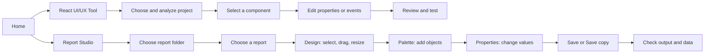

In React, **Components** contains components and elements that can be added to a
supported container. In Report Studio, palette and object lists are grouped; expand
or collapse them to reduce scrolling. Select an object on the page or in the left
structure to view its properties. **Remove object** removes it from the draft;
**Exit** prompts when changes are unsaved. For `.yrf`, Design is approximate and
Save copy creates a separate file; verify it in WaiReport before business use.

### YRF: image and static layouts

In YRF Design, select a band and choose **Image**; select the image and use **Import image** (PNG, JPEG or WebP, up to 2 MiB). Resize on the canvas or in Geometry, then **Save copy**. **Table layout** and **Form layout** insert separate editable objects; they are static starting layouts, not automatic repeating tables. Verify the saved copy in WaiReport.

### Native table columns and rows

Select a native table to edit its columns in Properties: set field key, heading, relative width, alignment and numeric format. Add or remove static rows when the binding path is empty, or enter a dataset path to use sample data. Change header and border colors, border width and row height. Save, reopen and check Preview and PDF warnings for clipped values. Percent values are entered in percentage points (13.5 displays as 13.50%).


To create a total, select a native Field and enter a dataset and field such as `lines.amount` in **Create a total**. Choose **Use total formula**, then Preview with sample data. For a group footer, `group.amount` uses the current group. Verify the output and rounding against independently calculated values.


New native reports start on A4 (210 × 297 mm); existing reports keep their saved paper size. Use **Zoom in** and **Zoom out** or the slider to change the screen view. Toggle **Grid** and **Ruler** for alignment; these guides do not print. In YRF the ruler shows unverified raw units. Select an object and choose **Background** and **Border color**; changing border color enables a visible border. Check Preview and exported PDF. YRF fill and border previews are approximate and should be checked in WaiReport.


For grouped table headings, give adjacent columns the same **Header group (optional)** value. Use **Repeat table heading on each page** to control continuation pages. Use **Add flowing text section** in Structure for simple narrative that continues across pages; check the result because wrapping uses an approximation. For conditional colors, select text or a field, enter a condition such as `invoice.total > 100` and set the colors in **Conditional style**. Conditions affect Preview/PDF; verify with sample data.


To highlight table rows, select a table and set **Conditional table rows**, for example `row.amount < 0`, plus a text or fill color. Use **Add row rule** for another condition. Preview with matching and non-matching rows; the last matching color wins.

### Multi-level table headings and merged cells

1. Select a native table and configure its columns first. In **Advanced table structure**, choose **Edit header rows**.
2. Change each heading and its column/row spans. Choose **Add header row** for another level. The spans must cover the complete grid; fix any red message before saving. Custom header rows replace the optional column groups.
3. Under **Merged body cells**, choose **Add merge**. Set the starting row and column (both start at 1) and the number of rows and columns to join. The first cell supplies the displayed value; avoid overlapping ranges.
4. Enter representative **Sample data**, select **Preview**, and check every page before saving or exporting. HTML keeps a multi-row merge together when it fits on a page. If it cannot fit, cells remain separate. PDF and other exports can simplify these features and show a warning.

In **Structure**, expand a section to rename it and use its layer controls to change the order of elements within that section. Select a data field to choose a field from the available sample data, or enter its binding path manually.

The native **Layers** list shows the selected section with frontmost objects first.
Select a row to select the object, search by type or ID, or use the arrows to move it
forward/backward or to the front/back. These changes remain a draft until **Save**;
Undo/Redo also work. Ordering across different sections is not supported here.

For a native image, choose **Image fit → cover** to fill its frame. Adjust **Image position horizontal (%)** and **Image position vertical (%)** from 0 to 100 to choose which part remains visible; 50 centers the image. The same position is used in Design, Preview and PDF. This is frame positioning, not a freeform crop rectangle.

### Report parameters

In the native report sidebar, choose **Add parameter**, enter a name such as `customer`, select its type, and optionally set a default. Select a field and use `parameters.customer` as its binding path or expression. For expressions, use names made of letters, digits and underscores, starting with a letter or underscore. In **Sample data**, override the default with `{"parameters":{"customer":"Example customer"}}`; Preview and PDF use the override. Preview and export warn when a required value is missing or its type is incorrect; they do not block output. Check the warnings and values before exporting.
