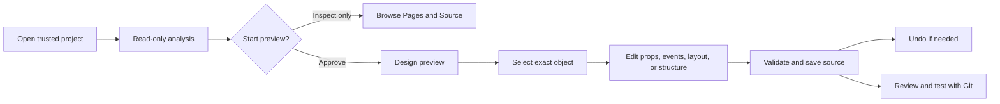
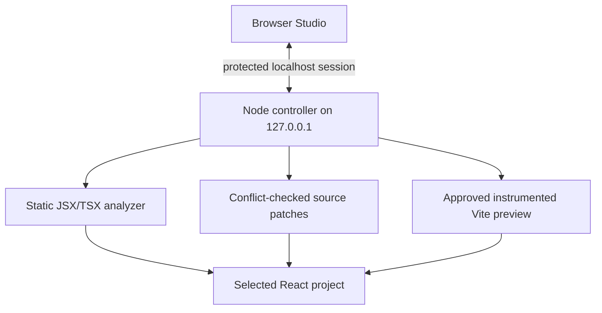

# React UI/UX Tool — User Guide

Version 0.1.0 · local test edition · [Bahasa Indonesia](USER_GUIDE_ID.md) · [README](../README.md) · [GitHub](https://github.com/RaditteAnggoro/react-uiux-tool)

This guide describes the available local workflow. Features marked unavailable do
not mean every React application can be edited safely.


## Guide map

This is the main reference for installation, project checks, visual
editing, safety, troubleshooting, and Git review. Use the in-application **?** button
for the same workflow as an interactive tour.

- [Install and run](#1-install-start-and-stop)
- [Understand the screen](#2-first-launch-and-screen-map)
- [Open and analyze a project](#5-open-an-existing-project-and-read-analysis)
- [Select and edit visually](#6-select-elements-use-modes-and-open-source)
- [Add, copy, move, align, and delete](#9-fixed-structure-and-keyboard-alternatives)
- [Undo and review with Git](#10-direct-writes-git-review-and-undo)
- [Troubleshoot safely](#12-troubleshooting-and-privacy)

## 1. Install, start, and stop

Use Node.js 24, a terminal, and a desktop browser. The declared minimum is 22.12.0;
the recorded development host is macOS with Node 24.22.1. Windows/Linux workflows
need their CI and manual checks before being described as verified. ChromeOS Linux
is experimental. No cloud account, Docker, Electron, database, or paid API is needed.

```bash
# From the react-uiux-tool repository
npm install
npm run build
npm start
```

Open the printed `http://127.0.0.1:<port>` URL. A random free loopback port avoids
conflicts. For development use `npm run dev`. To stop, press **Ctrl+C** in that
terminal; Studio also stops its managed preview. Closing the browser tab is not a
process stop. Avoid running multiple target servers on a low-memory laptop.

For a read-only command-line report:

```bash
node dist/cli.js analyze /absolute/path/to/project --json
node dist/cli.js open /absolute/path/to/project
node dist/cli.js --help
```

## 2. First launch and screen map

Choose **English** or **Bahasa Indonesia** on first use. The header language control
works without restarting and does not translate project content. Choose light,
dark, or system theme; this affects only Studio.

| Area | Purpose |
| --- | --- |
| Home | Front User Guide, New Project, Open Existing Project, recent projects |
| Project Check | What was found, scan coverage, readiness, editing status, warnings |
| Left rail/panel | Pages, Components, Tree, Files, Boards, assets |
| Canvas | Approved real preview, Design/Interact, viewport width, zoom |
| Inspector | Props, Style, Layout, Events, Data, A11y, Source |
| Bottom panel | Analysis, Problems, Changes, Console, Scenarios |
| Source workflow | Direct conflict-checked writes, one-session Undo, Git review before push |

Panel separators support dragging and keyboard arrows. Inspection remains useful
at smaller widths, but this is a desktop editor, not a full mobile design app.
Use the **?** control for local guides and About/version information.
The User Guide card appears before all project actions so scope, direct-write behavior,
preview risk, drag/drop, properties, events, and limitations can be read first.


## 3. Quick start

Choose **Open Existing Project** and select a trusted React project. Read the project
report before starting its local preview; this first check does not execute project
scripts. In Studio, select a fixed JSX object in Pages, inspect it in Design, and use
the supported Props/Events/Layout controls. Changes write directly to that project,
so use a disposable branch or fixture when learning and review with Git before push.





## 4. Create a new project

1. Choose **New Project**.
2. Enter an absolute parent directory or use **Browse**. The parent must exist and
   be writable. A folder picker is an OS bridge, not unrestricted browser access.
3. Enter a folder name. Check the full target path. Spaces/Unicode are supported;
   path separators, reserved device names, and unsafe names are rejected.
4. Choose **Vite + React + TypeScript** and a local template: Blank, Business
   Dashboard, Data Entry/Form, or Operations Console. Next.js creation is unavailable.
5. Choose plain CSS, CSS Modules, or Tailwind v4. The Tailwind starter includes its
   Vite plugin/dependencies; no component library is silently downloaded.
6. Review files, dependencies, and commands. Choose **Create files only**.

Creation does not run `npm install`, a lifecycle script, or a development command.
When ready, open the generated folder in a terminal and run:

```bash
npm install
npm run dev
# In a separate check, or after stopping the server:
npm run build
```

Existing nonempty folders, files, and symlink destinations are rejected. If a
creation attempt fails, choose an empty destination and retry; never delete useful
source to make the wizard proceed.


## 5. Open an existing project and read analysis

Choose **Open Existing Project**, then select the root containing `package.json`.
For monorepos, select the relevant application package. The initial scan does not
run package scripts, import project config, install dependencies, or modify files.

Read framework/router, discovered routes/components, literal props, behavior,
styling, source locations, Git state, readiness, warnings, and inspected/skipped
coverage. Counts are detected evidence, not proof of complete whole-program impact.
Choose **Inspect Only** to continue without execution, or approve **Start Preview**.

| State | Meaning |
| --- | --- |
| Editable | This operation has a supported source representation |
| Limited | Some properties/operations can be edited; others remain source-owned |
| Read-only | Inspection works, but a safe rewrite is unavailable |
| Unresolved | Source ownership cannot be established sufficiently |
| Error | Parsing/analysis failed; review the reported cause |

Vite/React with conventional `index.html` is supported by the Design preview.
The preview uses Vite in memory and does not run target scripts/configuration. It may
not reproduce custom plugins, SSR, environment injection, or dynamic aliases.
Selecting a discovered component opens it in a separate Design view; direct
local context providers used by imported hooks are found when the relationship is
clear. Nested/dynamic/router/auth provider setup is not guaranteed. Next App/Pages
projects are statically inspected; there is no Next
runtime preview. MUI/Ant Design and Storybook detection do not imply editable custom
controls or executable story import. See [compatibility](../COMPATIBILITY_MATRIX.md).


## 6. Select elements, use modes, and open source

In **Design**, hover shows a dotted outline. Click selection is intentionally stronger:
a solid purple 3 px outline, translucent fill, shadow, and **SELECTED** label identify
the active object. Additional Ctrl/Command-click selections use dashed outlines.
The inspector and source tree identify its file/line. You can also select directly
from the left tree. Selecting a component row switches the canvas from the app entry
to that component's isolated design, which lets menu-driven screens be inspected
without logging in. Use **App preview** to return to the normal entry. Elements with
unavailable mapping remain uneditable.

**Interact** enables normal application events and may perform real network requests.
A separate component Design redirects fetch/XMLHttpRequest service calls to an empty
local response so a menu screen can open without its backend. App preview, Interact,
WebSocket/EventSource, and other actions that run when a page opens can still affect
real systems. Use a trusted development environment for your own applications.

**Code** displays source without editing it. The Source inspector provides a
location and an IDE link where supported; ordinary manual editing in VS Code is
always possible. After an external edit, re-analyze. A stale patch cannot be applied.


## 7. Component Boards and scenarios

Boards is currently an experimental session-only area, not the primary editing flow.
It does not yet import any project scenario or keep Board configuration after restart.
For existing projects, use Pages → Components → Inspector. Provider-aware arbitrary
Boards, configurable response fixtures, and Storybook scenario import remain future
work.


## 8. Props, styles, events, data, and change range

**Props:** supported literal strings/numbers/booleans and literal child text can be
written directly. For a resolved project component, the inspector reads TypeScript
prop declarations and JavaScript destructuring defaults. Literal-union options become
a select control, and a missing optional literal prop can be added to the JSX usage.
Values such as `{customer.name}`, spreads, and controlled bindings stay source-owned.
A control being visible does not bypass engine validation.

**Style/Layout:** inspect source evidence for inline declarations, classes, CSS
variables, or stylesheet references. Only grounded source is editable. Class
declarations and computed browser cascade are not interchangeable; full computed
cascade resolution and global-token rewriting are unavailable. A supported inline
style change is explicitly an inline change, not a claim to edit a global rule.

**Events/Data/A11y:** a declared callback prop (or supported native React event) can
be added or replaced with an existing function discovered in the owning component.
The function must already be callable in that source scope. Backend actions, new
handler logic, imperative component methods, hook logic, runtime data, and permission
rules are not automatically rewritten.

The tool determines and checks how widely a change will apply before saving:

| Change range | Boundary |
| --- | --- |
| This instance only | The selected JSX usage in its actual source file |
| Shared implementation | A deliberate shared definition edit |
| Global token | Shown as a separate intent; automatic rewrite is blocked in this release |

Review known usages and incomplete indexing caveats. Editing a custom component's
internal DOM can affect all its consumers; inspect the owner first. Studio must
never silently turn an instance request into a token edit.

## 9. Fixed structure and keyboard alternatives

The left rail has two deliberately separate workspaces:

- **Pages** contains the lazy source Tree and Files list. Expand a directory/file/
  React component, then select the fixed JSX container where the new item should go.
- **Components** contains reusable visual project components, friendly visual
  basic visual elements, and a **Selected insertion target** card. Business menus under
  `views`, `pages`, `screens`, and `routes` remain in Pages. Providers, contexts,
  hooks, services, stores, and utilities are excluded from the insertion palette.
  Reusable locations such as `components`, `ui`, `shared`, `common`, `controls`,
  `widgets`, and design-system folders are preferred. It does not repeat the source tree.

Select a container in Pages, open Components, then drag a palette item onto the target
card. A project component adds its JSX and relative import directly. Wrapped
`memo(forwardRef(...))` default exports are recognized. The inserted project component
is selected so its props and callback events can be configured immediately. Clicking
a palette item is the keyboard alternative to dragging.

Basic element cards use recognizable icons and names such as **Container**, **Button**,
**Paragraph**, **Heading**, **Section**, and **Text input**; users do not need to
remember HTML tags. Project component icons distinguish common dates, combos, forms,
tables, inputs, files, alerts, and layout components.

Select an existing JSX subtree and use **Duplicate selected component** to choose a
literal `id`, `name`, `fromName`, `toName`, or `*Id` inside it, then supply the new
value. The subtree is copied beside the original with that identity changed.

Basic element insertion may also include checked fixed values and a safe event that
references an existing in-scope function. Every supported action writes immediately.
Drag a selected object directly to reposition it. Arrow keys move 1 px and
Ctrl/Command+Arrow moves 8 px. Ctrl/Command-click selects multiple objects; dragging
one selected object moves the group. Layout provides visual Align left/right/top/
bottom controls. Use **Delete selected object**, Delete, or Backspace to remove an
eligible fixed object. Command/Ctrl+Z restores the latest source edit. **Move Up**
and **Move Down** change source order. The tool never invents handler logic.

Repeated/conditional objects, unclear placement, unsupported nesting, and dynamic
containers are blocked. Private/unresolved components and required prop values are
not guessed. Read the reason and use source editing when an operation is unsupported.

## 10. Direct writes, Git review, and undo

Supported visual actions write directly to the selected source file. Before writing,
the engine rechecks the path, analyzed hash, operation, nesting, export, and syntax.
If VS Code or another process changed the file, the write fails rather than overwrite
it. Re-analyze before trying again.

**Undo** or **Command/Ctrl+Z** restores the latest visual-edit checkpoint in the current session only if
the current file still matches the saved version. There is no persistent multi-step
redo history. No build, lint, commit, or push is automatic. Review the changed files
with the project's normal Git workflow and run its own checks before pushing.

## 11. Shortcuts and accessibility

- **Esc:** clear selection or close the active dialog.
- **Command/Ctrl+Z:** restore the latest conflict-free visual source edit.
- **Delete/Backspace:** remove the selected eligible static object after confirmation.
- **Arrow:** move the selected object(s) 1 px.
- **Command/Ctrl+Arrow:** move the selected object(s) 8 px.
- **Command/Ctrl+Click:** add or remove an object from multi-selection.
- **Tab/Shift+Tab:** navigate controls and dialogs.
- Focus a panel separator and use arrow keys to resize it.
- Use visible Move/Insert buttons as alternatives to drag-and-drop.

Cmd/Ctrl+S, automatic save, command palette, multi-level history, and redo are not
shipped. Browser-native text-input undo remains available while typing in a field.


## 12. Troubleshooting and privacy

| Symptom | Next step |
| --- | --- |
| Folder picker unavailable | Paste an absolute path; Linux picker needs `zenity` |
| Project not recognized | Select the application package with `package.json` |
| Non-UTF-8 source warning | The named file is skipped safely; convert it explicitly in an encoding-aware editor if it must be inspected or edited |
| Preview fails or is blank | Check entry path/dependencies, Problems/Console, provider and adapter limits |
| Locked element | Read its source/editability reason; use Code or VS Code |
| Click appears to select nothing | Stay in Design mode and look for the solid purple SELECTED outline; hover alone is dotted |
| Added object should be removed | Select it, open Layout, then use Delete selected object or Delete/Backspace |
| Command/Ctrl+Z does nothing | Finish the active text field first; only the latest visual source checkpoint is available and external file changes block restoration |
| A business screen appears in Components | Re-analyze after updating; views/pages/screens/routes belong in Pages, while only reusable visual components belong in Components |
| Direct edit rejected | Re-analyze; verify scope, supported type, hash, export, and nesting |
| Application calls backend | Stop preview; use trusted fixtures/test configuration |
| Board requires provider | User-provider Board setup is not yet supported |
| High memory | Choose a narrower app package and stop unused dev servers |

The service runs locally without telemetry. Recent-project metadata contains local
paths/names/times; it is not an uploaded source cache. Keep `.env`, session tokens,
keys, and private data out of logs and screenshots. See [SECURITY.md](../SECURITY.md).

Visual regression is not implemented; absence of a screenshot comparison is
**NOT RUN**, never evidence of a visual pass. Screenshots included with the repository
are documentation of real running fixtures, not mockup proof of unimplemented flows.

## 13. FAQ and glossary

**Can any React app be edited?** No. Analysis and preview coverage differ, and each
operation is validated. **Does this replace VS Code?** No; normal source remains the
source of truth. **Must I install Storybook?** No. **Can Studio edit backend code or
push to GitHub?** No. GitHub publication remains a separate owner-controlled step.

**Who made this and what inspired it?** React UI/UX Tool is independent work by RA,
licensed under MIT. The About window links to the project's
[license](../LICENSE), [complete locked-package license inventory](../THIRD_PARTY_NOTICES.md),
and [inspiration record](../INSPIRATION.md). Inspiration is credited without claiming
sponsorship, affiliation, endorsement, or copied source.

- **Board:** isolated local component scenario.
- **Canvas:** running preview surface.
- **Inspector:** selected-source controls and evidence.
- **Props:** component inputs.
- **Source mapping:** linking rendered elements to JSX file/span.
- **Style provenance:** evidence for the source of a style declaration.
- **Diff:** exact before/after source differences.
- **Scope:** instance, shared implementation, or token intent.
- **Static analysis:** inspecting source without running the project.

Read [known limitations](../KNOWN_LIMITATIONS.md), [implementation status](../IMPLEMENTATION_STATUS.md),
the [project notice](../NOTICE.md), and the [Indonesian guide](USER_GUIDE_ID.md) for
additional context.
