# React UI/UX Tool — Panduan Pengguna

Versi 0.1.0 · edisi pengujian lokal · [English](USER_GUIDE_EN.md) · [README Indonesia](../README.id.md) · [GitHub](https://github.com/RaditteAnggoro/react-uiux-tool)

Panduan ini menjelaskan alur kerja yang tersedia. Fitur yang ditandai belum tersedia
bukan janji bahwa semua aplikasi React dapat diedit dengan aman.

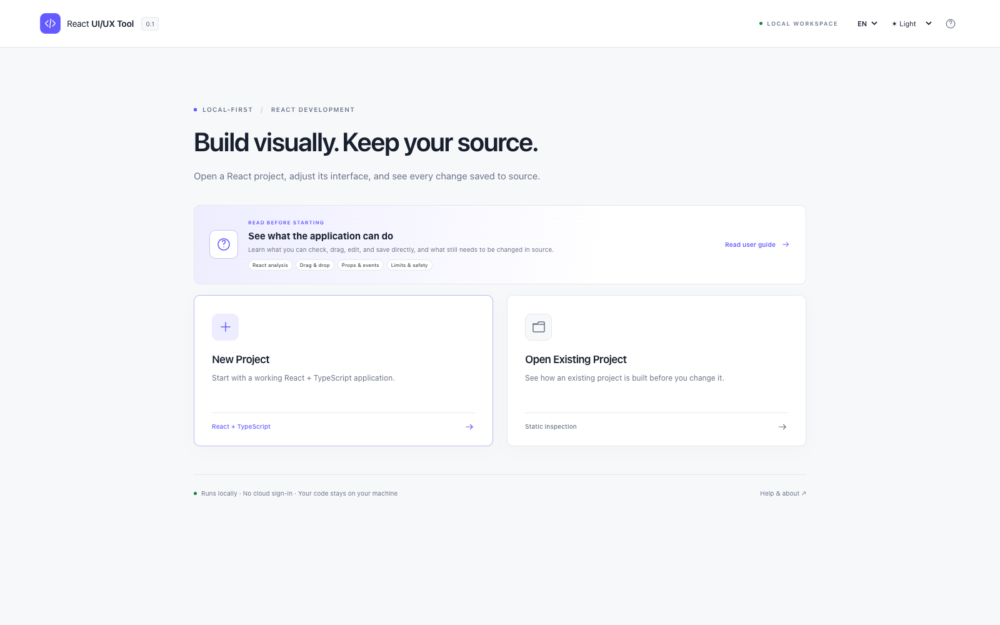

## Peta panduan

Halaman ini adalah panduan utama untuk instalasi, membaca hasil pemeriksaan project,
mengedit tampilan, bekerja dengan aman, mengatasi masalah, dan meninjau perubahan
melalui Git. Tombol **?** di aplikasi membuka tur interaktif dengan alur yang sama.

- [Install dan jalankan](#1-install-menjalankan-dan-menghentikan)
- [Kenali layar](#2-pertama-kali-membuka-dan-mengenal-layar)
- [Buka dan periksa project](#5-membuka-project-existing-dan-membaca-analisis)
- [Pilih dan edit tampilan](#6-memilih-element-mode-dan-source)
- [Tambah, salin, pindahkan, sejajarkan, dan hapus](#9-struktur-tetap-dan-alternatif-keyboard)
- [Batalkan dan review dengan Git](#10-simpan-langsung-review-git-dan-batalkan-perubahan)
- [Atasi masalah dengan aman](#12-troubleshooting-dan-privasi)

## 1. Install, menjalankan, dan menghentikan

Gunakan Node.js 24, terminal, dan browser desktop. Minimum package adalah 22.12.0;
host development yang diuji memakai macOS dan Node 24.22.1. Windows/Linux masih
memerlukan hasil CI dan pengujian platform masing-masing. ChromeOS Linux bersifat
eksperimental. Tidak perlu akun cloud, Docker, Electron, database, atau API berbayar.

```bash
# Dari folder repository react-uiux-tool
npm install
npm run build
npm start
```

Buka alamat `http://127.0.0.1:<port>` di terminal. Tool memilih port loopback yang
tersedia. Untuk development gunakan `npm run dev`. Hentikan lewat **Ctrl+C** pada
terminal; preview yang dikelola Studio ikut dihentikan. Menutup tab browser tidak
menghentikan Node. Di laptop RAM terbatas, cukup satu preview project aktif.

Untuk analisis read-only lewat terminal:

```bash
node dist/cli.js analyze /absolute/path/ke/project --json
node dist/cli.js open /absolute/path/ke/project
node dist/cli.js --help
```

## 2. Pertama kali membuka dan mengenal layar

Pilih **English** atau **Bahasa Indonesia**. Bahasa dapat diganti di header tanpa
restart atau menerjemahkan isi project. Theme light, dark, dan system hanya
memengaruhi Studio, bukan CSS aplikasi target.

| Bagian | Fungsi |
| --- | --- |
| Home | User Guide di depan, Buat Project Baru, Buka Project Existing, recent projects |
| Pemeriksaan Project | Hasil deteksi, cakupan pemeriksaan, kesiapan, status edit, peringatan |
| Rail/panel kiri | Pages, Components, Tree, Files, Boards, assets |
| Canvas | Preview nyata yang disetujui, Design/Interact, lebar viewport, zoom |
| Inspector | Props, Style, Layout, Events, Data, A11y, Source |
| Panel bawah | Analysis, Problems, Changes, Console, Scenarios |
| Alur source | Simpan langsung dengan pemeriksaan konflik, Batalkan sesi, review Git sebelum push |

Panel separator dapat di-drag atau diubah memakai tombol panah saat fokus. Ukuran
layar kecil tetap berguna untuk inspeksi, tetapi editor ini ditujukan untuk desktop.
Tombol **?** membuka panduan lokal serta informasi About/version.
Kartu Panduan Pengguna tampil sebelum seluruh aksi project agar cara menyimpan,
risiko preview, drag-and-drop, properti, event, dan batasan dapat dibaca lebih dahulu.

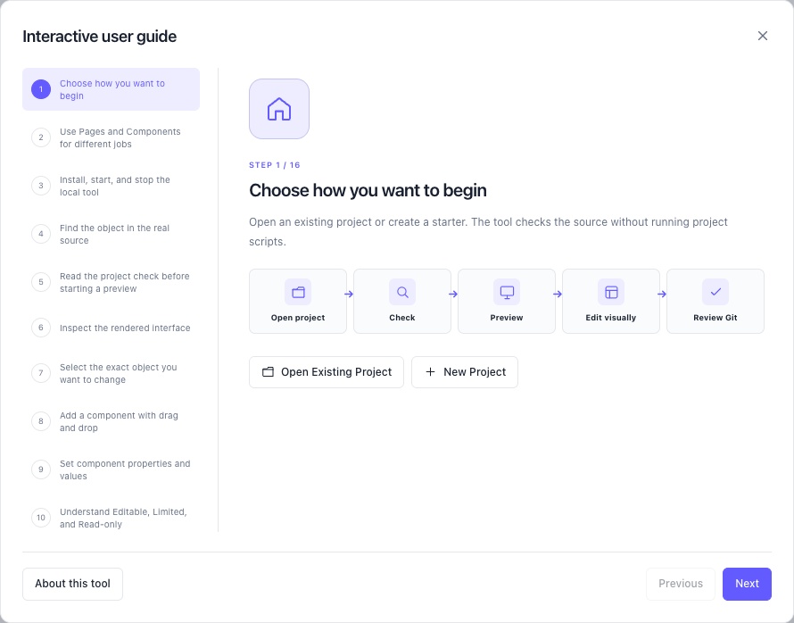

## 3. Mulai cepat

Pilih **Buka Project yang Sudah Ada** dan tentukan project React tepercaya. Baca
hasil pemeriksaan sebelum menjalankan preview lokal; pemeriksaan awal tidak menjalankan
script project. Di Studio, pilih objek JSX tetap melalui Pages, periksa di Design, lalu gunakan
kontrol Props/Events/Layout yang didukung. Perubahan langsung menulis project tersebut,
jadi gunakan branch atau project latihan saat belajar dan review melalui Git sebelum push.

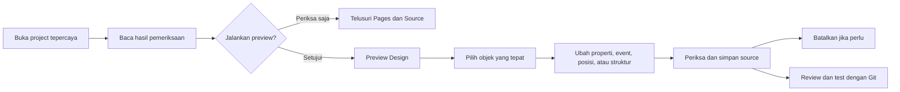

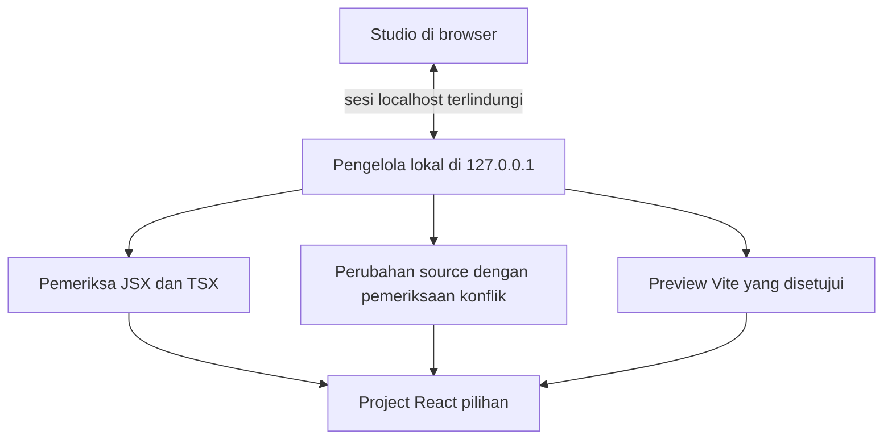

## 4. Membuat project baru

1. Pilih **Buat Project Baru**.
2. Masukkan absolute path folder induk atau gunakan **Browse**. Folder harus sudah
   ada dan writable. Picker bekerja melalui OS bridge, bukan akses filesystem bebas
   dari halaman browser.
3. Isi nama folder dan periksa full target path. Spasi/Unicode didukung; path
   separator, nama device yang reserved, dan karakter tidak aman ditolak.
4. Pilih **Vite + React + TypeScript** dan template lokal: Blank, Business Dashboard,
   Data Entry/Form, atau Operations Console. Starter Next.js belum tersedia.
5. Pilih plain CSS, CSS Modules, atau Tailwind v4. Starter Tailwind menyertakan
   dependency dan Vite plugin yang diperlukan; tidak ada download component library
   secara diam-diam.
6. Review file, dependency, dan command, lalu pilih **Buat file saja**.

Creation tidak menjalankan `npm install`, lifecycle script, atau dev command. Ketika
siap, buka terminal di folder hasil dan jalankan:

```bash
npm install
npm run dev
# Untuk verifikasi build:
npm run build
```

Target berupa folder nonempty, file, atau symlink ditolak. Bila gagal, pilih folder
kosong yang benar; jangan menghapus source berguna hanya agar wizard bisa lanjut.

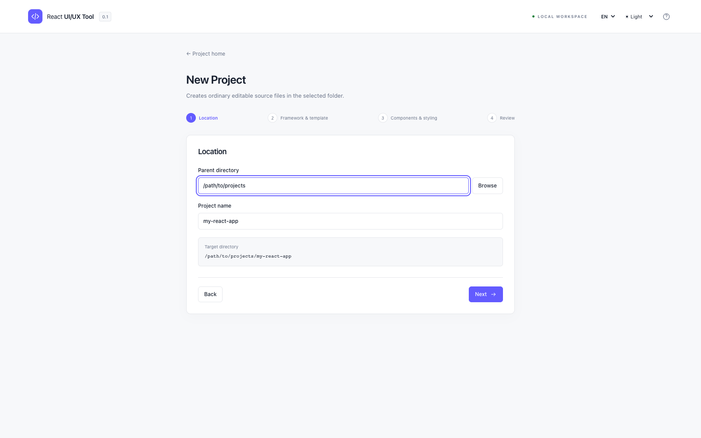

## 5. Membuka project existing dan membaca analisis

Pilih **Buka Project yang Sudah Ada**, lalu folder root yang berisi `package.json`.
Untuk monorepo, pilih package aplikasi yang relevan. Analisis pertama tidak
menjalankan script, meng-import config, meng-install dependency, atau menulis file.

Baca framework/router, route/component yang ditemukan, literal props, behavior,
styling, lokasi source, Git state, readiness, warning, dan cakupan file scan/skipped.
Jumlah yang terdeteksi adalah bukti analisis, bukan kepastian seluruh dampak program.
Pilih **Inspect Only** untuk lanjut tanpa eksekusi atau setujui **Start Preview**.

| Status | Artinya |
| --- | --- |
| Editable | Operasi ini memiliki representasi source yang didukung |
| Limited | Sebagian operasi/properties bisa diedit, lainnya tetap milik source |
| Read-only | Bisa diinspeksi, tetapi rewrite aman belum tersedia |
| Unresolved | Kepemilikan/lokasi source belum cukup pasti |
| Error | Parsing/analisis gagal; baca penyebab yang ditampilkan |

Preview Design mendukung Vite/React dengan `index.html` konvensional. Mesin preview
Vite berjalan di memori dan tidak menjalankan script/config target. Custom plugin, SSR,
environment injection, atau alias dinamis mungkin belum tereproduksi. Memilih baris
component membuka tampilan Design terpisah; provider context lokal yang digunakan
langsung oleh hook dicari otomatis ketika hubungannya jelas. Setup provider bertingkat,
dinamis, router, atau auth tidak dijamin.
Next App/Pages hanya dapat diperiksa dari source; preview Next belum tersedia. Deteksi MUI/Ant
Design/Storybook tidak otomatis berarti ada custom controls atau story import.
Lihat [compatibility](../COMPATIBILITY_MATRIX.md).

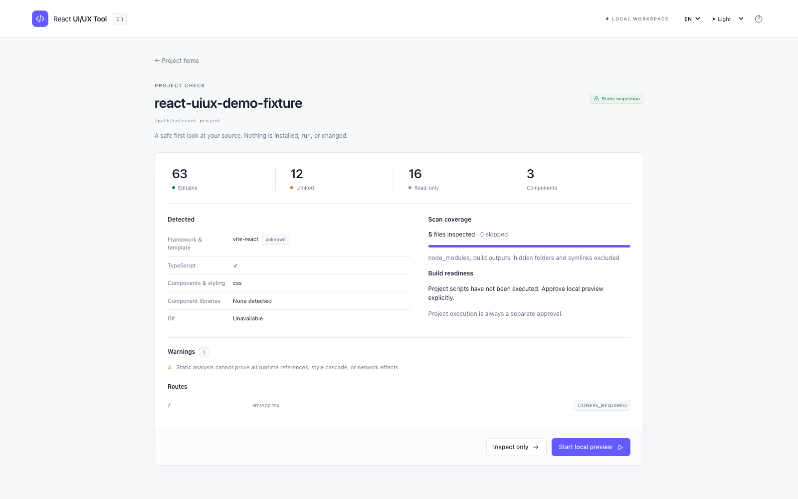

## 6. Memilih element, mode, dan source

Dalam **Design**, arahkan mouse untuk melihat garis putus-putus. Setelah diklik,
objek aktif memiliki garis ungu tebal 3 px, warna latar tipis, bayangan, dan label
**DIPILIH**. Pilihan tambahan dengan Ctrl/Command+klik memakai garis putus-putus.
Inspector dan tree menunjukkan file/baris. Anda juga bisa memilih dari tree kiri.
Klik baris component untuk mengganti canvas dari app entry ke desain component itu,
sehingga screen berbasis menu dapat diperiksa tanpa login. Gunakan **App preview**
untuk kembali ke entry normal. Element dengan mapping belum jelas tidak dipaksa
menjadi editable.

**Interact** mengaktifkan event aplikasi biasa dan bisa memanggil backend sungguhan.
Design terpisah mengarahkan request service fetch/XMLHttpRequest ke jawaban lokal
kosong agar screen menu dapat dibuka tanpa backend perusahaan. App preview, Interact,
WebSocket/EventSource, serta efek saat halaman dibuka tetap dapat berjalan. Gunakan
environment development yang dipercaya.

**Code** menampilkan source secara read-only. Tab Source menyediakan lokasi dan
IDE link jika didukung. File tetap dapat diedit normal melalui VS Code. Setelah ada
external edit, lakukan re-analysis. Patch lama tidak boleh menimpa source yang baru.

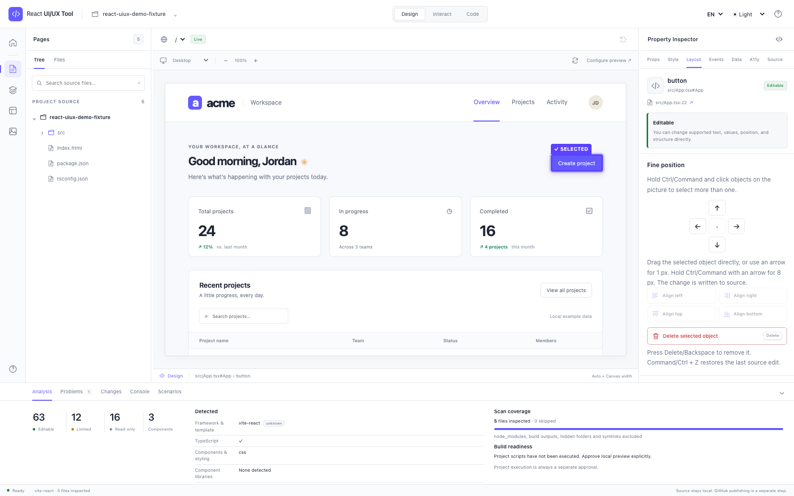

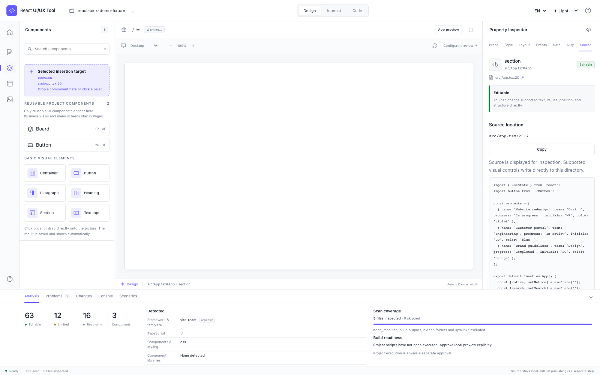

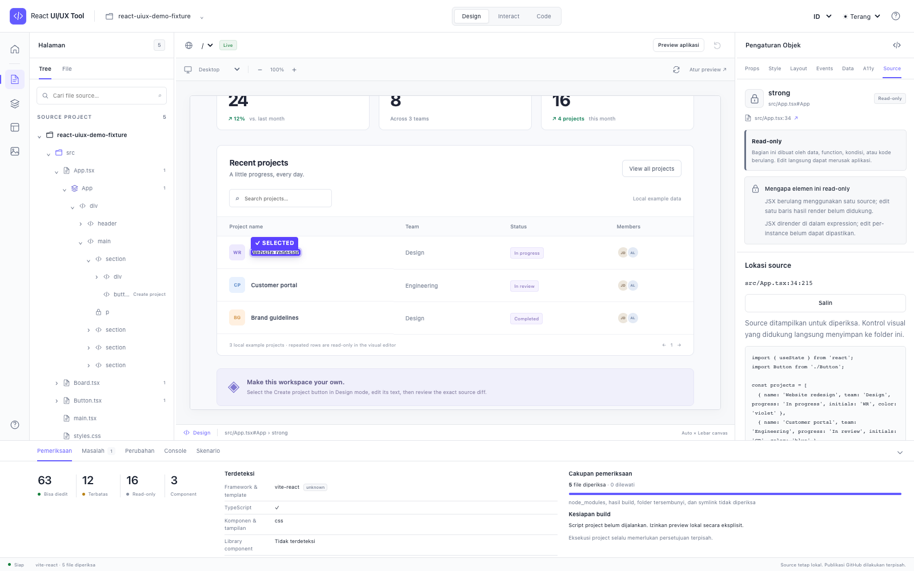

## 7. Component Boards dan scenario

Boards saat ini masih area percobaan dalam sesi, bukan alur edit utama. Boards
belum mengimpor scenario project bebas atau menyimpan konfigurasi. Untuk project
existing gunakan Pages → Components → Inspector. Board dengan provider pengguna,
contoh response yang dapat diatur, dan import scenario Storybook masih pekerjaan lanjutan.

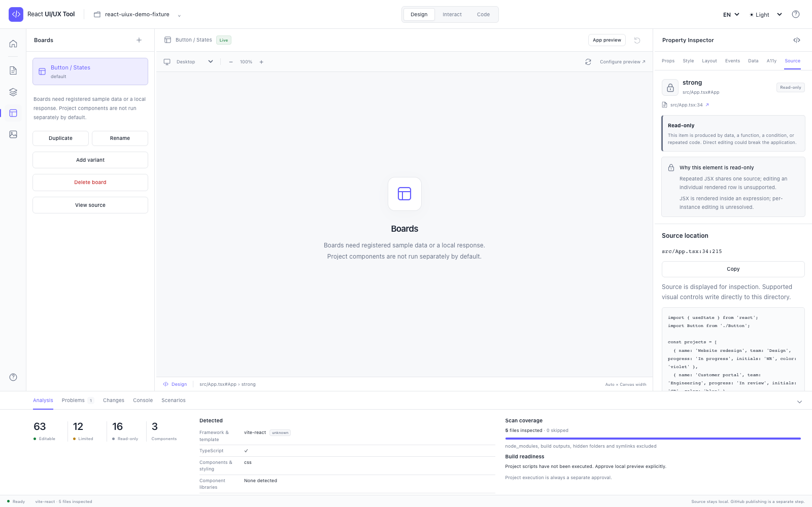

## 8. Props, style, events, data, dan cakupan perubahan

**Props:** literal string/number/boolean dan literal child text yang didukung dapat
langsung ditulis. Untuk component project yang resolved, inspector membaca deklarasi
prop TypeScript dan default destructuring JavaScript. Literal union menjadi pilihan,
dan prop literal opsional yang belum ada dapat ditambahkan ke pemakaian JSX.
Expression seperti `{customer.name}`, spread, dan controlled binding tetap dimiliki
source. Control yang terlihat tetap harus lolos validasi engine.

**Style/Layout:** lihat bukti asal inline declaration, class, CSS variable, atau
stylesheet reference. Hanya source yang jelas dapat diedit. Class declaration
berbeda dari computed cascade browser; resolusi seluruh cascade dan global-token
rewrite belum tersedia. Inline style edit memang perubahan inline, bukan klaim
mengedit aturan global. Tailwind standalone build/dev didukung starter, tetapi
adapter preview internal tidak memuat plugin Tailwind project.

**Events/Data/A11y:** callback prop yang dideklarasikan (atau event React native yang
didukung) dapat ditambah/diganti dengan function yang sudah ditemukan pada owner.
Function wajib sudah callable dalam scope source tersebut. Tool tidak otomatis
membuat logic handler baru, imperative method component, backend action, hook logic,
data runtime, atau permission rules.

Mesin menentukan dan memeriksa cakupan perubahan sebelum menyimpan:

| Cakupan | Batas |
| --- | --- |
| This instance only | Pemakaian JSX terpilih pada source file sebenarnya |
| Shared implementation | Perubahan definition bersama |
| Global token | Intent terpisah; rewrite otomatis diblokir pada versi ini |

Periksa usage yang ditemukan dan catatan cakupan scan. Mengedit DOM internal suatu
component bisa memengaruhi semua pemakainya; baca owner terlebih dahulu.
Scope instance tidak boleh diam-diam diperluas menjadi perubahan token global.

## 9. Struktur tetap dan alternatif keyboard

Rail kiri memiliki dua workspace yang sengaja dipisahkan:

- **Pages** berisi Tree source yang dibuka sesuai kebutuhan dan daftar Files. Buka
  folder, file, dan component React, lalu pilih container JSX tetap sebagai tempat penambahan.
- **Components** hanya berisi component visual reusable, elemen dasar dengan ikon,
  dan kartu **Tempat penambahan terpilih**. Menu bisnis di folder `views`, `pages`,
  `screens`, dan `routes` tetap berada di Pages. Provider, context, hook, service,
  store, dan utility tidak ditampilkan sebagai component visual. Folder reusable
  seperti `components`, `ui`, `shared`, `common`, `controls`, `widgets`, dan
  design-system lebih diutamakan. Tree source tidak diulang di sini.

Pilih container di Pages, buka Components, lalu drag item ke kartu tempat penambahan
atau langsung ke area Design.
Component project langsung menambahkan JSX dan relative import. Default export pola
`memo(forwardRef(...))` dikenali. Component baru dipilih otomatis agar prop dan
callback event dapat diatur. Klik item menjadi alternatif keyboard.

Kartu elemen dasar memakai ikon dan nama yang mudah dikenali seperti **Container**,
**Button**, **Paragraph**, **Heading**, **Section**, dan **Text input**. Pengguna tidak
perlu mengingat tag HTML. Ikon component project juga membedakan tanggal, combo,
form, tabel, input, file, alert, dan layout yang umum.

Pilih subtree JSX yang sudah ada lalu gunakan **Duplikasi component terpilih**. Pilih
property literal `id`, `name`, `fromName`, `toName`, atau `*Id` di dalam subtree dan
isi nilai baru. Salinan dibuat di samping original dengan identity tersebut diganti.

Penambahan elemen dasar juga dapat memakai nilai tetap yang diperiksa dan event aman yang
mereferensikan function dalam scope. Semua aksi yang didukung langsung menulis file.
Drag objek yang dipilih untuk memindahkannya. Tombol panah bergerak 1 px dan
Ctrl/Command+panah bergerak 8 px. Ctrl/Command+klik memilih beberapa objek; drag salah
satu objek untuk memindahkan kelompok. Layout menyediakan tombol ikon **Rata kiri**,
**Rata kanan**, **Rata atas**, dan **Rata bawah**. Gunakan **Hapus objek terpilih**,
Delete, atau Backspace untuk menghapus objek tetap yang didukung. Command/Ctrl+Z
mengembalikan perubahan source terakhir. **Move Up** dan **Move Down** mengubah urutan
source. Tool tidak membuat logic handler baru.

Repeated/conditional nodes, slot ambigu, nesting invalid, dan dynamic container
diblokir. Component private/unresolved dan required props tidak ditebak. Baca alasan
locked lalu edit source jika operasi belum didukung.

## 10. Simpan langsung, review Git, dan batalkan perubahan

Aksi visual yang didukung langsung menulis file source terpilih. Sebelum write,
engine memeriksa ulang path, hash hasil analisis, operasi, nesting, export, dan syntax.
Jika VS Code/proses lain telah mengubah file, write ditolak. Lakukan re-analysis lalu
coba lagi.

**Batalkan** atau **Command/Ctrl+Z** memulihkan edit visual terakhir dalam sesi aktif hanya jika isi
file masih sama dengan versi tersimpan. Belum ada redo multi-level. Build, lint,
commit, dan push tidak dijalankan otomatis. Review file melalui workflow Git project
dan jalankan pemeriksaan project sebelum push.

## 11. Shortcut dan aksesibilitas

- **Esc:** clear selection atau tutup dialog aktif.
- **Command/Ctrl+Z:** kembalikan edit visual terakhir yang tidak memiliki konflik.
- **Delete/Backspace:** hapus objek tetap terpilih yang didukung setelah konfirmasi.
- **Tombol panah:** pindahkan satu atau beberapa objek terpilih sejauh 1 px.
- **Command/Ctrl+panah:** pindahkan satu atau beberapa objek terpilih sejauh 8 px.
- **Command/Ctrl+klik:** tambah atau kurangi objek dari pilihan bersama.
- **Tab/Shift+Tab:** berpindah control/dialog.
- Fokus panel separator lalu gunakan tombol panah untuk resize.
- Gunakan tombol Move/Insert sebagai alternatif drag-and-drop.

Cmd/Ctrl+S, command palette, riwayat bertingkat, dan redo belum tersedia. Undo bawaan
browser pada text input tetap bekerja saat mengetik di dalam field.

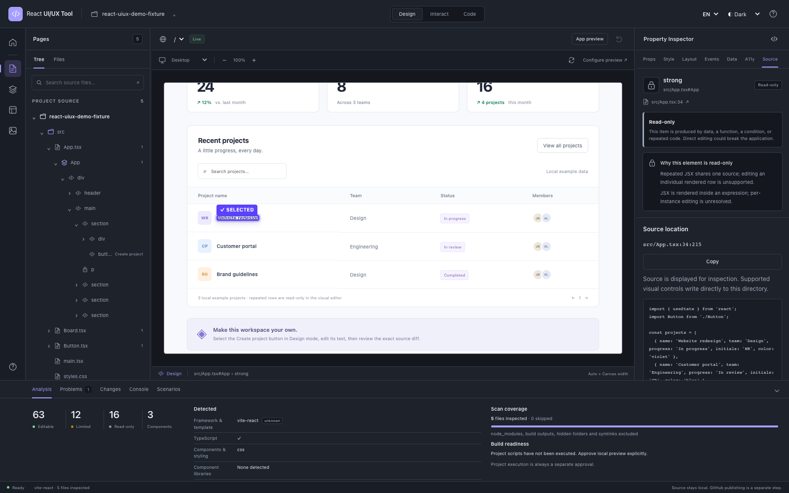

## 12. Troubleshooting dan privasi

| Masalah | Langkah berikutnya |
| --- | --- |
| Picker tidak tersedia | Paste absolute path; picker Linux memerlukan `zenity` |
| Project tidak dikenali | Pilih package aplikasi yang berisi `package.json` |
| Warning source non-UTF-8 | File yang disebutkan dilewati dengan aman; konversi secara eksplisit memakai editor yang memahami encoding jika file harus diperiksa atau diedit |
| Preview kosong/gagal | Cek entry/dependency, Problems/Console, provider, dan batas adapter |
| Element locked | Baca alasan source/editability; pakai Code atau VS Code |
| Klik terlihat tidak memilih apa pun | Pastikan mode Design dan cari garis ungu tebal serta label DIPILIH; hover hanya memakai garis putus-putus |
| Objek baru ingin dihapus | Pilih objek, buka Layout, lalu gunakan Hapus objek terpilih atau Delete/Backspace |
| Command/Ctrl+Z tidak bekerja | Selesaikan edit field aktif; hanya perubahan visual terakhir yang tersedia dan perubahan file dari luar akan memblokir pemulihan |
| Menu bisnis muncul di Components | Periksa ulang project setelah update; views/pages/screens/routes berada di Pages, sedangkan Components hanya untuk component visual reusable |
| Edit langsung ditolak | Re-analyze; periksa scope, tipe, hash, export, dan nesting |
| Aplikasi memanggil backend | Stop preview dan gunakan fixture/environment test |
| Board membutuhkan provider | Setup provider untuk user Board belum tersedia |
| RAM tinggi | Pilih package lebih kecil dan stop dev server yang tidak dipakai |

Service berjalan lokal tanpa telemetry. Recent metadata hanya berisi path/nama/waktu,
bukan upload cache source. Jaga `.env`, session token, key, dan data pribadi agar
tidak masuk log/screenshot. Baca [SECURITY.md](../SECURITY.md).

Visual regression belum tersedia. Tanpa screenshot comparison, statusnya **NOT RUN**,
bukan lulus otomatis. Screenshot dokumentasi repository berasal dari fixture yang
berjalan, bukan mockup untuk membuktikan fitur yang belum ada.

## 13. FAQ dan glosarium

**Semua aplikasi React bisa diedit?** Tidak. Cakupan analisis berbeda dari preview,
dan setiap operasi divalidasi. **Menggantikan VS Code?** Tidak. Source asli tetap
menjadi sumber kebenaran. **Wajib Storybook?** Tidak. **Bisa mengedit backend atau
push GitHub?** Tidak; publikasi GitHub tetap langkah terpisah oleh pemilik.

- **Board:** scenario component lokal yang terisolasi.
- **Canvas:** area preview berjalan.
- **Inspector:** kontrol dan informasi untuk source terpilih.
- **Props:** input component.
- **Lokasi source:** hubungan element yang tampil dengan file dan bagian JSX asalnya.
- **Asal style:** informasi tempat aturan style ditulis.
- **Diff:** perubahan source sebelum/sesudah.
- **Cakupan:** perubahan untuk satu pemakaian, component bersama, atau token global.
- **Pemeriksaan source:** membaca source tanpa menjalankan project.

Baca [batasan](../KNOWN_LIMITATIONS.md), [status implementasi](../IMPLEMENTATION_STATUS.md),
dan [English guide](USER_GUIDE_EN.md) untuk konteks tambahan.
