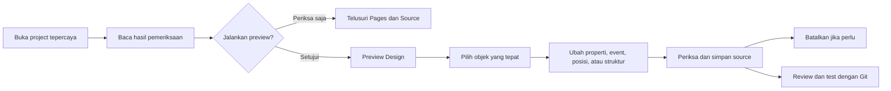
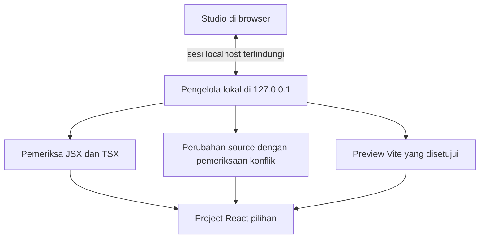
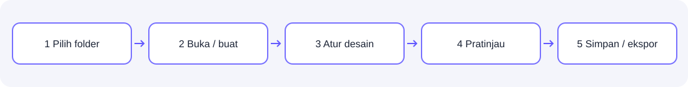
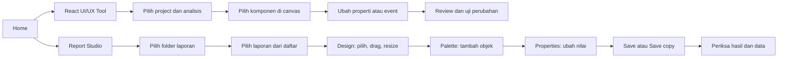

# React UI/UX Tool — Panduan Pengguna

Versi 0.1.0 · edisi pengujian lokal · [English](USER_GUIDE_EN.md) · [README Indonesia](../README.id.md) · [GitHub](https://github.com/RaditteAnggoro/react-uiux-tool)

Panduan ini menjelaskan alur kerja yang tersedia. Fitur yang ditandai belum tersedia
bukan janji bahwa semua aplikasi React dapat diedit dengan aman.


## Peta panduan

Halaman ini adalah panduan utama untuk instalasi, membaca hasil pemeriksaan project,
mengedit tampilan, bekerja dengan aman, mengatasi masalah, dan meninjau perubahan
melalui Git. Tombol **?** di aplikasi membuka tur interaktif dengan alur yang sama.

- [Install dan jalankan](#1-install-menjalankan-dan-menghentikan)
- [Kenali layar](#2-pertama-kali-membuka-dan-mengenal-layar)
- [Buka dan periksa project](#5-membuka-project-existing-dan-membaca-analisis)
- [Pilih dan edit tampilan](#6-memilih-element-mode-dan-source)
- [Tambah, salin, pindahkan, sejajarkan, dan hapus](#9-struktur-tetap-dan-alternatif-keyboard)
- [Batalkan dan review dengan Git](#10-simpan-langsung-review-git-dan-batalkan-perubahan)
- [Atasi masalah dengan aman](#12-troubleshooting-dan-privasi)
- [Membuat dan mengubah laporan](#14-report-studio-membuat-dan-mengubah-laporan)
- [Latihan drag and drop laporan](#menambah-memindahkan-dan-mengubah-ukuran)
- [Data, parameter, pengulangan, dan total](#data-parameter-pengulangan-dan-total)

## 1. Install, menjalankan, dan menghentikan

Gunakan Node.js 24, terminal, dan browser desktop. Minimum package adalah 22.12.0;
host development yang diuji memakai macOS dan Node 24.22.1. Windows/Linux masih
memerlukan hasil CI dan pengujian platform masing-masing. ChromeOS Linux bersifat
eksperimental. Tidak perlu akun cloud, Docker, Electron, database, atau API berbayar.

```bash
# Dari folder repository react-uiux-tool
npm install
npm run build
npm start
```

Buka alamat `http://127.0.0.1:<port>` di terminal. Tool memilih port loopback yang
tersedia. Untuk development gunakan `npm run dev`. Hentikan lewat **Ctrl+C** pada
terminal; preview yang dikelola Studio ikut dihentikan. Menutup tab browser tidak
menghentikan Node. Di laptop RAM terbatas, cukup satu preview project aktif.

Untuk analisis read-only lewat terminal:

```bash
node dist/cli.js analyze /absolute/path/ke/project --json
node dist/cli.js open /absolute/path/ke/project
node dist/cli.js --help
```

## 2. Pertama kali membuka dan mengenal layar

Pilih **English** atau **Bahasa Indonesia**. Bahasa dapat diganti di header tanpa
restart atau menerjemahkan isi project. Theme light, dark, dan system hanya
memengaruhi Studio, bukan CSS aplikasi target.

| Bagian | Fungsi |
| --- | --- |
| Home | User Guide di depan, Buat Project Baru, Buka Project Existing, recent projects |
| Pemeriksaan Project | Hasil deteksi, cakupan pemeriksaan, kesiapan, status edit, peringatan |
| Rail/panel kiri | Pages, Components, Tree, Files, Boards |
| Canvas | Preview nyata yang disetujui, Design/Interact, lebar viewport, zoom |
| Inspector | Props, Style, Layout, Events, Data, A11y, Source |
| Panel bawah | Analysis, Problems, Changes, Console, Scenarios |
| Alur source | Simpan langsung dengan pemeriksaan konflik, Batalkan sesi, review Git sebelum push |

Panel separator dapat di-drag atau diubah memakai tombol panah saat fokus. Ukuran
layar kecil tetap berguna untuk inspeksi, tetapi editor ini ditujukan untuk desktop.
Tombol **?** membuka panduan lokal serta informasi About/version.
Kartu Panduan Pengguna tampil sebelum seluruh aksi project agar cara menyimpan,
risiko preview, drag-and-drop, properti, event, dan batasan dapat dibaca lebih dahulu.


## 3. Mulai cepat

Pilih **Buka Project yang Sudah Ada** dan tentukan project React tepercaya. Baca
hasil pemeriksaan sebelum menjalankan preview lokal; pemeriksaan awal tidak menjalankan
script project. Di Studio, pilih objek JSX tetap melalui Pages, periksa di Design, lalu gunakan
kontrol Props/Events/Layout yang didukung. Perubahan langsung menulis project tersebut,
jadi gunakan branch atau project latihan saat belajar dan review melalui Git sebelum push.





## 4. Membuat project baru

1. Pilih **Buat Project Baru**.
2. Masukkan absolute path folder induk atau gunakan **Browse**. Folder harus sudah
   ada dan writable. Picker bekerja melalui OS bridge, bukan akses filesystem bebas
   dari halaman browser.
3. Isi nama folder dan periksa full target path. Spasi/Unicode didukung; path
   separator, nama device yang reserved, dan karakter tidak aman ditolak.
4. Pilih **Vite + React + TypeScript** dan template lokal: Blank, Business Dashboard,
   Data Entry/Form, atau Operations Console. Starter Next.js belum tersedia.
5. Pilih plain CSS, CSS Modules, atau Tailwind v4. Starter Tailwind menyertakan
   dependency dan Vite plugin yang diperlukan; tidak ada download component library
   secara diam-diam.
6. Review file, dependency, dan command, lalu pilih **Buat file saja**.

Creation tidak menjalankan `npm install`, lifecycle script, atau dev command. Ketika
siap, buka terminal di folder hasil dan jalankan:

```bash
npm install
npm run dev
# Untuk verifikasi build:
npm run build
```

Target berupa folder nonempty, file, atau symlink ditolak. Bila gagal, pilih folder
kosong yang benar; jangan menghapus source berguna hanya agar wizard bisa lanjut.


## 5. Membuka project existing dan membaca analisis

Pilih **Buka Project yang Sudah Ada**, lalu folder root yang berisi `package.json`.
Untuk monorepo, pilih package aplikasi yang relevan. Analisis pertama tidak
menjalankan script, meng-import config, meng-install dependency, atau menulis file.

Baca framework/router, route/component yang ditemukan, literal props, behavior,
styling, lokasi source, Git state, readiness, warning, dan cakupan file scan/skipped.
Jumlah yang terdeteksi adalah bukti analisis, bukan kepastian seluruh dampak program.
Pilih **Inspect Only** untuk lanjut tanpa eksekusi atau setujui **Start Preview**.

| Status | Artinya |
| --- | --- |
| Editable | Operasi ini memiliki representasi source yang didukung |
| Limited | Sebagian operasi/properties bisa diedit, lainnya tetap milik source |
| Read-only | Bisa diinspeksi, tetapi rewrite aman belum tersedia |
| Unresolved | Kepemilikan/lokasi source belum cukup pasti |
| Error | Parsing/analisis gagal; baca penyebab yang ditampilkan |

Preview Design mendukung Vite/React dengan `index.html` konvensional. Mesin preview
Vite berjalan di memori dan tidak menjalankan script/config target. Custom plugin, SSR,
environment injection, atau alias dinamis mungkin belum tereproduksi. Memilih baris
component membuka tampilan Design terpisah; provider context lokal yang digunakan
langsung oleh hook dicari otomatis ketika hubungannya jelas. Setup provider bertingkat,
dinamis, router, atau auth tidak dijamin.
Next App/Pages hanya dapat diperiksa dari source; preview Next belum tersedia. Deteksi MUI/Ant
Design/Storybook tidak otomatis berarti ada custom controls atau story import.
Lihat [compatibility](../COMPATIBILITY_MATRIX.md).


## 6. Memilih element, mode, dan source

Dalam **Design**, arahkan mouse untuk melihat garis putus-putus. Setelah diklik,
objek aktif memiliki garis ungu tebal 3 px, warna latar tipis, bayangan, dan label
**DIPILIH**. Pilihan tambahan dengan Ctrl/Command+klik memakai garis putus-putus.
Inspector dan tree menunjukkan file/baris. Anda juga bisa memilih dari tree kiri.
Klik baris component untuk mengganti canvas dari app entry ke desain component itu,
sehingga screen berbasis menu dapat diperiksa tanpa login. Gunakan **App preview**
untuk kembali ke entry normal. Element dengan mapping belum jelas tidak dipaksa
menjadi editable.

**Interact** mengaktifkan event aplikasi biasa dan bisa memanggil backend sungguhan.
Design terpisah mengarahkan request service fetch/XMLHttpRequest ke jawaban lokal
kosong agar screen menu dapat dibuka tanpa backend perusahaan. App preview, Interact,
WebSocket/EventSource, serta efek saat halaman dibuka tetap dapat berjalan. Gunakan
environment development yang dipercaya.

**Code** menampilkan source tanpa menjalankannya; untuk `.yrf` tersedia **Edit source**. Tab Source menyediakan lokasi dan
IDE link jika didukung. File tetap dapat diedit normal melalui VS Code. Setelah ada
external edit, lakukan re-analysis. Patch lama tidak boleh menimpa source yang baru.


## 7. Component Boards dan scenario

Boards saat ini masih area percobaan dalam sesi, bukan alur edit utama. Boards
belum mengimpor scenario project bebas atau menyimpan konfigurasi. Untuk project
existing gunakan Pages → Components → Inspector. Board dengan provider pengguna,
contoh response yang dapat diatur, dan import scenario Storybook masih pekerjaan lanjutan.


## 8. Props, style, events, data, dan cakupan perubahan

**Props:** literal string/number/boolean dan literal child text yang didukung dapat
langsung ditulis. Untuk component project yang resolved, inspector membaca deklarasi
prop TypeScript dan default destructuring JavaScript. Literal union menjadi pilihan,
dan prop literal opsional yang belum ada dapat ditambahkan ke pemakaian JSX.
Expression seperti `{customer.name}`, spread, dan controlled binding tetap dimiliki
source. Control yang terlihat tetap harus lolos validasi engine.

**Style/Layout:** lihat bukti asal inline declaration, class, CSS variable, atau
stylesheet reference. Hanya source yang jelas dapat diedit. Class declaration
berbeda dari computed cascade browser; resolusi seluruh cascade dan global-token
rewrite belum tersedia. Inline style edit memang perubahan inline, bukan klaim
mengedit aturan global. Tailwind standalone build/dev didukung starter, tetapi
adapter preview internal tidak memuat plugin Tailwind project.

**Events/Data/A11y:** callback prop yang dideklarasikan (atau event React native yang
didukung) dapat ditambah/diganti dengan function yang sudah ditemukan pada owner.
Function wajib sudah callable dalam scope source tersebut. Tool tidak otomatis
membuat logic handler baru, imperative method component, backend action, hook logic,
data runtime, atau permission rules.
Untuk melepas binding bernama, pilih event lalu **Remove event binding** dan
konfirmasi. Binding dihapus, tetapi function tetap ada. Expression inline tetap
dikelola di source dan tidak diubah lewat kontrol ini.

Mesin menentukan dan memeriksa cakupan perubahan sebelum menyimpan:

| Cakupan | Batas |
| --- | --- |
| This instance only | Pemakaian JSX terpilih pada source file sebenarnya |
| Shared implementation | Perubahan definition bersama |
| Global token | Intent terpisah; rewrite otomatis diblokir pada versi ini |

Periksa usage yang ditemukan dan catatan cakupan scan. Mengedit DOM internal suatu
component bisa memengaruhi semua pemakainya; baca owner terlebih dahulu.
Scope instance tidak boleh diam-diam diperluas menjadi perubahan token global.

## 9. Struktur tetap dan alternatif keyboard

Rail kiri memiliki dua workspace yang sengaja dipisahkan:

- **Pages** berisi Tree source yang dibuka sesuai kebutuhan dan daftar Files. Buka
  folder, file, dan component React, lalu pilih container JSX tetap sebagai tempat penambahan.
- **Components** hanya berisi component visual reusable, elemen dasar dengan ikon,
  dan kartu **Tempat penambahan terpilih**. Menu bisnis di folder `views`, `pages`,
  `screens`, dan `routes` tetap berada di Pages. Provider, context, hook, service,
  store, dan utility tidak ditampilkan sebagai component visual. Folder reusable
  seperti `components`, `ui`, `shared`, `common`, `controls`, `widgets`, dan
  design-system lebih diutamakan. Tree source tidak diulang di sini.

Pilih container di Pages, buka Components, lalu drag item ke kartu tempat penambahan
atau langsung ke area Design.
Component project langsung menambahkan JSX dan relative import. Default export pola
`memo(forwardRef(...))` dikenali. Component baru dipilih otomatis agar prop dan
callback event dapat diatur. Klik item menjadi alternatif keyboard.

Kartu elemen dasar memakai ikon dan nama yang mudah dikenali seperti **Container**,
**Button**, **Paragraph**, **Heading**, **Section**, dan **Text input**. Pengguna tidak
perlu mengingat tag HTML. Ikon component project juga membedakan tanggal, combo,
form, tabel, input, file, alert, dan layout yang umum.

Pilih subtree JSX yang sudah ada lalu gunakan **Duplikasi component terpilih**. Pilih
property literal `id`, `name`, `fromName`, `toName`, atau `*Id` di dalam subtree dan
isi nilai baru. Salinan dibuat di samping original dengan identity tersebut diganti.

Penambahan elemen dasar juga dapat memakai nilai tetap yang diperiksa dan event aman yang
mereferensikan function dalam scope. Semua aksi yang didukung langsung menulis file.
Drag objek yang dipilih untuk memindahkannya. Tombol panah bergerak 1 px dan
Ctrl/Command+panah bergerak 8 px. Ctrl/Command+klik memilih beberapa objek; drag salah
satu objek untuk memindahkan kelompok. Layout menyediakan tombol ikon **Rata kiri**,
**Rata kanan**, **Rata atas**, dan **Rata bawah**. Gunakan **Hapus objek terpilih**,
Delete, atau Backspace untuk menghapus objek tetap yang didukung. Command/Ctrl+Z
mengembalikan perubahan source terakhir. **Move Up** dan **Move Down** mengubah urutan
source. Tool tidak membuat logic handler baru.

Repeated/conditional nodes, slot ambigu, nesting invalid, dan dynamic container
diblokir. Component private/unresolved dan required props tidak ditebak. Baca alasan
locked lalu edit source jika operasi belum didukung.

## 10. Simpan langsung, review Git, dan batalkan perubahan

Aksi visual yang didukung langsung menulis file source terpilih. Sebelum write,
engine memeriksa ulang path, hash hasil analisis, operasi, nesting, export, dan syntax.
Jika VS Code/proses lain telah mengubah file, write ditolak. Lakukan re-analysis lalu
coba lagi.

**Batalkan** atau **Command/Ctrl+Z** memulihkan edit visual terakhir dalam sesi aktif hanya jika isi
file masih sama dengan versi tersimpan. Belum ada redo multi-level. Build, lint,
commit, dan push tidak dijalankan otomatis. Review file melalui workflow Git project
dan jalankan pemeriksaan project sebelum push.

## 11. Shortcut dan aksesibilitas

- **Esc:** clear selection atau tutup dialog aktif.
- **Command/Ctrl+Z:** kembalikan edit visual terakhir yang tidak memiliki konflik.
- **Delete/Backspace:** hapus objek tetap terpilih yang didukung setelah konfirmasi.
- **Tombol panah:** pindahkan satu atau beberapa objek terpilih sejauh 1 px.
- **Command/Ctrl+panah:** pindahkan satu atau beberapa objek terpilih sejauh 8 px.
- **Command/Ctrl+klik:** tambah atau kurangi objek dari pilihan bersama.
- **Tab/Shift+Tab:** berpindah control/dialog.
- Fokus panel separator lalu gunakan tombol panah untuk resize.
- Gunakan tombol Move/Insert sebagai alternatif drag-and-drop.

Cmd/Ctrl+S, command palette, riwayat bertingkat, dan redo belum tersedia. Undo bawaan
browser pada text input tetap bekerja saat mengetik di dalam field.


## 12. Troubleshooting dan privasi

| Masalah | Langkah berikutnya |
| --- | --- |
| Picker tidak tersedia | Paste absolute path; picker Linux memerlukan `zenity` |
| Project tidak dikenali | Pilih package aplikasi yang berisi `package.json` |
| Warning source non-UTF-8 | File yang disebutkan dilewati dengan aman; konversi secara eksplisit memakai editor yang memahami encoding jika file harus diperiksa atau diedit |
| Preview kosong/gagal | Cek entry/dependency, Problems/Console, provider, dan batas adapter |
| Element locked | Baca alasan source/editability; pakai Code atau VS Code |
| Klik terlihat tidak memilih apa pun | Pastikan mode Design dan cari garis ungu tebal serta label DIPILIH; hover hanya memakai garis putus-putus |
| Objek baru ingin dihapus | Pilih objek, buka Layout, lalu gunakan Hapus objek terpilih atau Delete/Backspace |
| Command/Ctrl+Z tidak bekerja | Selesaikan edit field aktif; hanya perubahan visual terakhir yang tersedia dan perubahan file dari luar akan memblokir pemulihan |
| Menu bisnis muncul di Components | Periksa ulang project setelah update; views/pages/screens/routes berada di Pages, sedangkan Components hanya untuk component visual reusable |
| Edit langsung ditolak | Re-analyze; periksa scope, tipe, hash, export, dan nesting |
| Aplikasi memanggil backend | Stop preview dan gunakan fixture/environment test |
| Board membutuhkan provider | Setup provider untuk user Board belum tersedia |
| RAM tinggi | Pilih package lebih kecil dan stop dev server yang tidak dipakai |

Service berjalan lokal tanpa telemetry. Recent metadata hanya berisi path/nama/waktu,
bukan upload cache source. Jaga `.env`, session token, key, dan data pribadi agar
tidak masuk log/screenshot. Baca [SECURITY.md](../SECURITY.md).

Visual regression belum tersedia. Tanpa screenshot comparison, statusnya **NOT RUN**,
bukan lulus otomatis. Screenshot dokumentasi repository berasal dari fixture yang
berjalan, bukan mockup untuk membuktikan fitur yang belum ada.

## 13. FAQ dan glosarium

**Semua aplikasi React bisa diedit?** Tidak. Cakupan analisis berbeda dari preview,
dan setiap operasi divalidasi. **Menggantikan VS Code?** Tidak. Source asli tetap
menjadi sumber kebenaran. **Wajib Storybook?** Tidak. **Bisa mengedit backend atau
push GitHub?** Tidak; publikasi GitHub tetap langkah terpisah oleh pemilik.

**Siapa pembuatnya dan dari mana inspirasinya?** React UI/UX Tool adalah karya
independen RA dengan lisensi MIT. Jendela Tentang menyediakan tautan ke
[lisensi project](../LICENSE), [daftar lengkap lisensi package](../THIRD_PARTY_NOTICES.md),
dan [catatan inspirasi](../INSPIRATION.md). Inspirasi diberi kredit tanpa mengklaim
sponsor, afiliasi, dukungan resmi, atau penyalinan source.

- **Board:** scenario component lokal yang terisolasi.
- **Canvas:** area preview berjalan.
- **Inspector:** kontrol dan informasi untuk source terpilih.
- **Props:** input component.
- **Lokasi source:** hubungan element yang tampil dengan file dan bagian JSX asalnya.
- **Asal style:** informasi tempat aturan style ditulis.
- **Diff:** perubahan source sebelum/sesudah.
- **Cakupan:** perubahan untuk satu pemakaian, component bersama, atau token global.
- **Pemeriksaan source:** membaca source tanpa menjalankan project.

Baca [batasan](../KNOWN_LIMITATIONS.md), [status implementasi](../IMPLEMENTATION_STATUS.md),
[pemberitahuan project](../NOTICE.md), dan [English guide](USER_GUIDE_EN.md) untuk
konteks tambahan.

## 14. Report Studio: membuat dan mengubah laporan

Bayangkan Report Studio seperti meja kerja untuk menyusun halaman. **Folder** adalah tempat menyimpan; **template** adalah contoh awal; **canvas** adalah kertas tempat kamu menyusun objek.



### Mulai dari Home atau dari project

1. Dari Home pilih **Report Studio**, atau buka project React lalu pilih **Reports** di rail kiri.
2. Pilih **Choose report folder** dan pilih folder tujuan. Bila picker tidak terbuka, tempel path lengkap sebagai cadangan. Periksa lokasi folder yang tampil sebelum membuat file.
3. Pilih template dan **Create report**, atau pilih laporan yang ada dari daftar. Kembali ke project melalui tombol kembali jika masuk dari project.

Membuka project tidak berarti seluruh jenis laporan dapat diedit. `.report.json` adalah sumber laporan native; file ekspor seperti PDF bukan otomatis file desain yang dapat dibuka kembali untuk diedit.

### Kenali meja kerja

| Bagian | Gunanya |
| --- | --- |
| Kiri: template, file, struktur, sample data | Pilih laporan, band, objek, dan data contoh. |
| Tengah: canvas | Lihat halaman, pilih objek, lalu tarik untuk memindahkan atau tarik handle di tepi untuk mengubah ukuran. |
| Kanan: properties | Ubah isi, posisi, ukuran, warna, font, dan properti lain sesuai jenis objek. |
| Atas: Design, Code, Preview | Susun tampilan, lihat/edit JSON native, atau lihat hasil dengan data contoh. |

Untuk menambah objek native, klik tombol objek atau tarik dari palette ke band yang sesuai. Klik objek untuk memilihnya. Tarik handle pada tepi/sudut untuk mengubah ukuran; gunakan kolom ukuran bila butuh angka tepat. Gunakan Undo jika salah. Snap membantu merapikan posisi; matikan bila tidak diperlukan. Tidak semua objek atau format mendukung semua operasi.

### Data contoh dan pengulangan

1. Isi **Sample data** dengan JSON objek, atau gunakan **Import data (CSV/JSON)**. Pilih tabel yang terikat ke dataset tujuan sebelum impor; data lain yang sudah ada tetap dipertahankan.
2. Periksa nama dataset, kolom dan baris contoh. Contoh: dataset `lines` dapat berisi baris barang dengan kolom `description` dan `amount`.
3. Bind tabel atau field ke dataset/kolom yang sesuai, lalu pilih **Preview**. Band detail/tabel dapat mengulang baris pada fitur yang didukung; pastikan jumlah baris dan total benar.
4. Jika JSON salah, perbaiki error sebelum preview atau ekspor. Gunakan data sintetis untuk mencoba fitur, bukan data pelanggan sebenarnya.

### Simpan, lihat Code, dan ekspor

- **Save** menyimpan sumber `.report.json`; jika ada perubahan di tab Code yang belum diterapkan, pilih Apply atau buang perubahan dulu. Saat berpindah laporan, baca pilihan Save / Discard / Cancel.
- **Preview** menunjukkan hasil renderer native dengan data contoh. **Export** membuat dokumen PDF, HTML, CSV, XLSX, atau DOCX; baca warning sebelum menggunakan hasilnya.
- Format punya batas yang berbeda: CSV berisi data tabel; XLSX menggunakan tabel pertama; PDF belum menggambar chart/crosstab. PDF memakai font terbatas dan dapat mengganti karakter yang tidak didukung dengan `?`; warning menunjukkan jika penggantian terjadi pada teks yang dirender. Periksa hasil PDF dan total secara manual.
- Ekspor bukan bukti kesamaan cetak antarformat. Review sumber dan uji hasil dengan data serta aplikasi tujuan sebelum dipakai untuk keputusan bisnis.

### Membuka `.yrf` yang sudah ada

1. Pilih **YRF (.yrf)** dan pilih folder, lalu pilih file dari daftar; path manual tersedia sebagai cadangan.
2. **Design (approximate)** menampilkan struktur dan posisi perkiraan. Pilih objek untuk memeriksa properti; **Code** awalnya menampilkan source secara read-only. Pilih **Edit source** untuk mengubah draf, lalu **Apply & save copy** untuk menyimpan salinan. Script vendor tidak dijalankan saat inspeksi.
3. Edit caption/geometri yang tersedia, pilih **Preview change**, lalu **Save copy**. File asli tidak ditimpa. Pembuatan `.yrf` baru meminta persetujuan bahwa hasilnya eksperimental.
4. Unit, tampilan cetak, dan file yang dibuat/diubah belum divalidasi oleh renderer vendor. Cek salinan dalam WaiReport dengan data uji dan bandingkan total, barcode, halaman, dan cetakan sebelum digunakan.

Jika folder tidak muncul, pilih kembali folder yang benar; jika file berubah di luar aplikasi, buka ulang sebelum menyimpan. Jangan menganggap hasil preview sebagai bukti bahwa fungsi atau angka bisnis sudah benar.

### Latihan lengkap: buat invoice percobaan

Gunakan data rekaan saat belajar. Istilah pada tombol mengikuti bahasa aplikasi;
panduan ini juga menyertakan nama English agar mudah dicari.

1. Di Home pilih **Report Studio**. Pilih **Pilih folder laporan / Choose report folder**,
   lalu pilih folder latihan. Jika picker OS gagal, isi path folder di bagian bawah dan
   tekan **Pakai folder / Use folder**. Pastikan path yang tampil benar.
2. Di **Template**, pilih **Invoice / factur**. Pilih **Style family**, misalnya
   Corporate Navy, isi **Nama file / File name**, lalu tekan **Buat laporan / Create report**.
   Perubahan desain disimpan sebagai `.report.json` di folder laporan.
3. Lihat **Struktur / Structure** di kiri. Setiap *band* adalah bagian halaman,
   misalnya header, detail, atau footer; nama objek ada di bawah band-nya. Klik nama
   objek untuk menemukannya di canvas. Klik area kertas kosong untuk kembali ke
   pengaturan halaman di panel kanan.
4. Ubah judul laporan pada kotak di bagian atas. Perhatikan status **Perubahan belum
   disimpan / Unsaved changes**. Tekan **Save** setelah selesai.

### Mengatur kertas dan posisi objek

Saat tidak ada objek dipilih, panel kanan menampilkan **Page / Halaman**:

| Kontrol | Contoh dan hasil |
| --- | --- |
| Page size | Pilih A4, A5, Letter, atau Legal; A4 berukuran 210 × 297 mm. |
| Orientation | Portrait untuk tegak; Landscape untuk mendatar. |
| Margins: top, right, bottom, left | Jarak isi dari tepi kertas dalam mm. Coba isi `10` pada setiap sisi. |
| Zoom | Geser slider di atas canvas untuk memperbesar tampilan; ini bukan ukuran cetak. |
| Snap 1 mm | Membulatkan gerakan dan resize ke kisi 1 mm; tahan Alt saat menarik untuk melewati snap sementara. |

Objek menggunakan **X** (jarak dari kiri), **Y** (jarak dari atas band), **W**
(lebar), dan **H** (tinggi). Angka-angka ini dalam mm pada laporan native. Untuk
latihan, pilih judul lalu masukkan `X = 10`, `Y = 2`, `W = 80`, `H = 10`.
Pastikan tinggi cukup untuk font, dan perhatikan warning jika isi melewati kotak.
Klik area kosong jika ingin kembali mengatur kertas.

### Menambah, memindahkan, dan mengubah ukuran

1. Di panel kiri, temukan **Struktur / Structure** lalu pilih band tujuan.
2. Untuk drag and drop, tekan dan tahan **Add text / Tambah teks**, tarik ke dalam
   band di kertas, lalu lepaskan. Objek baru muncul dan dipilih. Cara lain: klik
   tombol tersebut untuk menambah objek di band yang dipilih.
3. Pilih objek pada canvas atau namanya di Structure. Tarik bagian tengah objek
   untuk memindahkannya. Untuk resize, tarik kotak kecil pada sisi atau sudut
   objek; periksa nilai X/Y/W/H di kanan agar hasilnya tepat.
4. Coba juga **Add box**, **Add line**, dan **Add image**. Duplikasi objek terpilih
   dengan tombol duplikasi bila tersedia atau `Cmd+D` di Mac / `Ctrl+D` di Windows.
   Hapus lewat **Remove element**. Gunakan Undo bila salah.
5. Untuk teks, ubah **Content / Isi** di kanan; teks juga dapat diedit langsung
   dengan double-click. Atur ukuran kotaknya jika teks terpotong.

Contoh: tarik **Add text** ke band header, isi `INVOICE LATIHAN`, set W `80`, H
`10`, ukuran font `16`, dan warna biru. Simpan, lalu buka Preview untuk memeriksa
apakah tulisan terbaca dan berada di tempat yang benar. Gerakan di editor berlaku
untuk laporan native; inspector `.yrf` memiliki kemampuan berbeda di bawah.

| Shortcut saat canvas aktif | Fungsi |
| --- | --- |
| Tombol panah | Pindahkan objek terpilih 1 mm; tambahkan Shift untuk 5 mm. |
| Alt + panah | Ubah lebar/tinggi; tambahkan Shift untuk langkah 5 mm. |
| Delete / Backspace | Hapus objek terpilih. |
| Cmd/Ctrl + Z; Cmd/Ctrl + Shift + Z atau Y | Undo; Redo. |
| Cmd/Ctrl + D; Cmd/Ctrl + S | Duplikasi; simpan. |
| Cmd/Ctrl + E | Mulai edit objek yang mendukung edit teks. |

### Mengisi nilai dan tampilan objek

Pilih objek terlebih dahulu. Kontrol tertentu hanya muncul untuk tipe yang sesuai.

| Properti | Cara mencoba |
| --- | --- |
| Content / Label | Masukkan teks tetap, misalnya `Nama pelanggan`. Label dan Content tersedia bila objek memilikinya. |
| X, Y, W, H | Masukkan posisi dan ukuran secara presisi; cek kembali setelah mengubah margin. |
| Font size, Font family, Font weight, Italic | Misalnya ukuran `12`, family `Arial`, weight `700` untuk tebal, lalu centang Italic bila perlu. Hasil font dapat berbeda pada ekspor. |
| Color, Background, Align | Pilih warna teks/latar, lalu Left, Center, atau Right. Tidak semua renderer mendukung seluruh styling dengan hasil sama. |
| Binding path | Pada objek `field`, isi lokasi data seperti `invoice.customerName`; ini membaca data, bukan teks tetap. |
| Expression | Pada `field`, contoh yang disediakan editor adalah `SUM(group.principal)` untuk konteks grup yang sesuai. Cek hasil terhadap perhitungan manual. |
| Dataset | Pada objek `table` dengan dataset yang tersedia, pilih dataset untuk baris tabel. Kolom tetap bergantung pada definisi tabel/template. |
| Choose image, Alt text, Image fit | Pada objek gambar, pilih PNG/JPEG/WebP maksimal 2 MiB; isi deskripsi; `contain` menjaga gambar utuh, `cover` mengisi kotak dan dapat memotong tepi. |

Untuk logo, klik **Add image**, pilih objek gambar, tekan **Choose image**, lalu
pilih file lokal. Atur W/H dan lihat Preview. Gambar disimpan sebagai bagian dari
sumber laporan; jangan masukkan gambar rahasia ke dokumen yang akan dibagikan.

### Data, parameter, pengulangan, dan total

**Data contoh** adalah nilai untuk mencoba laporan; data ini bukan koneksi otomatis
ke database produksi. Pada contoh berikut `invoice` adalah satu objek, sedangkan
`lines` adalah daftar dua baris. Di panel kiri **Sample data / Data contoh**,
ganti isinya dengan JSON berikut:

```json
{
  "invoice": {"number": "INV-001", "customerName": "Toko Contoh", "total": 30000},
  "lines": [
    {"description": "Buku", "quantity": 2, "unitPrice": 10000, "amount": 20000},
    {"description": "Pensil", "quantity": 1, "unitPrice": 10000, "amount": 10000}
  ]
}
```

1. Dalam template invoice, pilih field pelanggan dari Structure/canvas dan periksa
   **Binding path** `invoice.customerName`. Preview seharusnya membaca `Toko Contoh`.
2. Pilih tabel dan pastikan **Dataset** adalah `lines`. **Preview** lalu periksa
   apakah dua baris Buku dan Pensil muncul pada kolom yang cocok. Jika tidak,
   periksa dataset, definisi kolom dan warning; jangan menganggap semua template
   otomatis mempunyai kolom yang sama.
3. Untuk mencoba total, pilih field yang memang mendukung Expression dan gunakan
   ekspresi yang sesuai dengan grup dan kolom template. Misalnya
   `SUM(group.principal)` hanya relevan bila grup memiliki kolom `principal`; jangan
   memakainya untuk kolom `amount` tanpa memeriksa struktur. Bandingkan total dengan
   hitungan sendiri. Invoice contoh di atas berjumlah 30.000.
4. Alternatif input: pilih tabel tujuan lalu **Import data (CSV/JSON)**. CSV harus
   punya header kolom; file JSON bisa berupa array baris atau objek dataset. Impor
   menggabungkan dataset lain yang sudah ada, tetapi mengganti dataset tujuan yang
   bernama sama. Batas file impor 2 MiB. Perbaiki JSON sebelum Preview/Export.

Jika yang kamu maksud **parameter laporan** adalah tanggal, nomor kontrak, atau
nama pelanggan, masukkan nilai contoh di Sample data dan hubungkan field dengan
Binding path yang sesuai. Saat ini tidak ada formulir parameter runtime terpisah,
koneksi database otomatis, atau pembuat query di layar ini. Pengaturan ukuran kertas,
orientasi, dan margin ada di panel Page seperti dijelaskan di atas.

### Code, Preview, ekspor, dan menyimpan

- **Design**: ubah objek secara visual. **Code**: edit draf JSON native lalu tekan
  **Apply JSON**; JSON tidak valid tidak menggantikan desain terakhir yang valid.
  Draf tetap ada saat pindah tab; terapkan draf sebelum Save. Untuk membuangnya, kembali ke Home/project dan pilih Discard changes; ini juga membuang perubahan laporan lain yang belum disimpan.
- **Preview**: perbarui tampilan menggunakan data contoh. Preview tidak otomatis
  menyimpan sumber. Klik **Refresh preview** setelah memperbarui data.
- **Save** menyimpan sumber native. Jika muncul pilihan **Save and continue / Discard
  changes / Cancel**, pilih simpan dan lanjut, buang perubahan dan lanjut, atau
  tetap di editor. Jika file berubah di luar aplikasi, buka ulang sebelum menyimpan.
- Pilih format lalu tekan **Export**. PDF cocok untuk memeriksa halaman; HTML untuk
  browser; CSV untuk data tabel; XLSX untuk spreadsheet; DOCX untuk dokumen. Hasil
  ekspor adalah output, bukan sumber desain `.report.json`.
- Baca warning: PDF belum menggambar chart dan isi crosstab; karakter di luar font
  yang didukung dapat menjadi `?`. CSV tidak menyimpan layout; XLSX dan DOCX
  mengekspor hanya tabel pertama. DOCX juga tidak mempertahankan chart/crosstab.
  Periksa angka, baris, tampilan, dan hasil cetak sendiri sebelum penggunaan bisnis.
  Tombol **Formats** menunjukkan kemampuan tiap ekstensi; tidak semua dapat diedit.

### Latihan membuka dan mengubah `.yrf`

Saat file terbuka, objek teks pertama dipilih otomatis. Klik objek lain pada halaman
atau Structure; ubah **Teks** di kanan, lalu pilih **Simpan salinan**. Double-click
objek teks juga memfokuskan kolom teks. Untuk textbox dengan properti `dataField`,
kolom **Field data** mengubah nama binding yang sudah ada. Garis yang menyimpan
titik ujung dapat dipilih dan dipindahkan. Perubahan
textbox/binding bersifat eksperimental dan perlu diuji di runtime vendor.

Di **Palet** sebelah kiri, klik **Teks**, **Field**, **Kotak**, atau **Garis** untuk
menambah ke band objek terpilih, atau tarik tombol ke band pada halaman. Pilih objek
untuk mengubah teks, posisi, ukuran, binding, dan properti string/angka/boolean yang ada di
panel kanan. Nilai terstruktur dapat diubah melalui **Kode**. Klik **Simpan salinan**
setelah selesai; objek baru dan tampilannya masih perlu diverifikasi di WaiReport.
Untuk menghapus, pilih objek lalu klik **Hapus objek**; perubahan baru ditulis saat
kamu menyimpan laporan ke salinan.

1. Tekan **YRF (.yrf)**, pilih folder, lalu pilih file dari daftar; atau masukkan
   path file dan tekan **Open .yrf**. **Design (approximate)** memperlihatkan
   perkiraan proporsi, bukan hasil cetak vendor yang pasti.
2. Pilih objek pada Structure atau canvas. Objek yang didukung bisa digeser dan
   di-resize dengan delapan handle; **Caption** dan `left`, `top`, `width`, `height`
   tetap tersedia untuk nilai tepat. Geometri memakai unit mentah vendor yang belum
   terverifikasi, bukan mm. Objek yang tidak didukung tetap hanya baca.
3. Tekan **Preview change**, periksa nilai sebelum/sesudah, lalu **Save copy**.
   File asli tidak ditimpa dan pengeditan berikutnya berlanjut dari salinan. Tab
   **Code** menampilkan source secara inert; **Edit source** mengaktifkan draf
   tervalidasi dan **Apply & save copy** menulis salinan baru. Draf yang belum
   diterapkan memunculkan pilihan Simpan / Buang / Batal saat keluar atau membuka file lain.
4. **+ New .yrf** menyediakan pembuatan eksperimental dengan template dan persetujuan
   eksplisit. Hasil maupun perubahan geometri belum divalidasi renderer WaiReport;
   buka salinan di aplikasi vendor dan bandingkan data serta cetakan sebelum dipakai.
   Drag/resize visual dan seluruh properti editor native tidak otomatis tersedia di `.yrf`.

### Jika hasil belum seperti yang diharapkan

| Gejala | Yang bisa dicoba |
| --- | --- |
| Folder/file tidak terlihat | Pilih folder yang benar atau gunakan path manual, lalu periksa ekstensi dan daftar. |
| Panel Page tidak terlihat | Klik area kosong pada kertas untuk membatalkan pilihan objek. |
| Teks terpotong | Perbesar W/H, kecilkan font, dan baca warning overflow. |
| Tabel kosong / nilai `—` | Periksa JSON, nama dataset, binding path, nama kolom, lalu refresh Preview. |
| Preview/Export ditolak | Perbaiki JSON data contoh dan baca pesan kesalahan. |
| Save draf Code ditolak | Terapkan JSON yang valid; untuk membuangnya, kembali ke Home/project dan pilih Discard changes (perubahan lain yang belum disimpan juga dibuang). |
| Hasil PDF berbeda | Baca warning format, cek karakter, isi tabel, total, dan halaman secara manual. |
| `.yrf` tidak sesuai | Canvas hanya perkiraan; cek file salinan di runtime vendor dan jangan anggap skala telah terverifikasi. |

## Report Studio

Buka **Report Studio** dari Home atau tombol **Reports** di workspace project.

1. Pilih **Open existing report** untuk memilih folder laporan dan memindainya secara
   lokal, atau **Create new report** untuk memilih folder dan template. Root project tidak
   pernah dipakai diam-diam; folder terpilih ditampilkan di footer workspace.
2. Sidebar menampilkan file native `.report.json` dan `.yrf` dengan badge kecil serta path
   relatif. Search dan Refresh bersifat lokal; scan tidak menulis file.
3. Workspace memiliki **Design**, **Code**, dan **Preview**. Design mendukung geser,
   delapan handle resize, snap 1 mm (toggle atau tahan Alt), palette drag/klik untuk teks,
   field, tabel, formulir, gambar, kotak dan garis, plus properti, parameter dan band ulang.
4. **Code** mengedit draf JSON native; JSON tidak valid tidak pernah menimpa draf valid.
   Simpan bersifat eksplisit dan ditolak selama draf Code belum diterapkan.
5. Inspector dibuka dengan toolbar format: preset gaya (Body/Heading/List/Caption),
   tebal, miring, garis bawah, coret, daftar butir/nomor, rata kanan-kiri, tinggi baris,
   jarak huruf, tebal/warna garis, bungkus teks, dan rotasi. Pilih beberapa objek dengan
   Shift/Cmd-click untuk meratakan, mengelompokkan, menggeser bersama, atau menghapusnya.
   Palette dikelompokkan (Teks & data, Tata letak, Tabel) dengan ikon dan bisa dilipat;
   Structure melipat setiap band agar laporan panjang tetap rapi. Baris **Gaya** menerapkan
   preset (Judul, Teks isi, Redup, Aksen, Kartu, Bahaya, plus List/Caption/Sorot/Header
   tabel untuk report). Palette Components di workspace React punya baris Gaya yang sama,
   dan menerapkannya menulis patch gaya ke source. File `.yrf` yang sudah ada juga punya
   palette Gaya dan kontrol gaya (tebal/miring/garis bawah, ukuran, warna, perataan) yang
   mengubah string `style` vendor dan memperbarui kanvas perkiraan; pilih beberapa objek
   dengan Shift/Cmd-click untuk meratakannya, lalu **Save copy**. Header laporan punya
   tombol **Keluar** eksplisit. Aksi hapus berwarna merah.
6. `.yrf` dibuka di studio yang sama. Design ditandai perkiraan, Code bisa diedit dan
   divalidasi, dan penyimpanan selalu membuat salinan `*.edited.yrf` — file asli tidak
   pernah ditimpa. Pembuatan `.yrf` tetap eksperimental dan berlabel.
7. **Formats** menampilkan aksi yang didukung tiap format; format tak didukung seperti
   JRXML, RDL dan `.rpt` tidak pernah dikonversi diam-diam.

Pada editor React, tab **Style** memiliki **Palet format** untuk memilih properti
seperti font, warna, border, garis bawah, wrap dan rotation; masukkan nilai CSS lalu
pilih **Save to source**. Contoh: pilih `Underline / strikethrough`, masukkan
`underline`, dan simpan. Palet ini bekerja pada elemen dengan operasi style yang
tersedia; ia belum menyediakan preset laporan atau pembuatan daftar otomatis.
Di Report Studio, Align dan Group tersedia untuk pilihan dalam band yang sama;
pilih objek pada satu band agar posisi tidak bergeser keliru antarbagian halaman.

## Peta cepat workspace React dan laporan



Di React, **Components** menyediakan komponen dan elemen yang dapat ditambahkan ke
container yang didukung. Di Report Studio, palette dan daftar objek dikelompokkan;
buka atau tutup kelompok untuk mengurangi scroll. Klik objek pada kertas untuk
melihat propertinya, atau pilih dari struktur di kiri. **Remove object** menghapus
objek terpilih dari draft; **Exit** meminta keputusan jika ada perubahan belum disimpan.
Untuk `.yrf`, Design adalah perkiraan dan Save copy membuat salinan; pastikan hasilnya
terbuka dan tercetak dengan benar di WaiReport sebelum digunakan.
